# ADR-0002: Blueprint for a multi-tenant microservice platform (gateway + services + Kafka + OIDC)

- **Status:** Accepted. Generic reference derived from a working implementation (this repo).
- **Audience:** Anyone building a new product with the same shape. Names are placeholders:
  `<gateway>`, `<svc>` (a business service), `<tenant>`, `<domain>`.
- **Companion:** `0001-hrms-microservice-architecture.md` is the HRMS-specific instance.
- **Contents:** Sections 1-19 = generic blueprint + diagrams. Part 2 (HLD and LLD) and Part 3 (structure, functions, connections, tech stack) use this repo (HRMS, `leave` service) as the worked example.
- **Provenance:** Every concrete value (ports, properties, class names) was read from this repo's
  config and code. Items marked **(verify)** were not traced end to end. Version numbers are the
  ones in this repo and are examples, not requirements.

---

## 1. Problem and goals

Build a business product made of several independently changeable domains, used by many customers
(tenants) on one installation, with one UI and one login.

| Goal | Design answer |
|---|---|
| One UI, one login, one origin | Gateway serves the SPA and is the only public entry point (§5, §6) |
| Domains evolve and deploy independently | One service per domain, own repo folder, own build, own DB (§3, §4) |
| Tenants never see each other's data | Tenant resolved from the token, enforced by the ORM (§9) |
| Services keep working when a neighbour is down | Async events + local copies of foreign data (§7) |
| No hardcoded addresses | Service discovery (§8) |
| Operable | Health, metrics, structured config per environment (§10, §11) |
| Repeatable delivery | CI matrix per service, containers, compose/orchestrator (§13) |

Non-goals: this blueprint does not cover multi-region, service mesh, or per-tenant databases.

---

## 2. Architecture at a glance

```
                       Internet
                          │ HTTPS (TLS terminates at reverse proxy / LB)
                          ▼
                 ┌─────────────────┐
                 │  Reverse proxy  │  (nginx/Traefik/cloud LB)  [outside this repo]
                 └────────┬────────┘
                          ▼
  Browser ────────► ┌───────────────────────────────┐   OIDC code flow   ┌──────────────┐
  (Angular SPA      │ <gateway>  :8080              │◄──────────────────►│  Identity    │
   served from here)│  • static SPA + SPA fallback  │                    │  Provider    │
                    │  • OAuth2 client (session)    │                    │  (Keycloak)  │
                    │  • Spring Cloud Gateway       │                    └──────▲───────┘
                    │  • own DB (reactive R2DBC)    │                           │ JWKS / issuer
                    └───────┬───────────────────────┘                           │
          /services/<svc>/**│ + Bearer JWT (TokenRelay)                         │
          resolved via      ▼                                                   │
          ┌───────────┐  ┌──────────────────────────────────────────────┐       │
          │  Service  │  │ <svc-a> :8081   <svc-b> :8082   <svc-c> :8083│───────┘ validate JWT
          │ discovery │◄─┤  each: REST API (resource server, stateless) │
          │ + config  │  │        own PostgreSQL (JDBC + Liquibase)     │
          │ (Consul)  │  │        Kafka producer/consumer (outbox)      │
          └───────────┘  └───────┬───────────────────┬──────────────────┘
                                 │ JDBC              │ Kafka protocol
                          ┌──────▼─────┐      ┌──────▼──────┐
                          │ PostgreSQL │ ×N   │    Kafka    │  topics: <org>.<domain>.events.v1
                          │ per service│      │   broker    │  + DLQ topics
                          └────────────┘      └─────────────┘
```

Two communication planes:

- **Synchronous plane** (user-driven): Browser → Gateway → Service, REST/JSON, JWT carried.
- **Asynchronous plane** (system-driven): Service → Kafka → Service, events, tenant in a header.

Services never call each other's databases. They rarely call each other over HTTP (see §7.6).

---

## 3. Repository and module layout

Monorepo, one folder per deployable. Each folder is a self-contained Maven project with its own
`mvnw`, `pom.xml`, `src/main/{java,resources,docker}`.

```
repo/
├── <domains>.jdl             # generator input: apps + entities (single source of truth)
├── TENANCY.md                # tenancy rules (normative)
├── docker-compose/           # full local stack: infra + all services + DBs
│   ├── docker-compose.yml
│   ├── central-server-config/application.yml   # shared config loaded into Consul
│   └── realm-config/<realm>.json               # IdP realm import
├── gateway/                  # edge: SPA + routing + login      (port 8080)
├── <svc-a>/                  # domain service                   (8081)
├── <svc-b>/                  # domain service                   (8082)
├── docs/adr/                 # decisions
├── scripts/ci-local.sh       # same steps as CI
└── .github/workflows/ci.yml  # CI
```

Port convention: gateway 8080, services 8081+. IdP 9080, Consul 8500, Kafka 9092 (internal).

### Per-service code layout (all services identical, which is what makes new ones cheap)

```
com.<org>.<product>.<svc>/
├── config/        SecurityConfiguration, DatabaseConfiguration, LiquibaseConfiguration,
│                  WebConfigurer(CORS), Async/Logging/Clock config, consumers (Kafka)
├── domain/        JPA entities (extend AbstractTenantAuditingEntity), enumeration/, OutboxEvent
├── repository/    Spring Data repositories
├── service/       business logic, dto/, mapper/, events/ (outbox), sync/ (ref-data), workflow/
├── tenancy/       TenantContext, TenantIdentifierResolver, cleanup filter, exception
├── security/      AuthoritiesConstants, SecurityUtils (claims → authorities)
└── web/rest/      *Resource controllers, errors/ (ExceptionTranslator)
src/main/resources/config/
├── application.yml, application-dev.yml, application-prod.yml
└── liquibase/{master.xml, changelog/*.xml}
```

---

## 4. Database connectivity

### 4.1 Rules
1. **Database per service.** Only the owning service connects to it.
2. **No cross-service foreign keys or joins.** Relate by IDs only; copy needed data via events (§7).
3. **Schema is code:** Liquibase changelogs inside the owning service; never edit an applied changeset.
4. **Every tenant table has `tenant_id`** (§9).

### 4.2 Two access stacks (important, easy to get wrong)

| Component | Stack | Why |
|---|---|---|
| Gateway | **Reactive**: Spring WebFlux + **R2DBC** (`SPRING_R2DBC_URL=r2dbc:postgresql://...`) | Gateway is non-blocking; DB access must not block event loop threads |
| Domain services | **Blocking**: Spring MVC + JPA/Hibernate + **JDBC** (`SPRING_DATASOURCE_URL=jdbc:postgresql://...`) | Simpler transactional model, Hibernate `@TenantId` |
| Both | **Liquibase over JDBC** (`SPRING_LIQUIBASE_URL=jdbc:postgresql://...`) | Liquibase has no R2DBC driver; the gateway therefore needs *both* an R2DBC URL and a JDBC URL |

### 4.3 Connection wiring (per service, compose environment)

```
SPRING_DATASOURCE_URL      = jdbc:postgresql://<svc>-postgresql:5432/<svc>
SPRING_DATASOURCE_USERNAME = <svc>
SPRING_DATASOURCE_PASSWORD = <from secret>           # empty + trust auth in LOCAL compose only
SPRING_LIQUIBASE_URL       = jdbc:postgresql://<svc>-postgresql:5432/<svc>
```

- Hostname = compose service name (`<svc>-postgresql`) on the compose network. Port 5432 is *not* published to the host.
- Startup order: `depends_on: <svc>-postgresql: condition: service_healthy` using `pg_isready -U $POSTGRES_USER`.
- Readiness group includes the DB: `management.endpoint.health.group.readiness.include: readinessState,db`.
- `spring.jpa.open-in-view: false` (no DB session held during view rendering).
- `spring.data.jpa.repositories.bootstrap-mode: deferred` (faster startup).
- Dev only: `spring.docker.compose` starts `src/main/docker/postgresql.yml` automatically (`lifecycle-management: start-only`).

> **Production note:** the local compose uses `POSTGRES_HOST_AUTH_METHOD=trust` and an empty password.
> That is unacceptable outside a developer laptop. In production use per-service credentials from a secret store
> and a private network.

### 4.4 Migrations and zero-downtime
- Additive first (add nullable column → deploy code → backfill → add constraint).
- Per-tenant uniqueness: unique constraints include `tenant_id`.
- Index `tenant_id` on every tenant table.
- Run Liquibase at service start (default). With several replicas, Liquibase's lock table serialises it.

---

## 5. Frontend ↔ backend connection

### 5.1 Decision: the SPA lives inside the gateway
All UI code is in `<gateway>/src/main/webapp/app/`. Backend services have **no** web assets.
The SPA is built into the gateway artifact (frontend-maven-plugin), so the browser sees **one origin**.

Consequences:
- No CORS for the SPA → API path (same origin).
- One deploy for any UI change; gateway CI job is the slowest (it builds Angular).
- UI release cadence is coupled to the gateway's.

### 5.2 Folder convention in the SPA
```
app/
├── entities/<svc>/      generated CRUD screens, one folder per backend service
├── workspace/           custom, hand-built UI (shell, pages, data, ui)
├── admin/, user/        platform administration
├── home/, login/, layouts/, core/, shared/
└── app.routes.ts, entity.routes.ts
```
Rule: the SPA only ever talks to the gateway, never to a service address.

### 5.3 Request path

```
SPA (Angular HttpClient)
  GET /services/<svc>/api/<resource>            ← relative URL, same origin
    │  Cookie: SESSION=…  (HttpOnly)             ← browser session with gateway
    │  X-XSRF-TOKEN: …    (on mutating calls)    ← CSRF double-submit
    ▼
Gateway
  1. Spring Security (reactive): authenticated? CSRF ok?
  2. Route: Path=/services/<svc>/**  →  StripPrefix=2  →  lb://<svc>
  3. Filter TokenRelay: attach  Authorization: Bearer <access JWT>
  4. Resolve <svc> instances from discovery (only health-passing)
    ▼
<svc>  GET /api/<resource>   (resource server: validates JWT, no session)
```

### 5.4 Browser-facing security (gateway)
- OAuth2 **login** (authorization code flow) with the IdP; session held by the gateway; browser never holds the access token.
- **CSRF:** cookie-based (`XSRF-TOKEN` readable by JS, header `X-XSRF-TOKEN` echoed back). Backends disable CSRF because they are stateless and token-authenticated.
- **SPA fallback:** `SpaWebFilter` returns `index.html` for client-side routes so deep links and refresh work.
- **Headers:** CSP from properties, `X-Frame-Options: SAMEORIGIN`, strict referrer policy, restrictive Permissions-Policy.
- **Public paths:** `/`, static assets, `/api/authenticate`, `/api/auth-info`, health/info/prometheus. Everything under `/api/**` and `/services/**` requires authentication; `/management/**` and API docs require the admin role.

### 5.5 Frontend to-do when you add a backend service
1. Add `entities/<svc>/` (generated or hand-written) calling `/services/<svc>/api/...`.
2. Register routes in `entity.routes.ts` / `workspace.routes.ts`.
3. Nothing in the gateway Java code changes (routes are discovered, §8).

---

## 6. Gateway responsibilities (and non-responsibilities)

Does: serve SPA, authenticate users, route, relay token, apply browser security headers, expose its own health/metrics.
Does **not**: hold business logic for domains, join data across services, or write to domain databases.
(It has its own DB for gateway-local concerns, e.g. users/audit; **verify** exact use.)

Routing is **convention-based** via the discovery locator:

```yaml
spring.cloud.gateway.server.webflux:
  default-filters: [TokenRelay]
  discovery.locator:
    enabled: true
    lower-case-service-id: true
    predicates: [ { name: Path, args: { pattern: "'/services/'+serviceId+'/**'" } } ]
    filters:    [ StripPrefix=2 ]
  httpclient.pool.max-connections: 1000
spring.cloud.consul.discovery.query-passing: true      # route only to healthy instances
```

A `DiscoveryRouteRefresher` keeps routes in sync when instances change.

---

## 7. Kafka and event-driven integration

### 7.1 Why
Domains need each other's facts (e.g. one service needs a snapshot of data owned by another).
Calling the owner synchronously couples availability and latency. Instead the owner publishes events;
consumers maintain a **local, tenant-scoped copy** and read that.

### 7.2 Wiring (per service)
- Library: **Spring Cloud Stream** with the Kafka binder, enabled by profile `kafka` (in `dev` and `prod` profile groups).
- Broker address: `SPRING_CLOUD_STREAM_KAFKA_BINDER_BROKERS=kafka:9092` (compose service name; not published to the host by default).
- Topics are auto-created (`auto-create-topics: true`), **fine for dev; in production create topics explicitly** with partitions/replication/retention.
- Producer: `StreamBridge` (publishes by binding name).
- Consumer: a `java.util.function.Consumer<Message<String>>` bean per input, bound to a destination.

### 7.3 Topic naming and versioning
```
<org>.<domain>.events.v<N>        e.g.  hrms.employee.events.v1
error.<topic>.<consumer-group>    dead-letter topic
```
- One topic per aggregate/domain, key = aggregate id (ordering per entity).
- Never break a schema in place: add optional fields (consumers ignore unknown properties) or publish `v2`.

### 7.4 Producer side: Transactional Outbox
```
@Transactional business method
   ├─ save entity            ┐ same DB transaction
   └─ insert OutboxEvent row ┘
OutboxPublisher (@Scheduled, ~1s, batch 100)
   ├─ read unpublished rows
   ├─ streamBridge.send(topic, payload, headers{tenantId})   (sync=true: wait for broker ack)
   └─ mark published   (retention default P7D, then purge)
```
Properties: `application.outbox.enabled` (default true), `application.outbox.poll-interval` (PT1S), `application.outbox.retention` (P7D).
Guarantee: **at-least-once**. Therefore **consumers must be idempotent** (this repo's consumers upsert snapshots).
Why not publish inside the transaction: a crash between DB commit and broker send would lose the event; publishing before commit could announce a rolled-back change.

### 7.5 Consumer side
```java
@Bean Consumer<Message<String>> <name>Events(Sync sync, ObjectMapper mapper) {
  return msg -> {
    String tenant = requiredHeader(msg.getHeaders(), "tenantId");   // reject if missing
    TenantContext.runAs(tenant, () -> sync.apply(parse(msg.getPayload())));  // tenant set BEFORE @Transactional
  };
}
```
- Tenant comes **only** from the `tenantId` header; never from the payload.
- `without(FAIL_ON_UNKNOWN_PROPERTIES)` for forward compatibility.
- Retries (`max-attempts`), then **DLQ** (`enableDlq: true`) so a poison message cannot block a partition. Alert on DLQ depth.
- Upsert by business key = idempotent; handle out-of-order by carrying a version/timestamp in the event **(verify the implementation does this)**.

### 7.6 When synchronous service-to-service calls are acceptable
Rare. The stack includes Feign with circuit breaker enabled (`feign.circuitbreaker.enabled: true`) and each
service has an `internal` OAuth2 client registration for service credentials. Use only for queries that cannot
tolerate eventual consistency, always with timeout + circuit breaker. **(verify usage in this repo)**

### 7.7 Kafka failure modes

| Failure | Behaviour | Mitigation |
|---|---|---|
| Broker down | Outbox rows accumulate; business writes still succeed | Alert on outbox lag; broker HA in prod |
| Consumer throws | Retries then DLQ | Replay from DLQ after fix |
| Duplicate delivery | Possible (at-least-once) | Idempotent upsert |
| Reordering across keys | Possible | Per-key ordering; versioned snapshots |
| Missing `tenantId` header | Message rejected | Producer always sets it |

---

## 8. Service discovery and configuration (Consul)

- Every service registers: `spring.cloud.consul.discovery.service-name: <svc>`, `healthCheckPath: /management/health`,
  unique `instanceId: <svc>:${random.value}`.
- `health-check-critical-timeout: 1m` → Consul deregisters an instance critical for 1 minute (cleans up dead containers).
- Gateway uses `query-passing: true` (only healthy instances get traffic).
- Connection: `SPRING_CLOUD_CONSUL_HOST=consul`, `SPRING_CLOUD_CONSUL_PORT=8500`.
- **Shared config:** `docker-compose/central-server-config/application.yml` is pushed into Consul K/V by the
  `consul-config-loader` container; all services read it as common config. `config.watch.enabled: false`
  (changes need a restart).
- Adding a service = registering it. No gateway edit.

---

## 9. Identity, authorization and multi-tenancy

### 9.1 Identity provider
Keycloak (OIDC). One realm per product. Realm JSON is committed (`realm-config/<realm>.json`) and imported on start.
Clients: `web_app` (gateway, confidential, auth code flow), `internal` (service credentials).

### 9.2 Token validation in services (resource servers)
```
issuer-uri      = http://keycloak:9080/realms/<realm>      (env: SPRING_SECURITY_OAUTH2_CLIENT_PROVIDER_OIDC_ISSUER_URI)
JwtDecoder      = from issuer JWKS
validators      = default issuer validator + AudienceValidator(configured audience)
authorities     = SecurityUtils.extractAuthorityFromClaims(claims)  → ROLE_*
principal claim = preferred_username
session policy  = STATELESS ; CSRF disabled
```
Rules: `/api/**` authenticated; `/api/admin/**` admin; `/management/health*`, `info`, `prometheus` public; other `/management/**` admin.
Fine-grained access: class-level `@PreAuthorize` on each resource, method security enabled.

**Important:** the issuer URI must be reachable from every service *and* match the `iss` claim in tokens.
Inside compose it is `keycloak:9080`; browsers use the public hostname. Mismatches between internal and public
issuer URLs are the #1 cause of "invalid issuer" 401s (configure the IdP hostname/frontend URL accordingly).

### 9.3 Tenancy (discriminator column)
```
token.organization = ["<tenant>"]  ──►  TenantIdentifierResolver  ──►  Hibernate @TenantId
insert: tenant_id set automatically      query: "where tenant_id = ?" appended automatically
```

| Situation | Result |
|---|---|
| exactly 1 organization claim | that tenant |
| >1 | 403 |
| none (startup, anonymous, platform admin) | placeholder tenant `__none__`: reads empty, **writes rejected** |
| `TenantContext.runAs(t, …)` | explicit tenant for Kafka/jobs |
| `TenantContext.runAs(ROOT, …)` | cross-tenant read for platform jobs; writes still rejected |

Rules (copy into every new service):
1. Entities extend `AbstractTenantAuditingEntity` (`tenantId`, created/modified by/date).
2. Never expose `tenantId` in DTOs/requests/headers; never hand-write tenant filters.
3. No native SQL (Hibernate does not filter it) unless reviewed specifically.
4. Unique constraints include `tenant_id`; index `tenant_id`.
5. Set tenant **before** the transaction starts (Hibernate fixes the tenant when the session opens).
6. Non-HTTP threads (`@Scheduled`, `@Async`, Kafka) set the tenant explicitly; `@Async` does not inherit ThreadLocals.
7. A `TenantContextCleanupFilter` clears the ThreadLocal after each request.
8. Global reference data (countries etc.) has no `tenant_id`.
9. Object storage keys carry a tenant prefix (planned).

---

## 10. Health, observability, operations

- Endpoints under `/management`: `health` (liveness/readiness groups), `info`, `prometheus`, `loggers`, `liquibase`, `threaddump`, etc.
  Details only for admins (`show-details: when_authorized`).
- Metrics: Micrometer → Prometheus (`/management/prometheus`), percentile histograms (p50/75/95/99), tagged `application=<svc>`.
- Container health check: probe `/management/health` for `"status":"UP"`; `retries: 40, interval: 5s` gives ~200s start budget.
- JVM: `_JAVA_OPTIONS=-Xmx512m -Xms256m` in compose (tune per environment).
- Logging: CRLF-safe converter (log-injection protection); `LoggingAspect` in dev.
- Recommended additions (not in repo): log aggregation, tracing (OpenTelemetry), alert rules for outbox lag, DLQ depth, 5xx rate, JVM memory.

---

## 11. Configuration, profiles, secrets

| Concern | Mechanism |
|---|---|
| Per-environment config | Spring profiles: `dev`, `prod`; profile groups add `kafka`, `api-docs`, `secret-samples` |
| Container overrides | Environment variables (`SPRING_*`) in compose / orchestrator |
| Shared config | Consul K/V (`central-server-config`) |
| Secrets | **Not** in git. Dev uses `secret-samples` profile (sample values). Prod: secret manager / CI secrets / orchestrator secrets |
| Feature flags | Properties under `application.*` |

Never commit tokens, passwords or private keys. If one is pasted into chat/logs/tickets, rotate it.

---

## 12. Testing strategy

- Unit tests (`*Test`) and integration tests (`*IT`, run by Failsafe in `verify`) using Testcontainers (PostgreSQL, Kafka) → **CI runner and dev machine need Docker**.
- Mandatory per service:
  - `TenantIsolationIT`: rows invisible across tenants; root reads across; tenant-less writes rejected; tenant-less reads empty.
  - `RoleAccessIT`: unauthorised roles/anonymous rejected on CRUD.
  - `TenantIdentifierResolverTest`: claim parsing.
  - Resource ITs with `@WithMockUser(authorities="ROLE_…")`.
- `DefaultTestTenantExtension` runs all tests as a fixed test tenant.
- Static checks: Checkstyle (`checkstyle.xml`), Sonar config present per service.

---

## 13. Build, CI/CD, deployment

### 13.1 Build
Java 21 (JHipster requires 21–25), Maven wrapper per service, Node via frontend-maven-plugin for the gateway.

### 13.2 CI (implemented)
```
push / PR / manual
   └─ matrix[service] (parallel, fail-fast: false)
        checkout → setup-java 21 (+Maven cache) → npm cache → ./mvnw -ntp -B verify → upload surefire/failsafe reports
```
`concurrency` cancels superseded runs of the same ref. `scripts/ci-local.sh` runs the same steps; `--install-hook` adds a `pre-push` hook.

### 13.3 CD (recommended, not yet implemented)
```
main/tag ─► CI green ─► build image per changed service ─► push to registry (tag = git sha)
          ─► deploy: ssh deploy-user@host  →  docker compose pull <svc> && docker compose up -d <svc>
          ─► smoke test /management/health, rollback to previous tag on failure
```
- Use a dedicated deploy user + SSH key stored as a CI secret; **not** root + password.
- Build only what changed (path filters) to keep the gateway's slow build off unrelated pushes.
- Environments: dev (auto from main), staging, production (manual approval).

### 13.4 Local stack
`docker compose up` in `docker-compose/` starts: per-service PostgreSQL, Keycloak, Consul + config loader, Kafka, Mailpit, all services, gateway.
Start order: DBs → IdP → Consul → config loader → Kafka → services → gateway (enforced by `depends_on` health conditions).
Images are referenced by bare name (`gateway`, `<svc>`), so build them locally first (e.g. Jib `jib:dockerBuild`) **(verify)**.

---

## 14. Security checklist (before production)

- [ ] TLS at the edge; HSTS; secure cookies
- [ ] No `trust` DB auth; per-service DB users and passwords from a secret store; DB not publicly reachable
- [ ] Kafka authN/authZ (SASL/TLS) and replication ≥ 3; topics created explicitly
- [ ] IdP: real client secrets (not `web_app`/`internal` as secrets), restricted redirect URIs, MFA for admins
- [ ] `/management/**` not exposed publicly (only health/prometheus where needed)
- [ ] API docs (`api-docs` profile) off in production
- [ ] Rotate any credential that was ever shared in plain text
- [ ] Rate limiting at the edge; request size limits
- [ ] Backups and restore drills for each database
- [ ] Dependency and image scanning in CI

---

## 15. Trade-offs

| Benefit | Cost |
|---|---|
| Independent deploy/scale per domain | Many moving parts: IdP, discovery, broker, N databases |
| Strong tenant isolation by construction | Rules must be followed (no native SQL, set tenant before tx) |
| Resilience via async + local copies | Eventual consistency; duplicate/ordering handling required |
| One UI/one login | UI and gateway released together; gateway is a single entry point to protect and scale |
| Generated, uniform services | Generator upgrades need care; conventions must be kept |

Alternatives and when to prefer them:

| Alternative | Prefer when |
|---|---|
| Modular monolith | Small team, few domains, no independent scaling need |
| DB/schema per tenant | Regulatory isolation, few large tenants |
| Sync REST between services | Strong consistency needed and latency/availability coupling acceptable |
| Separate frontends per service (micro-frontends) | Many UI teams with independent release needs |
| Managed Kafka/IdP | You do not want to operate them |

---

## 16. Playbook: implement this for a new product

### Step 0: decide names
`<org>`, `<product>`, realm name, topic prefix `<org>.<domain>.events.v1`, port plan (gateway 8080, services 8081+).

### Step 1: scaffold
1. Write `<product>.jdl`: one `gateway` app (`applicationType gateway`, oauth2, postgresql, consul, kafka, angular) and one `microservice` app per domain (oauth2, sql/postgresql, consul, kafka, `cacheProvider no`).
2. Generate with JHipster. Commit.
3. Put each app in its own folder with `mvnw`.

### Step 2: platform stack (compose)
For each service: `<svc>` + `<svc>-postgresql` (+ healthchecks, `depends_on`). Add Keycloak (+ realm import), Consul (+ config loader), Kafka, Mailpit.
Wire the env vars from §4.3 / §7.2 / §8 / §9.2.

### Step 3: identity
Create the realm (clients `web_app`, `internal`; roles; organizations as tenants; `organization` client scope so the claim reaches the token). Export to `realm-config/<realm>.json`.

### Step 4: tenancy in every service
Copy `tenancy/*`, `AbstractTenantAuditingEntity`, the tenant Liquibase pattern, `DefaultTestTenantExtension`, `TenantIsolationIT`, `RoleAccessIT`. Make entities extend the base class. Add `@PreAuthorize` to resources.

### Step 5: events
Copy `OutboxEvent`, `OutboxService`, `OutboxPublisher`, `EventBindings`. Define topics and bindings; add consumers (`Consumer<Message<String>>`) with tenant-from-header and DLQ. Add `*Ref` entities + sync service for foreign data.

### Step 6: frontend
Build screens in `gateway/.../entities/<svc>` and `workspace/`. Call only `/services/<svc>/api/...`.

### Step 7: CI/CD
Copy `.github/workflows/ci.yml` and `scripts/ci-local.sh`; update the service list. Add image build + deploy job (§13.3).

### Step 8: harden
Walk §14.

### Adding a new domain service later (checklist)
- [ ] JDL block (next port) → generate
- [ ] compose: service + DB + healthcheck + env (§4.3, §7.2, §8, §9.2)
- [ ] tenancy classes, tenant Liquibase, base entity, tests (§9.3, §12)
- [ ] `@PreAuthorize` on resources
- [ ] outbox + topics (if it publishes), consumers (if it subscribes)
- [ ] SPA folder `entities/<svc>/` + routes
- [ ] CI matrix + `ci-local.sh` list
- [ ] it appears at `/services/<svc>/**` automatically; verify in Consul
- [ ] realm: roles/scopes if new ones are needed

---

## 17. Quick reference: environment variables per service

```
SPRING_PROFILES_ACTIVE=prod[,api-docs][,secret-samples]    # secret-samples: dev/demo only
_JAVA_OPTIONS=-Xmx512m -Xms256m
SPRING_CLOUD_CONSUL_HOST=consul           SPRING_CLOUD_CONSUL_PORT=8500
SPRING_SECURITY_OAUTH2_CLIENT_PROVIDER_OIDC_ISSUER_URI=http://keycloak:9080/realms/<realm>
SPRING_SECURITY_OAUTH2_CLIENT_REGISTRATION_OIDC_CLIENT_ID=<web_app|internal>
SPRING_SECURITY_OAUTH2_CLIENT_REGISTRATION_OIDC_CLIENT_SECRET=<secret>
SPRING_DATASOURCE_URL / _USERNAME / _PASSWORD       # services (JDBC)
SPRING_R2DBC_URL / _USERNAME / _PASSWORD            # gateway only (R2DBC)
SPRING_LIQUIBASE_URL=jdbc:postgresql://...          # all
SPRING_CLOUD_STREAM_KAFKA_BINDER_BROKERS=kafka:9092
MANAGEMENT_PROMETHEUS_METRICS_EXPORT_ENABLED=true
```

---

## 18. Open items / things this blueprint intentionally leaves to you

- Production topology (HA Kafka, DB replicas, multiple service instances, autoscaling).
- Secrets management and key rotation.
- Tenant switching for users in multiple organizations; tenant-prefixed object storage.
- Tracing and centralised logging.
- Schema registry / contract tests for events.
- Items marked **(verify)** above.

---

## 19. Diagrams (Mermaid)

Render in GitHub, GitLab, VS Code (Mermaid extension) or https://mermaid.live.

### 19.1 System context and containers


### 19.2 Login (OIDC authorization code flow)

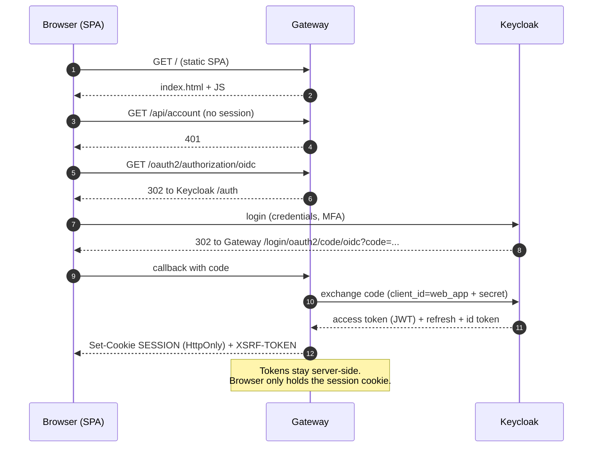

### 19.3 Authenticated API call (browser to service)

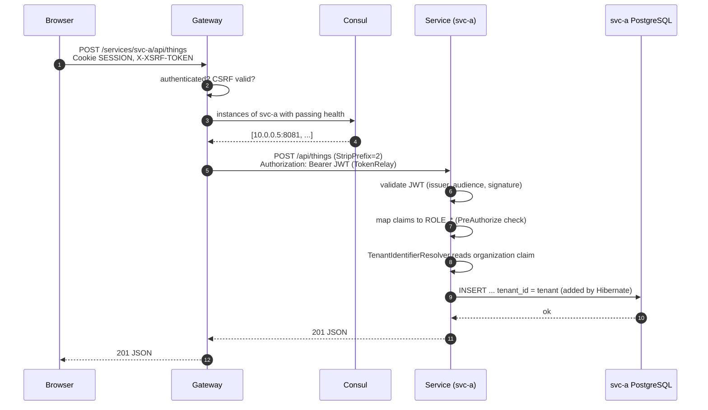

### 19.4 Transactional outbox and event consumption

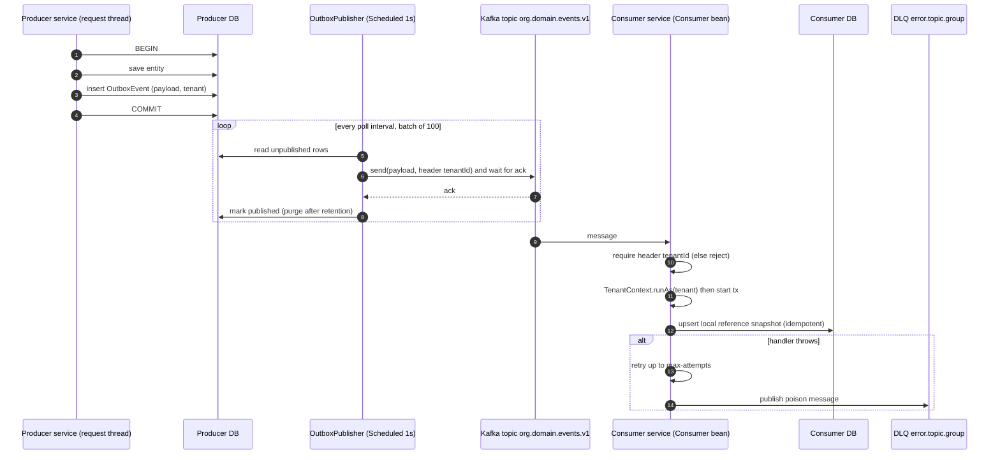

### 19.5 Event flow between services

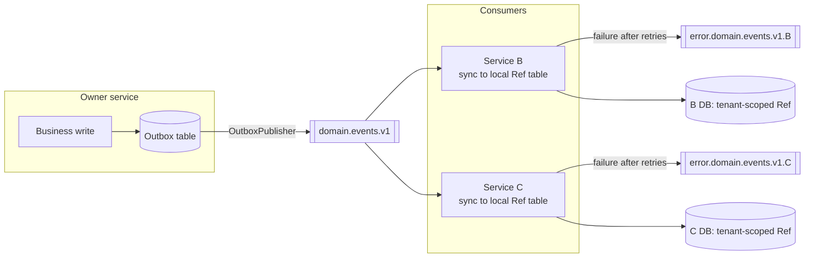

### 19.6 Tenant resolution

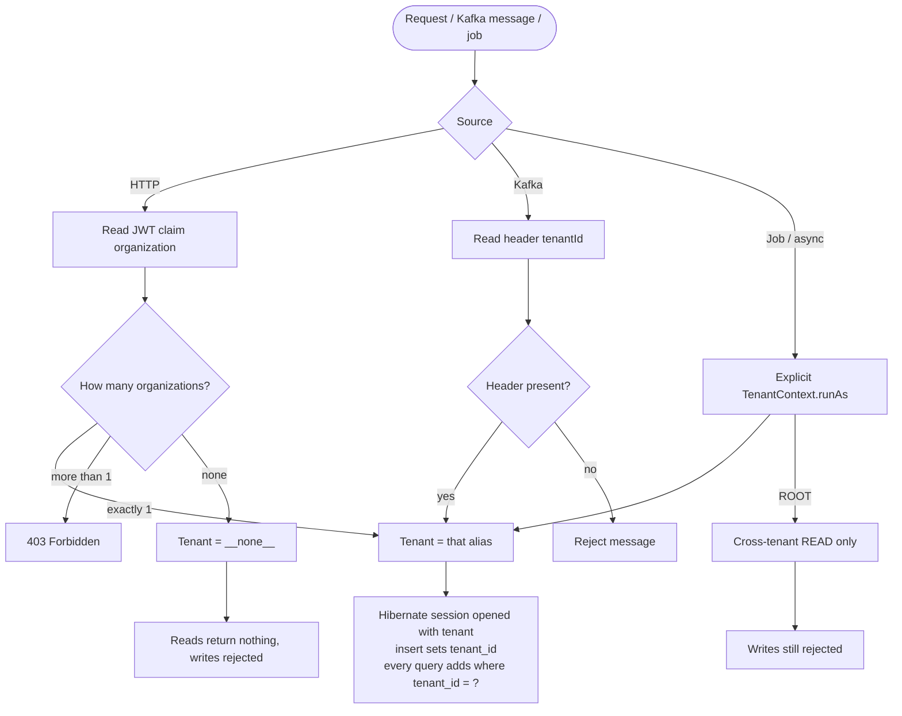

### 19.7 Deployment topology (compose startup order)

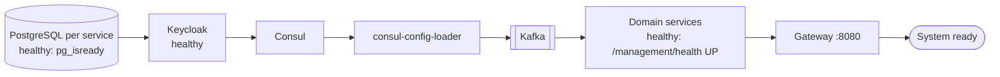

### 19.8 CI/CD pipeline


### 19.9 Adding a new service

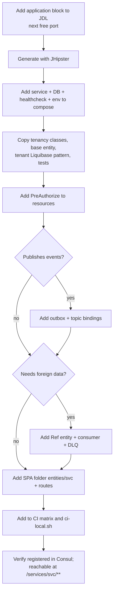

### 19.10 Data ownership (logical ER view, generic)

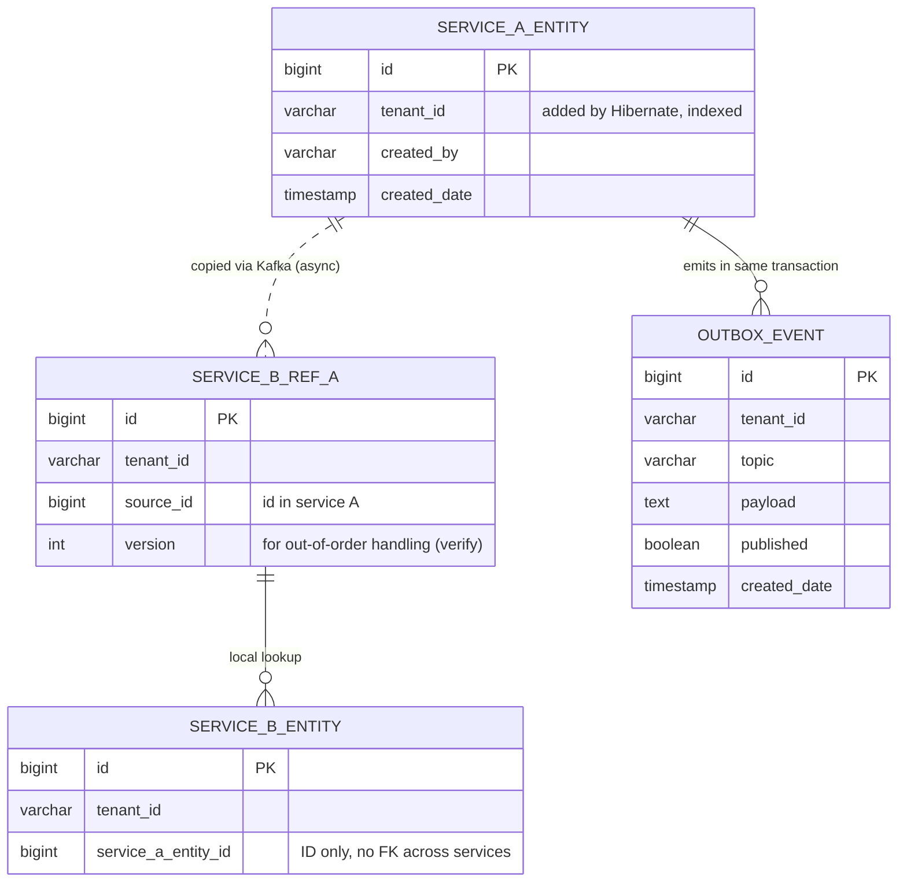


---

# PART 2: HLD AND LLD (worked example: HRMS, `leave` service)

## PART A: HIGH-LEVEL DESIGN (HLD)

### A1. What the system is, in one paragraph
A browser app is served by a **gateway**. The gateway logs the user in through an **identity provider**,
then forwards each API call to the right **business service** (found through a **registry**), adding the
user's token. Each service has its **own database**. Services tell each other about changes by publishing
**events on Kafka**, never by reading each other's databases. Every row belongs to a **tenant** taken from
the user's token.

### A2. Component responsibilities

| Component | Responsibility | Talks to | Protocol |
|---|---|---|---|
| Browser SPA (Angular) | Screens, calls `/services/<svc>/api/...` | Gateway only | HTTPS, JSON, session cookie |
| Gateway | Serve SPA, login, CSRF, route, relay token | IdP, registry, services, own DB | HTTP, OIDC, R2DBC |
| Identity provider (Keycloak) | Users, roles, organizations (tenants), tokens | Gateway, services (JWKS) | OIDC/OAuth2 |
| Registry (Consul) | Who is running where, health, shared config | All services | HTTP |
| Business service | One domain: API, rules, data | Own DB, Kafka, registry, IdP (JWKS) | REST, JDBC, Kafka |
| PostgreSQL (one per service) | Durable data of that service only | Its service | JDBC |
| Kafka | Durable ordered event log between services | Services | Kafka protocol |

### A3. Three views of the same system

#### A3.1 Logical view (who owns what)

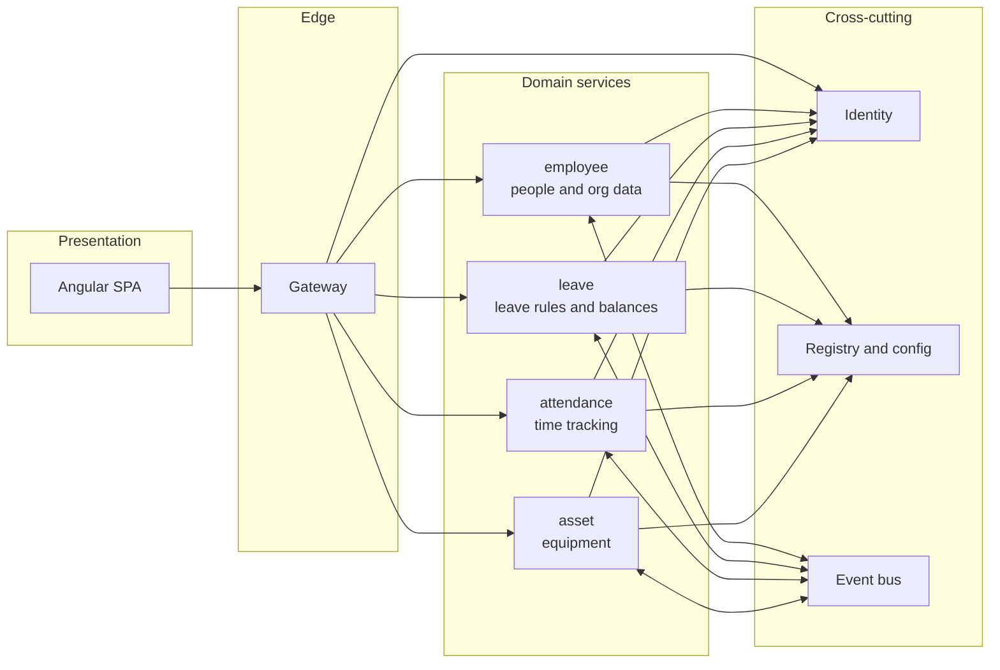

#### A3.2 Process view (what runs and how they connect)
See `this document, section 19.1 (containers) and 19.7 (startup order).

#### A3.3 Data view (who stores what)

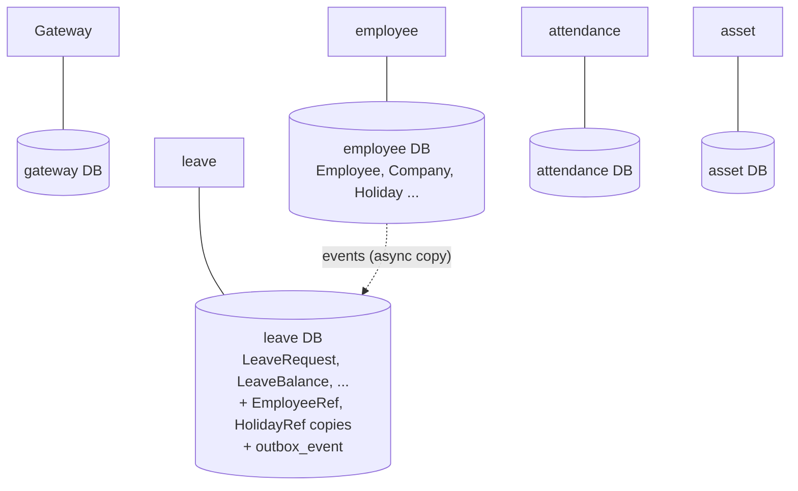
Rule: arrows between databases do not exist. Only the dotted event path moves data across services.

### A4. Key end-to-end flows (HLD level)

| # | Flow | Path | Diagram |
|---|---|---|---|
| 1 | Login | Browser, Gateway, IdP, back with session | this document, 19.2 |
| 2 | API call | Browser, Gateway, registry, Service, DB | this document, 19.3 |
| 3 | Publish event | Service tx writes row + outbox, publisher sends to Kafka | this document, 19.4 |
| 4 | Consume event | Consumer sets tenant from header, upserts local copy | this document, 19.4/19.5 |
| 5 | Tenant resolution | token claim or header to Hibernate | this document, 19.6 |
| 6 | Build and ship | push, CI matrix, (CD recommended) | this document, 19.8 |

### A5. Quality attributes: how each is achieved

| Attribute | Mechanism | Where |
|---|---|---|
| Security | OIDC login, JWT validation (issuer + audience), `@PreAuthorize`, CSRF, CSP | Gateway + each service |
| Tenant isolation | Hibernate `@TenantId`, tenant only from token/header | Each service `tenancy/` |
| Availability | Local reference copies, async events, health-based routing | Services, Consul |
| Consistency | Strong inside a service (DB tx, row locks); eventual across services | Workflow service, outbox |
| Scalability | Stateless services, add instances; Kafka partitions by key | Services, Kafka |
| Observability | `/management/health`, Prometheus metrics, structured logs | Each service |
| Evolvability | Versioned topics, additive schema, Liquibase, one folder per service | Repo |

### A6. HLD risks and decisions needing follow-up
- Single Kafka broker and single instances (compose) are not HA. Plan production topology.
- Gateway is a single entry point and the heaviest build.
- Trust-auth databases in compose must never reach production.
- Token pasted in chat or logs must be rotated.

---

## PART B: LOW-LEVEL DESIGN (LLD): the `leave` service

Base package: `com.blute.hrms.leave`. Port 8082. DB: its own PostgreSQL via JDBC + Liquibase.

### B1. Package and class map

```
leave/src/main/java/com/blute/hrms/leave/
├── web/rest/                 HTTP layer
│   ├── LeaveWorkflowResource     /api   (employee self-service + approve/reject)
│   ├── ManagerLeaveResource      /api/manager
│   ├── HrLeaveResource           /api/hr
│   ├── LeaveTypeResource         /api/leave-types
│   └── errors/                   ExceptionTranslator
├── service/
│   ├── workflow/                 business rules
│   │   ├── LeaveWorkflowService      apply, cancel, approve/reject (decide), views, balance adjust
│   │   ├── CurrentEmployee           maps JWT user to EmployeeRef, isHr()
│   │   ├── WorkingDayCalculator      weekends/holidays excluded
│   │   ├── LeaveCalendar             leave year logic
│   │   ├── LeaveBalanceProvisioner   create/freeze balances for employees
│   │   ├── LeaveEventPublisher       builds LeaveEvent and records to outbox
│   │   ├── LeaveViews, LeaveExceptions
│   ├── events/                   outbox
│   │   ├── OutboxService             record(...) (tx MANDATORY)
│   │   ├── OutboxPublisher           scheduled drain to Kafka
│   │   └── EventBindings             binding, event type and header constants
│   ├── sync/                     foreign data copies
│   │   ├── ReferenceDataSync         onEmployeeEvent / onHolidayEvent
│   │   ├── EmployeeEvent, HolidayEvent   payload records
│   ├── dto/, mapper/             LeaveTypeDTO etc.
├── repository/                   Spring Data: LeaveRequest, LeaveBalance, LeaveApproval, LeaveType,
│                                 LeaveBalanceAdjustment, EmployeeRef, HolidayRef, OutboxEvent
├── domain/                       entities (below) + enumeration/
├── tenancy/                      TenantContext, TenantIdentifierResolver, TenantContextCleanupFilter,
│                                 TenantNotResolvedException
├── config/                       SecurityConfiguration, ReferenceDataConsumers (Kafka), DB, Liquibase, Async, Clock...
└── security/                     AuthoritiesConstants, SecurityUtils
```

### B2. Layering rule

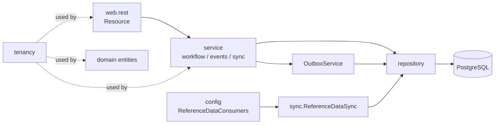
Resources contain no business rules; services do. Only services touch repositories. Only `OutboxService` writes events.

### B3. Class diagram (core domain)

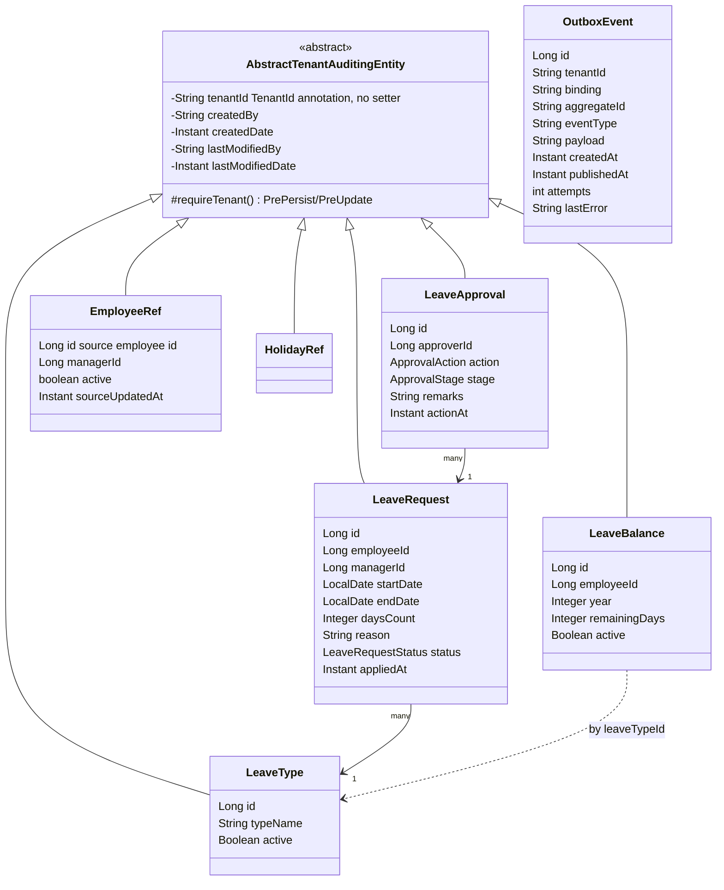
Notes: `OutboxEvent` is a plain entity (not tenant-filtered; it stores `tenant_id` explicitly so the publisher can
send events for all tenants). The `LeaveBalance`/`LeaveType` field list above shows the fields seen in the workflow
code; other columns may exist **(verify)**. `employeeId` and `managerId` are IDs of the employee service's data, with no cross-service foreign key.

### B4. Database LLD

Liquibase changelogs (in order): `00000000000000_initial_schema`, `20231208143306_added_entity_LeaveType`,
`..._LeaveBalance` (+ constraints), `..._LeaveRequest` (+ constraints), `..._LeaveApproval` (+ constraints),
`20261103000000_tenancy_and_audit` (adds `tenant_id`, audit columns, indexes, per-tenant uniques),
`20261104000100_leave_workflow` (workflow tables such as refs, outbox, adjustments).

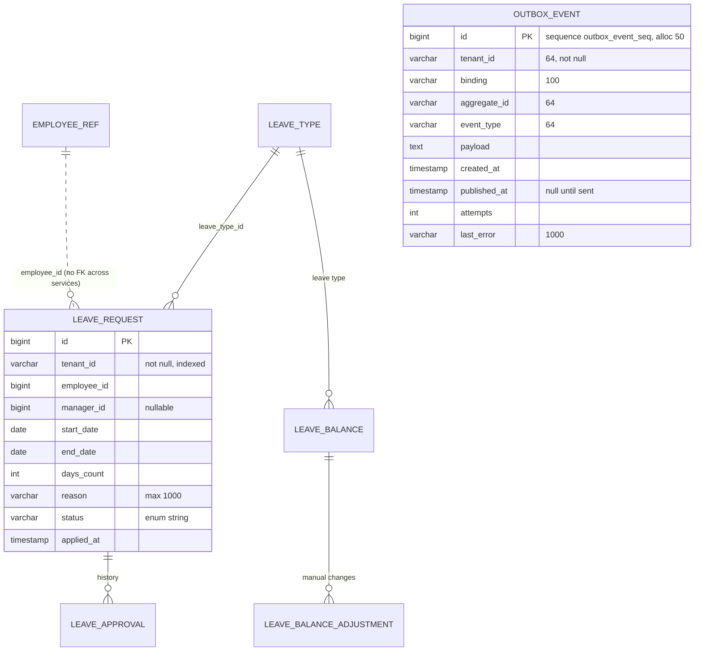

Design rules in the schema: every tenant table has `tenant_id varchar(64) not null`, audit columns, an index on
`tenant_id`, and unique constraints that include `tenant_id`.

### B5. Tenancy LLD (exact mechanics)

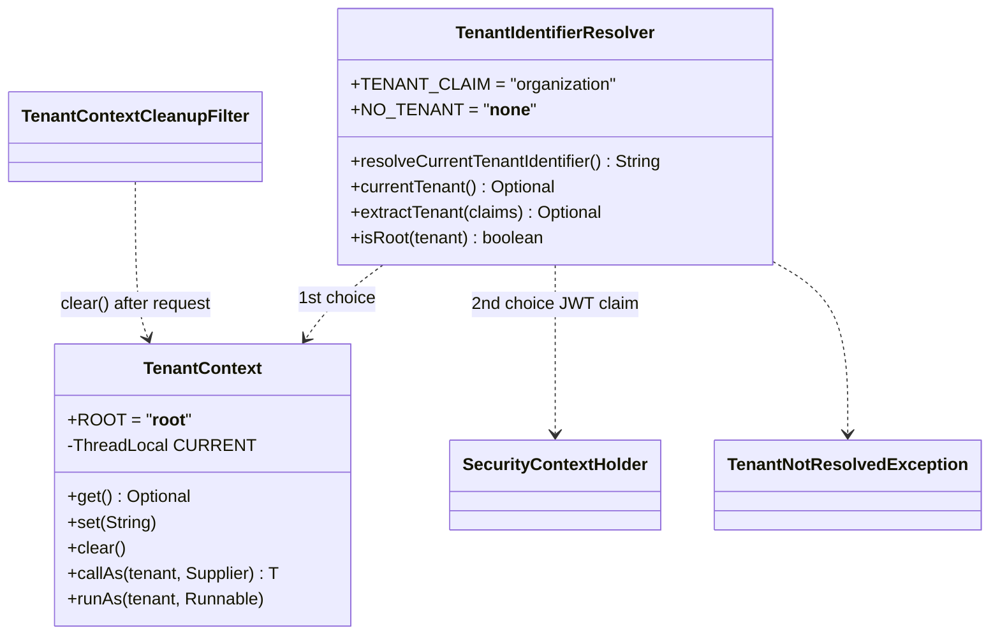

Resolution algorithm (`TenantIdentifierResolver.currentTenant`):
1. If `TenantContext` has a value, use it (Kafka consumers, jobs, tests).
2. Else if the authentication is a `JwtAuthenticationToken`, read claim `organization`.
   Claim may be a collection, a map (keys used), or a single string.
3. More than one organization: throw `TenantNotResolvedException` (phase-2 TODO).
4. A single org equal to `__root__` or `__none__`: throw (reserved ids cannot be claimed by users).
5. Nothing found: Hibernate gets `__none__`, which matches no rows.

Write guard (`AbstractTenantAuditingEntity.requireTenant`, `@PrePersist/@PreUpdate`): if no tenant or tenant is
`__root__`, throw. So root can read all tenants but can never write.

`callAs` restores the previous value in `finally`, so nesting is safe. Remember: set the tenant before the
transaction opens, because Hibernate fixes a session's tenant at open.

### B6. REST API LLD

| Resource | Base path | Authorization | Endpoints |
|---|---|---|---|
| LeaveWorkflowResource | `/api` | `isAuthenticated()` (rules inside service) | `POST /leave-requests`, `GET /leave-requests/{id}`, `GET /leave-requests/{id}/approvals`, `POST /leave-requests/{id}/cancel`, `POST /leave-requests/{id}/approve`, `POST /leave-requests/{id}/reject`, `GET /leave-requests/working-days`, `GET /me/leave-requests`, `GET /me/leave-balances`, `GET /me/leave-types`, `GET /me/leave-approvals` |
| ManagerLeaveResource | `/api/manager` | `isAuthenticated()` | `GET /leave-requests`, `GET /team`, `GET /team-calendar`, `GET /team-availability` |
| HrLeaveResource | `/api/hr` | `ROLE_SUPER_ADMIN` or `ROLE_HR` | `GET /leave-requests`, `GET /employees/{employeeId}/leave-balances`, `PUT /leave-balances/{id}` |
| LeaveTypeResource | `/api/leave-types` | `ROLE_SUPER_ADMIN` or `ROLE_HR` | `POST ""`, `PUT /{id}`, `PATCH /{id}` (merge-patch), `GET ""`, `GET /{id}`, `DELETE /{id}` |

Through the gateway each is reached as `/services/leave/api/...`.
Note the pattern: coarse role check at the class (`@PreAuthorize`), fine-grained rules (own request, assigned manager) in the service.

### B7. Core algorithm: apply for leave (`LeaveWorkflowService.apply`)

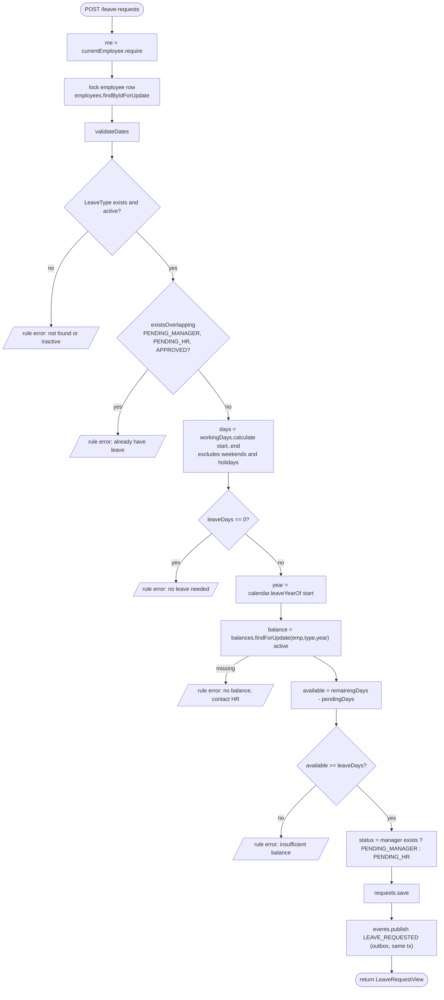
Concurrency: the employee row lock serialises two simultaneous applications by the same person; `findForUpdate` locks the balance row.

### B8. Core algorithm: approve / reject (`decide`)

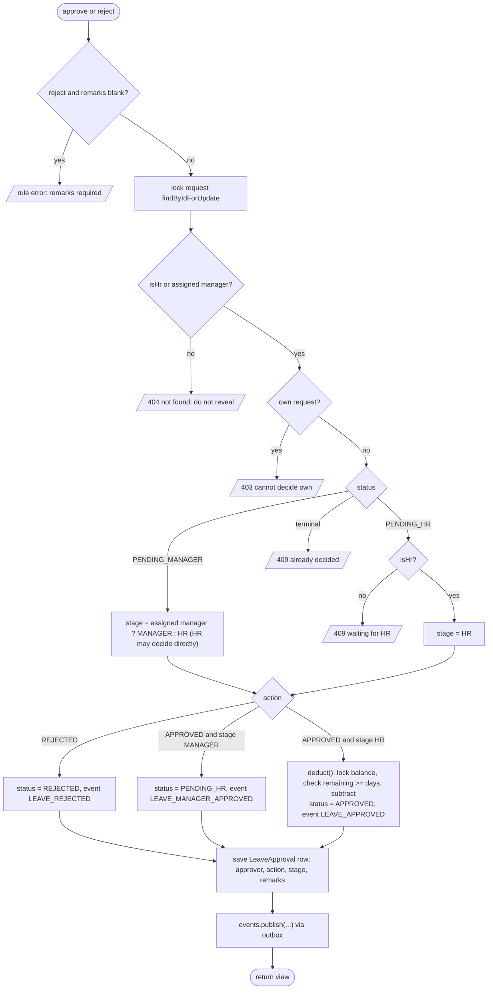

Corrected state machine (includes HR deciding directly at stage 1):

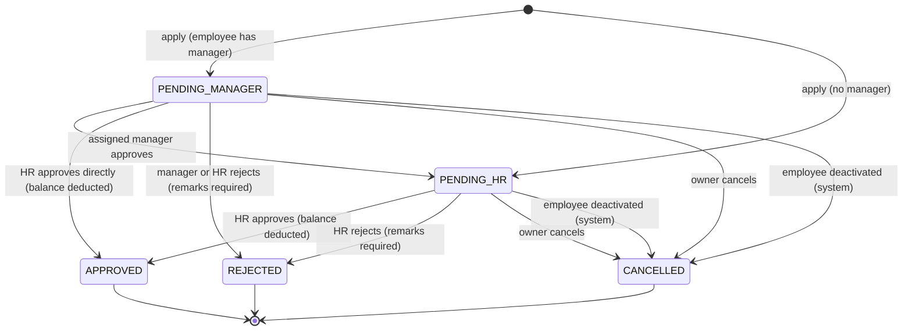

#### Business rules (from the class Javadoc and code)
1. Leave days exclude weekends and the tenant's holidays.
2. Available balance = remaining minus days waiting in either approval stage.
3. Balance is deducted only at final approval; balance and employee rows are locked (no double spend).
4. Nobody acts on their own request; terminal requests cannot be acted on.
5. Assigned manager acts at stage 1; HR/tenant admin at stage 2 and may decide a stage-1 request directly.
6. Employees without a manager go straight to HR.
7. Rejection requires remarks.
8. Max span `MAX_SPAN_DAYS = 366`; team warning threshold `TEAM_WARNING_PERCENT = 40.0` (team availability view).
9. Requests of other people return 404, not 403, to avoid leaking existence.

### B9. Outbox LLD

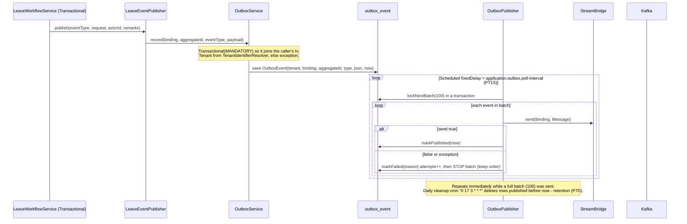

Message format built by `toMessage`:

| Part | Value |
|---|---|
| Payload | JSON string of the event |
| Kafka key | `"<tenantId>:<aggregateId>"` (ordering per tenant and aggregate) |
| Header `tenantId` | tenant of the event |
| Header `eventType` | e.g. `LEAVE_APPROVED` |
| Header `eventId` | outbox row id |

Events produced: `LEAVE_REQUESTED`, `LEAVE_MANAGER_APPROVED`, `LEAVE_APPROVED`, `LEAVE_REJECTED`,
`LEAVE_CANCELLED`, `LEAVE_BALANCE_ADJUSTED`, on binding `leaveEvents-out-0` (topic `hrms.leave.events.v1`).
Delivery: at-least-once. If an event fails, later events in that batch wait, so per-batch order is preserved.
The exact lock query in `lockNextBatch` (e.g. `FOR UPDATE SKIP LOCKED`) was not read **(verify)**.

### B10. Kafka consumer LLD (`ReferenceDataConsumers`, `ReferenceDataSync`)

Consumers: bean `employeeEvents` (topic `hrms.employee.events.v1`) and `holidayEvents` (`hrms.holiday.events.v1`).

```mermaid
flowchart TD
    M([Message arrives]) --> H[requiredHeader tenantId]
    H -->|missing| X[/IllegalArgumentException: retried then DLQ/]
    H --> RA["TenantContext.runAs(tenant): set BEFORE Transactional call"]
    RA --> P[parse payload, ignore unknown properties]
    P --> V{valid? employeeId and occurredAt present}
    V -->|no| X
    V -->|yes| S{existing ref and event not newer than sourceUpdatedAt?}
    S -->|yes| IGN[ignore stale event: out-of-order safe and idempotent]
    S -->|no| U{event type}
    U -->|EMPLOYEE_DELETED| D[ref.deactivate]
    U -->|EMPLOYEE_UPSERTED| UP[ref.apply: userId, code, name, email, managerId, active]
    D --> SV[employees.save]
    UP --> SV
    SV --> Q{became active, or new?}
    Q -->|yes| PR[provisioner.provisionEmployee + setActive true]
    Q -->|deactivated| DE["onDeactivated: setActive false,<br/>cancel pending requests, publish LEAVE_CANCELLED"]
```
This closes the earlier open question: consumers **are** idempotent and out-of-order safe for employees via
the `occurredAt` versus `sourceUpdatedAt` check (holiday handler follows the same pattern **(verify)**).
Failures: retry up to `max-attempts`, then dead-letter `error.<topic>.leave`.

### B11. Security LLD (service side)

`SecurityConfiguration` (blocking MVC): CSRF disabled, stateless sessions, `oauth2ResourceServer.jwt` with a custom
authority converter.

| Matcher | Rule |
|---|---|
| `/api/authenticate`, `/api/auth-info` | permitAll |
| `/api/admin/**` | `ROLE_ADMIN` |
| `/api/**` | authenticated |
| `/v3/api-docs/**` | `ROLE_ADMIN` |
| `/management/health`, `/health/**`, `/info`, `/prometheus` | permitAll |
| `/management/**` | `ROLE_ADMIN` |

JWT pipeline: `JwtDecoders.fromOidcIssuerLocation(issuerUri)` + validators (issuer + `AudienceValidator`) ->
`SecurityUtils.extractAuthorityFromClaims` -> authorities -> principal name from `preferred_username`.
Method security enabled, so `@PreAuthorize` works.

### B12. Request lifecycle inside the service (call stack)

```mermaid
sequenceDiagram
    participant GW as Gateway
    participant F as Security filter chain
    participant CL as TenantContextCleanupFilter
    participant R as LeaveWorkflowResource
    participant S as LeaveWorkflowService (tx)
    participant H as Hibernate
    participant DB as PostgreSQL
    GW->>F: POST /api/leave-requests + Bearer JWT
    F->>F: decode + validate JWT, build authorities
    F->>R: authenticated request (PreAuthorize check passed)
    R->>S: apply(cmd)
    S->>H: begin tx (session opens: tenant resolved from JWT claim now)
    H->>DB: select ... for update, insert ... tenant_id = ?
    S-->>R: LeaveRequestView
    R-->>GW: 200 JSON
    F->>CL: after request
    CL->>CL: TenantContext.clear()
```

### B13. Error handling LLD
- `LeaveExceptions` provide `rule(...)` (business-rule violation, 4xx), `notFound(...)`, `conflict(...)` (409), `forbidden(...)`.
- `web/rest/errors/ExceptionTranslator` converts them to problem-detail JSON.
- `TenantNotResolvedException` for missing/ambiguous tenant (mapped to 403 or similar **(verify mapping)**).
- Kafka side: exceptions in handlers trigger retry then DLQ, never lost silently.

### B14. Configuration LLD (properties that matter)

| Property | Default / example | Effect |
|---|---|---|
| `application.outbox.enabled` | true | turn publisher on/off |
| `application.outbox.poll-interval` | `PT1S` | how often to drain |
| `application.outbox.retention` | `P7D` | keep published rows this long |
| `application.outbox.cleanup-cron` | `0 17 3 * * *` | daily purge time |
| `spring.cloud.consul.discovery.service-name` | `leave` | registry name, URL segment `/services/leave` |
| `spring.profiles.group.prod` | `kafka` | enables Kafka profile |
| `management.endpoint.health.group.readiness.include` | `readinessState,db` | readiness includes DB |
| `feign.circuitbreaker.enabled` | true | for any Feign client calls |
| env `SPRING_DATASOURCE_URL`, `SPRING_LIQUIBASE_URL` | `jdbc:postgresql://leave-postgresql:5432/leave` | DB |
| env `SPRING_CLOUD_STREAM_KAFKA_BINDER_BROKERS` | `kafka:9092` | broker |
| env `SPRING_SECURITY_OAUTH2_CLIENT_PROVIDER_OIDC_ISSUER_URI` | `http://keycloak:9080/realms/blute-hrms` | token validation |

### B15. Test LLD

| Test | Proves |
|---|---|
| `LeaveWorkflowIT` (19 tests) | apply / approve / reject / cancel rules end to end **(verify the scenario list)** |
| `TenantIsolationIT` | rows invisible across tenants; root reads all; tenant-less writes rejected |
| `RoleAccessIT` | employee, manager and anonymous rejected on admin CRUD |
| `TenantIdentifierResolverTest` | claim parsing (list, map, string, multi-org error, reserved ids) |
| `*ResourceIT` | REST behaviour with `@WithMockUser(authorities="ROLE_HR")` |
| `ExceptionTranslatorIT` | error mapping |
Recorded run: 64 tests, 0 failures (Java 21, Docker/Testcontainers).

---

## PART C: REUSABLE TEMPLATE (apply LLD to any service)

### C1. The recipe

```mermaid
flowchart TD
    A[1 Define aggregate and its states] --> B[2 Entities extend AbstractTenantAuditingEntity]
    B --> C[3 Liquibase: tenant_id, audit, indexes, per-tenant uniques]
    C --> D[4 Repositories incl. findXForUpdate for locked rows]
    D --> E[5 Workflow service: Transactional, rules, row locks]
    E --> F[6 Publish events through OutboxService inside the same tx]
    F --> G[7 Resources: class-level PreAuthorize, thin controllers]
    G --> H[8 Consumers: header tenant, runAs, idempotent upsert, DLQ]
    H --> I[9 Tests: isolation, role access, workflow IT]
    I --> J[10 Register in CI matrix, compose, SPA folder]
```

### C2. Naming conventions
- Event types: `<AGGREGATE>_<PAST_TENSE>` (`LEAVE_APPROVED`). Bindings: `<domain>Events-out-0`.
- Topics: `<org>.<domain>.events.vN`. DLQ: `error.<topic>.<consumer-group>`.
- Kafka key: `<tenantId>:<aggregateId>`. Headers: `tenantId`, `eventType`, `eventId`.
- Local copies: `<Entity>Ref` with `sourceUpdatedAt` to drop stale events.
- Row-lock repository methods: `findByIdForUpdate`, `findForUpdate(...)`.

### C3. Template: workflow service skeleton

```java
@Service @Transactional
class XWorkflowService {
  XView apply(Cmd c) {
    var me = currentUser.require();
    lockParent(me);                 // serialise concurrent commands of same actor
    validate(c);                    // dates, enums, existence
    checkNoConflict(c);             // overlap / duplicate
    checkQuota(c);                  // available = remaining - pending, with row lock
    var x = repo.save(newEntity(c, initialStatus()));
    events.publish(X_REQUESTED, x, me.getId(), null);   // OutboxService.record (MANDATORY tx)
    return view(x);
  }
  XView decide(Long id, Action a, String remarks) {
    var x = repo.findByIdForUpdate(id).orElseThrow(notFound());
    authorise(x);                   // hide existence with 404, forbid self-approval
    var stage = stageFor(x.status(), actor);
    apply transition; deduct only at final stage; save approval row; events.publish(...)
  }
}
```

### C4. Template: consumer skeleton

```java
@Bean Consumer<Message<String>> fooEvents(FooSync sync, ObjectMapper m) {
  var reader = m.readerFor(FooEvent.class).without(FAIL_ON_UNKNOWN_PROPERTIES);
  return msg -> {
    String tenant = requiredHeader(msg.getHeaders(), "tenantId");
    String type   = requiredHeader(msg.getHeaders(), "eventType");
    TenantContext.runAs(tenant, () -> sync.onFooEvent(type, reader.readValue(msg.getPayload())));
  };
}
// FooSync.onFooEvent: validate, drop if event.occurredAt <= ref.sourceUpdatedAt, upsert, side effects
```

### C5. Definition of done for a new service
- [ ] Every entity tenant-scoped; Liquibase has tenant_id + indexes + per-tenant uniques
- [ ] Every Resource has `@PreAuthorize`; service rejects cross-user access with 404
- [ ] Every state change + its event in one transaction via `OutboxService`
- [ ] Every consumer takes tenant from header only, is idempotent, has DLQ
- [ ] `TenantIsolationIT`, `RoleAccessIT`, workflow IT green
- [ ] In compose, CI matrix, `ci-local.sh`, SPA routes
- [ ] ADR updated if a new pattern was introduced


---

# PART 3: STRUCTURE, FUNCTIONS, CONNECTIONS, TECH STACK

### 1. Tech stack

#### 1.1 Summary

```mermaid
flowchart LR
    subgraph FE[Frontend in gateway]
        a1[Angular 22.1.6] --- a2[TypeScript 6.0.3] --- a3[Bootstrap 5.3.8 + ng-bootstrap 21]
        a4[RxJS 7.8.2] --- a5[Vitest 4.1.11] --- a6[ESLint 10 + Prettier 3.9]
    end
    subgraph BE[Backend services]
        b1[Java 21] --- b2[Spring Boot 4.1.1] --- b3[Spring Cloud 2025.1.3]
        b4[JHipster framework 9.4.0] --- b5[Hibernate / JPA] --- b6[Liquibase]
        b7[MapStruct 1.6.3] --- b8[springdoc OpenAPI 3.1.1] --- b9[Resilience4j circuit breaker]
    end
    subgraph PLAT[Platform]
        p1[PostgreSQL 18.6] --- p2[Kafka 4.3.1 native] --- p3[Consul 2.0.4]
        p4[Keycloak 26.7.4] --- p5[Mailpit 1.33.0] --- p6[consul-config-loader 0.4.1]
    end
    subgraph TOOL[Build and delivery]
        t1[Maven wrapper] --- t2[Jib 3.5.2 image build] --- t3[Node v24.21.0 / npm 12.0.2 via frontend plugin]
        t4[Docker Compose] --- t5[GitHub Actions] --- t6[Testcontainers + JUnit]
    end
```

#### 1.2 Table: technology, role, where used

| Layer | Technology | Version | Role | Used in |
|---|---|---|---|---|
| Language | Java | 21 (21-25 supported) | Backend language | all 5 services |
| Framework | Spring Boot | 4.1.1 | App framework (parent POM) | all |
| Framework | Spring Cloud | 2025.1.3 | Consul discovery/config, Stream, circuit breaker | all |
| Framework | JHipster framework | 9.4.0 | Generated scaffolding, metrics, security helpers | all |
| Web (gateway) | Spring Cloud Gateway (WebFlux, reactive) + R2DBC | per Boot | Edge, routing, non-blocking DB | gateway |
| Web (services) | Spring MVC (starter-web, Tomcat) | per Boot | REST controllers | employee, leave, attendance, asset |
| Persistence | Spring Data JPA + Hibernate (`@TenantId`) | per Boot | ORM, multi-tenancy | services |
| Persistence | PostgreSQL driver / R2DBC driver | per Boot | DB access | services / gateway |
| Migrations | Liquibase | per Boot | Schema as code (JDBC) | all |
| Mapping | MapStruct | 1.6.3 | Entity to DTO | all |
| Security | Spring Security: OAuth2 client (gateway), resource server (services) | per Boot | Login, JWT validation | all |
| Messaging | Spring Cloud Stream + Kafka binder (`StreamBridge`, `Consumer<Message<String>>`) | 2025.1.3 | Events | services (+ gateway broker pkg) |
| Resilience | Resilience4j via Spring Cloud CircuitBreaker, Feign | per cloud | Optional sync calls | services |
| API docs | springdoc OpenAPI | 3.1.1 | Swagger (profile `api-docs`) | all |
| Mail | spring-boot-starter-mail, Thymeleaf | per Boot | Emails/templates | services |
| Frontend | Angular | 22.1.6 | SPA | gateway |
| Frontend | TypeScript / RxJS | 6.0.3 / 7.8.2 | Language / reactive | gateway |
| Frontend UI | Bootstrap + ng-bootstrap; custom `workspace/ui` components | 5.3.8 / 21.0.0 | Styling and widgets (workspace routes comment mentions Tailwind **(verify)**) | gateway |
| Quality | ESLint 10.10.0, Prettier 3.9.6, Checkstyle, Sonar config | | Lint/format/static analysis | all |
| Tests | JUnit 5, Spring test, Testcontainers, Vitest 4.1.11 | | Backend ITs, frontend unit | all |
| Identity | Keycloak (Organizations feature) | 26.7.4-0 | IdP, tenants as organizations | platform |
| Registry/config | Consul + consul-config-loader | 2.0.4 / 0.4.1 | Discovery, shared config | platform |
| Broker | Apache Kafka (native image) | 4.3.1 | Event bus | platform |
| Database | PostgreSQL | 18.6 | One instance per service | platform |
| Dev mail | Mailpit | 1.33.0 | SMTP sink | platform |
| Containers | Jib (images), Docker Compose | 3.5.2 | Build/run | all |
| Observability | Actuator, Micrometer Prometheus; Prometheus/Grafana/Zipkin compose files per service | | Metrics, dashboards, tracing (files present, enablement **(verify)**) | all |
| CI | GitHub Actions (this work), local `scripts/ci-local.sh` | | Build + test | repo root |

---

### 2. Repository structure (top level)

```
blute360-hrms/
├── .yo-rc.json                     JHipster workspace config: appsFolders [gateway, employee, leave, attendance, asset]
├── blute-hrms.jdl                  JDL: all applications and entities (generator input)
├── README.md, TENANCY.md           project docs, tenancy rules
├── docs/adr/                       0001..0002 architecture decision records
├── .github/workflows/ci.yml        GitHub Actions CI (matrix per service)      [added]
├── scripts/ci-local.sh             local CI + pre-push hook installer            [added]
├── docker-compose/                 full stack
│   ├── docker-compose.yml          infra + 5 services + 5 DBs
│   ├── central-server-config/application.yml   shared config for Consul
│   ├── realm-config/blute-hrms-realm.json      Keycloak realm import
│   │   └── keycloak-health-check.sh
│   ├── themes/blute-hrms/          Keycloak login theme
│   ├── dev-seed.sh                 dev data seeding (what it creates: verify)
│   └── README-DOCKER-COMPOSE.md
├── gateway/        :8080   Spring Cloud Gateway + Angular
├── employee/       :8081   people and organisation data
├── leave/          :8082   leave workflow
├── attendance/     :8083   attendance and WFH
└── asset/          :8084   assets
```

---

### 3. Per-backend-service structure (identical shape)

Shown for `leave` (verified). `employee`, `attendance`, `asset` have the same skeleton with their own domain classes.

```
leave/
├── pom.xml                         dependencies + build (Java 21, Boot parent, Jib, checkstyle, sonar)
├── mvnw, mvnw.cmd                  Maven wrapper (no local Maven needed)
├── package.json, package-lock.json JHipster tooling scripts only (no UI)
├── checkstyle.xml, sonar-project.properties
└── src/
    ├── main/
    │   ├── java/com/blute/hrms/leave/
    │   │   ├── LeaveApp.java (main class)       [name: verify]
    │   │   ├── config/        wiring: Security, Database, Liquibase, Web/CORS, Async, Clock, Logging,
    │   │   │                  SpringDoc, ReferenceDataConsumers (Kafka)
    │   │   ├── security/      AuthoritiesConstants, SecurityUtils, oauth2/AudienceValidator
    │   │   ├── tenancy/       TenantContext, TenantIdentifierResolver, TenantContextCleanupFilter,
    │   │   │                  TenantNotResolvedException
    │   │   ├── domain/        entities + enumeration/ + AbstractTenantAuditingEntity + OutboxEvent
    │   │   ├── repository/    Spring Data interfaces
    │   │   ├── service/
    │   │   │   ├── workflow/  LeaveWorkflowService + helpers (rules)
    │   │   │   ├── events/    OutboxService, OutboxPublisher, EventBindings
    │   │   │   ├── sync/      ReferenceDataSync, EmployeeEvent, HolidayEvent
    │   │   │   ├── dto/, mapper/
    │   │   │   └── LeaveTypeService, LeaveBalanceService, LeaveRequestService, LeaveApprovalService (CRUD)
    │   │   ├── web/rest/      *Resource controllers + errors/ExceptionTranslator
    │   │   ├── aop/logging/   LoggingAspect
    │   │   └── broker/        (package placeholder)
    │   ├── resources/
    │   │   ├── config/        application.yml, -dev, -prod, -kafka, -secret-samples, -tls, bootstrap*.yml
    │   │   ├── config/liquibase/{master.xml, changelog/*.xml}
    │   │   ├── i18n/, templates/ (mail), static/
    │   └── docker/            per-service dev compose: postgresql.yml, kafka.yml, consul.yml, keycloak.yml,
    │                          monitoring.yml, prometheus/, grafana/, jib/entrypoint.sh, sonar.yml, zipkin.yml, ...
    └── test/
        ├── java/com/blute/hrms/leave/
        │   ├── IntegrationTest.java (annotation), TechnicalStructureTest.java (ArchUnit-style rules **(verify)**)
        │   ├── tenancy/ (TenantIsolationIT, TenantIdentifierResolverTest), web/rest/ (*ResourceIT, RoleAccessIT),
        │   ├── service/, domain/, repository/, security/, config/, aop/
        └── resources/ (config, i18n, META-INF)
```

#### 3.1 What lives where, per service (verified file lists)

| Service | `domain` highlights | `web/rest` resources |
|---|---|---|
| employee | City, Company, Country, Employee, EmployeeAddress, EmployeeDocument, FinancialYear, Holiday, State, OutboxEvent | City, Company, Country, Employee, EmployeeAddress, EmployeeDocument, FinancialYear, Holiday, State, **HrPeopleResource**, **MyProfileResource** (+ `service/people`, `service/events`) |
| leave | LeaveType, LeaveBalance, LeaveBalanceAdjustment, LeaveRequest, LeaveApproval, EmployeeRef, HolidayRef, OutboxEvent | **LeaveWorkflowResource**, ManagerLeaveResource, HrLeaveResource, LeaveTypeResource |
| attendance | WorkType, BreakType, AttendanceRequestType, AttendanceRecord, AttendanceBreak, AttendanceRegularization, WfhRequest | MyAttendanceResource, ManagerAttendanceResource, HrAttendanceResource, AttendanceApprovalResource, WorkType, BreakType, AttendanceRequestType |
| asset | AssetCategory, AssetSubCategory, AssetCondition, AssetMaintenanceType, AssetMaintenanceStatus, Asset, AssetAssignment, AssetMaintenance | one resource per entity |

---

### 4. Gateway structure

```
gateway/
├── pom.xml (includes frontend-maven-plugin), mvnw, npmw, package.json, angular.json, tsconfig*.json
├── eslint.config.ts, vitest-base.config.ts, ngsw-config.json (service worker), proxy.config.mjs (dev proxy)
├── build-plugins/                  custom Angular build plugins
└── src/main/
    ├── java/com/blute/hrms/gateway/
    │   ├── GatewayApp.java
    │   ├── config/      SecurityConfiguration (reactive), WebConfigurer (CORS), DatabaseConfiguration (R2DBC),
    │   │                LiquibaseConfiguration, DiscoveryRouteRefresher, ReactorConfiguration, Async, Logging
    │   ├── security/    AuthoritiesConstants, SecurityUtils, oauth2/
    │   ├── web/rest/    gateway-local endpoints (account, auth-info, route info ...)  [list: verify]
    │   ├── web/filter/  SpaWebFilter, CookieCsrfFilter, etc. [exact names: verify]
    │   ├── domain/, repository/, service/ (dto, mapper), broker/, aop/logging/
    └── webapp/app/
        ├── app.ts, app.config.ts, app.routes.ts, app-page-title-strategy.ts
        ├── core/        auth (AccountService, userRouteAccessService), interceptor, request, util
        ├── shared/      alert, auth, date, filter, jhipster, language, pagination, sort
        ├── layouts/     main, navbar, footer, error, profiles
        ├── home/, login/ (login.service.ts), admin/ (configuration, docs, gateway, health, logs, metrics)
        ├── entities/    entity.routes.ts, admin/, user/, enumerations/,
        │                employee/, leave/, attendance/, asset/   <- generated CRUD, one folder per entity:
        │                  <entity>/{list,detail,update,delete,route,service}/ + .model.ts + .routes.ts + .test-samples.ts
        └── workspace/   hand-built product UI
            ├── workspace.routes.ts   lazy routes + hrOnly guard
            ├── shell/                shell.ts / shell.html (full-screen layout, no JHipster navbar)
            ├── data/                 leave-api.service.ts, attendance-api.service.ts, people-api.service.ts,
            │                         *.models.ts, workspace-state.service.ts, format.ts
            ├── pages/                dashboard, attendance, people (+ person), profile, apply-leave,
            │                         my-requests, approvals, team
            └── ui/                   kpi-card, balance-ring, status-pill, avatar, icon, toast-host + toast.service,
                                      decision-dialog, person-form-dialog, attendance-request-dialog
```

Frontend pattern: a page component calls a typed API service in `workspace/data/` (e.g. `leave-api.service.ts`, base
`/services/leave/api`), which uses Angular `HttpClient`; the HTTP interceptors in `core/` add the CSRF header; the gateway does the rest.
Route guards: `userRouteAccessService` (logged in), `hrOnly` (ROLE_HR or ROLE_SUPER_ADMIN, UX only; APIs enforce it).

---

### 5. Key functions and where they live

#### 5.1 Backend (leave, verified signatures)

| Function | Class | What it does |
|---|---|---|
| `apply(ApplyLeave)` | `LeaveWorkflowService` | Validate, lock, check overlap/balance, save request, emit `LEAVE_REQUESTED` |
| `cancel(Long)` | same | Owner cancels pending request, emit `LEAVE_CANCELLED` |
| `approve(Long, String)` / `reject(Long, String)` | same | Both call private `decide(...)`: stage logic, deduct at final approval, save `LeaveApproval`, emit event |
| `myRequests`, `myBalances`, `activeLeaveTypes`, `workingDays`, `get`, `history` | same | Employee read models |
| `managerQueue`, `myDecisions`, `myTeam`, `teamCalendar`, `teamAvailability` | same | Manager views |
| `hrSearch`, `balancesOfEmployee`, `adjustBalance` | same | HR views and balance correction |
| `publish(eventType, request, actorId, remarks)` | `LeaveEventPublisher` | Build `LeaveEvent`, hand to outbox |
| `record(binding, aggregateId, eventType, payload)` | `OutboxService` | Write `OutboxEvent` (tx MANDATORY, tenant required) |
| `publishPending()` / `publishBatch()` | `OutboxPublisher` | Scheduled drain: send via `StreamBridge`, mark published/failed |
| `cleanupPublished()` | `OutboxPublisher` | Daily purge of old published rows |
| `employeeEvents`, `holidayEvents` (beans) | `ReferenceDataConsumers` | Kafka consumers: require `tenantId` header, `runAs`, delegate |
| `onEmployeeEvent`, `onHolidayEvent` | `ReferenceDataSync` | Upsert refs; ignore stale; provision balances; cancel on deactivation |
| `currentTenant()`, `extractTenant(claims)` | `TenantIdentifierResolver` | Resolve tenant for Hibernate |
| `runAs`, `callAs`, `set`, `get`, `clear` | `TenantContext` | Explicit tenant for non-HTTP code |
| `requireTenant()` | `AbstractTenantAuditingEntity` | Block writes without a tenant |
| `filterChain`, `authenticationConverter`, `jwtDecoder` | `SecurityConfiguration` | Resource-server security |

#### 5.2 Gateway (reactive)
`springSecurityFilterChain` (CSRF cookie, CSP, OAuth2 login, path rules), discovery route locator (`/services/<id>/**`,
`StripPrefix=2`, `TokenRelay`), `DiscoveryRouteRefresher` (refresh routes on instance changes), `SpaWebFilter` (index.html fallback).

#### 5.3 Frontend
`AccountService.identity()` (current user + authorities), `userRouteAccessService`, `hrOnly` guard, `LeaveApiService` /
`AttendanceApiService` / `PeopleApiService` (typed REST clients), `WorkspaceStateService` (shared UI state),
`ToastService` (notifications).

---

### 6. How the services are connected

#### 6.1 Connection matrix (who talks to whom, and how)

| From | To | How | Address / config | Carries |
|---|---|---|---|---|
| Browser | Gateway | HTTPS | public host :8080 | session cookie, `X-XSRF-TOKEN` |
| Gateway | Keycloak | OIDC (browser redirects + back-channel code exchange) | issuer `http://keycloak:9080/realms/blute-hrms` | auth code, tokens |
| Gateway | Services | HTTP via discovery | `lb://<service>` from Consul, path `/services/<svc>/**` | `Authorization: Bearer <JWT>` |
| Services | Keycloak | HTTPS/HTTP GET (JWKS, issuer metadata) | same issuer URI | public keys only |
| Every app | Consul | HTTP | `SPRING_CLOUD_CONSUL_HOST=consul`, `:8500` | registration, health checks, shared config |
| Each service | Own PostgreSQL | JDBC | `jdbc:postgresql://<svc>-postgresql:5432/<svc>` | SQL (gateway: R2DBC) |
| Services | Kafka | Kafka protocol | `kafka:9092` | events, headers `tenantId`, `eventType`, `eventId` |
| Service to service | Direct HTTP | Rare, Feign + circuit breaker (**verify usage**) | via Consul | service token (`internal` client) |
| consul-config-loader | Consul | one-shot HTTP | reads `central-server-config/application.yml` | shared config |

#### 6.2 Network and ports

```mermaid
flowchart LR
    host[Host / Internet] -->|8080| gw[gateway]
    host -->|9080, 9443| kc[keycloak]
    host -->|8500, 8300, 8600| consul[consul]
    subgraph net[Compose network: names resolve as DNS]
        gw --> emp[employee 8081]
        gw --> lv[leave 8082]
        gw --> att[attendance 8083]
        gw --> ast[asset 8084]
        emp & lv & att & ast & gw --> kc
        emp & lv & att & ast & gw --> consul
        emp & lv & att & ast <--> kf[[kafka 9092 internal]]
        emp --> edb[(employee-postgresql 5432)]
        lv --> ldb[(leave-postgresql 5432)]
        att --> adb[(attendance-postgresql 5432)]
        ast --> sdb[(asset-postgresql 5432)]
        gw --> gdb[(gateway-postgresql 5432)]
    end
```
Published to host: 8080 (gateway), 9080/9443 (Keycloak), 8300/8500/8600 (Consul). Kafka 9092 is internal unless uncommented. DB ports are internal.

#### 6.3 Frontend to backend (concrete example)

```mermaid
sequenceDiagram
    participant P as Page (apply-leave)
    participant A as LeaveApiService
    participant I as HTTP interceptors
    participant G as Gateway
    participant L as leave service
    P->>A: submit(ApplyLeave)
    A->>I: POST /services/leave/api/leave-requests
    I->>G: + Cookie SESSION + X-XSRF-TOKEN
    G->>L: POST /api/leave-requests + Bearer JWT (StripPrefix=2, TokenRelay)
    L-->>G: 200 LeaveRequestView
    G-->>A: 200
    A-->>P: update UI (toast, list refresh)
```

#### 6.4 Backend to backend (events, concrete example)

```mermaid
sequenceDiagram
    participant HR as HR user (UI)
    participant E as employee service
    participant K as Kafka
    participant L as leave service
    HR->>E: create/update employee (via gateway)
    E->>E: save Employee + OutboxEvent (one tx)
    E->>K: hrms.employee.events.v1 (EMPLOYEE_UPSERTED), header tenantId
    K->>L: deliver
    L->>L: runAs(tenantId); upsert EmployeeRef; provision leave balances
    Note over L: Later "apply leave" uses EmployeeRef locally,<br/>with no call to the employee service.
```

#### 6.5 Startup dependency order

```mermaid
flowchart LR
    pg[(PostgreSQL x5, healthy)] --> kc[Keycloak healthy]
    kc --> cs[Consul]
    cs --> cl[config loader]
    cl --> kf[[Kafka]]
    kf --> sv[employee, leave, attendance, asset: health UP]
    sv --> gw[gateway]
```
`depends_on` in compose enforces: each service waits for its own DB and Keycloak; health check polls `/management/health` for `"status":"UP"` (interval 5s, retries 40).

---

### 7. Where to change what (quick map)

| I want to... | Edit here |
|---|---|
| Add an entity/field | `blute-hrms.jdl` -> generate; `<svc>/domain`, new Liquibase changelog, DTO/mapper, Resource |
| Add a business rule | `<svc>/service/workflow/*Service` (+ IT test) |
| Add an endpoint | `<svc>/web/rest/*Resource` with `@PreAuthorize` |
| Publish a new event | `EventBindings` constant + `LeaveEventPublisher.publish` style call inside the tx |
| Consume an event | `config/ReferenceDataConsumers` bean + `service/sync` handler |
| Change who can do what | `@PreAuthorize` + role claims in Keycloak realm JSON |
| Add a screen | `gateway/.../workspace/pages/<name>` + route in `workspace.routes.ts` + API service in `workspace/data/` |
| Add a service | JDL, compose, tenancy classes, CI matrix, SPA folder (see section 16) |
| Change a port/URL/secret | compose env vars; never commit real secrets |
| Change CI | `.github/workflows/ci.yml`, `scripts/ci-local.sh` |