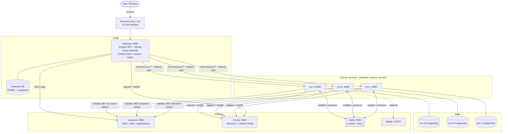
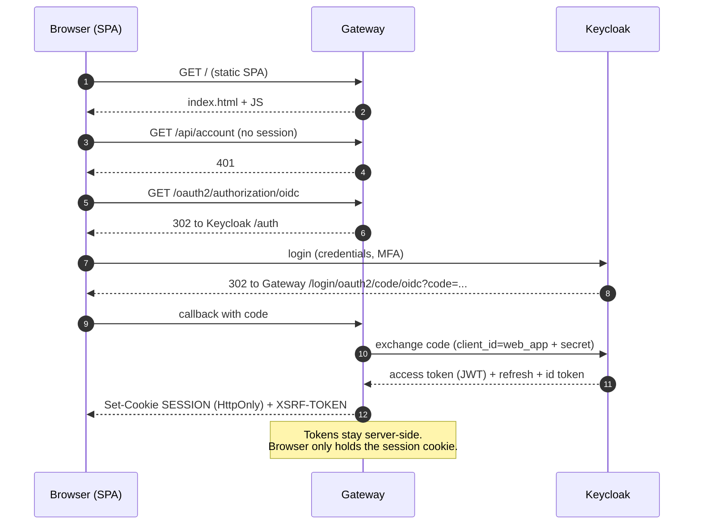
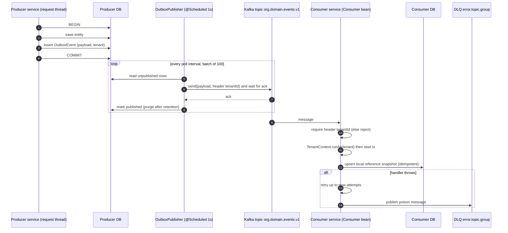
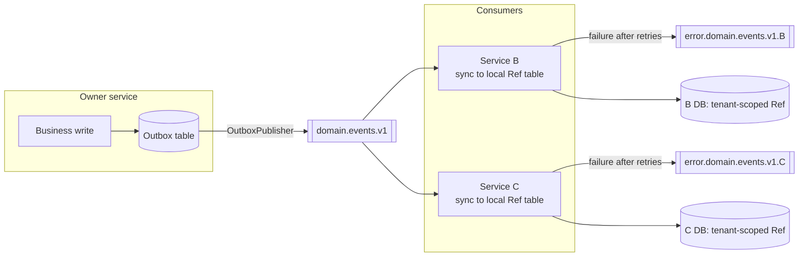
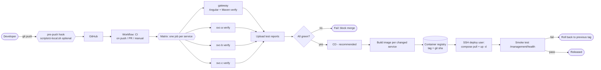
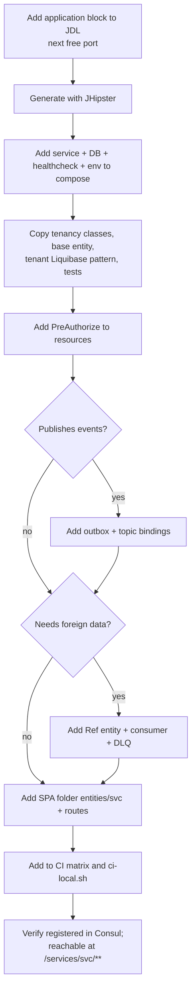
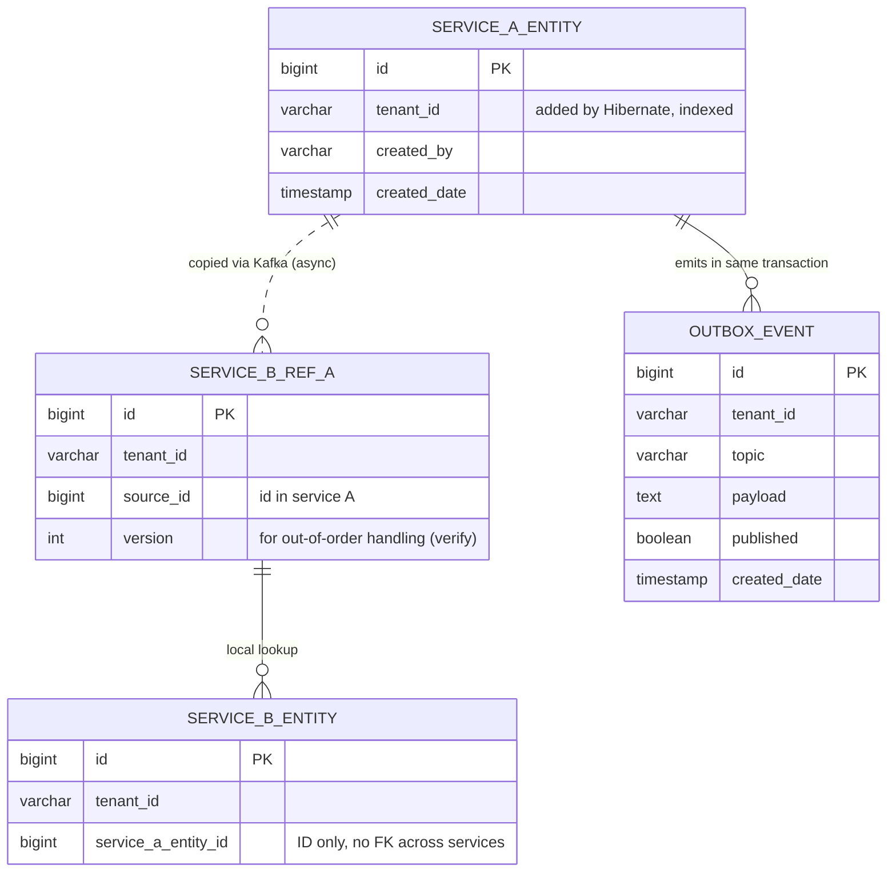

# ADR-0002: Blueprint for a multi-tenant microservice platform (gateway + services + Kafka + OIDC)

- **Status:** Accepted. Generic reference derived from a working implementation (this repo).
- **Audience:** Anyone building a new product with the same shape. Names are placeholders:
  `<gateway>`, `<svc>` (a business service), `<tenant>`, `<domain>`.
- **Companion:** `0001-hrms-microservice-architecture.md` is the HRMS-specific instance.
- **Provenance:** Every concrete value (ports, properties, class names) was read from this repo's
  config and code. Items marked **(verify)** were not traced end to end. Version numbers are the
  ones in this repo and are examples, not requirements.

---

## 1. Problem and goals

Build a business product made of several independently changeable domains, used by many customers
(tenants) on one installation, with one UI and one login.

| Goal | Design answer |
|---|---|
| One UI, one login, one origin | Gateway serves the SPA and is the only public entry point (§5, §6) |
| Domains evolve and deploy independently | One service per domain, own repo folder, own build, own DB (§3, §4) |
| Tenants never see each other's data | Tenant resolved from the token, enforced by the ORM (§9) |
| Services keep working when a neighbour is down | Async events + local copies of foreign data (§7) |
| No hardcoded addresses | Service discovery (§8) |
| Operable | Health, metrics, structured config per environment (§10, §11) |
| Repeatable delivery | CI matrix per service, containers, compose/orchestrator (§13) |

Non-goals: this blueprint does not cover multi-region, service mesh, or per-tenant databases.

---

## 2. Architecture at a glance

```
                       Internet
                          │ HTTPS (TLS terminates at reverse proxy / LB)
                          ▼
                 ┌─────────────────┐
                 │  Reverse proxy  │  (nginx/Traefik/cloud LB)  [outside this repo]
                 └────────┬────────┘
                          ▼
  Browser ────────► ┌───────────────────────────────┐   OIDC code flow   ┌──────────────┐
  (Angular SPA      │ <gateway>  :8080              │◄──────────────────►│  Identity    │
   served from here)│  • static SPA + SPA fallback  │                    │  Provider    │
                    │  • OAuth2 client (session)    │                    │  (Keycloak)  │
                    │  • Spring Cloud Gateway       │                    └──────▲───────┘
                    │  • own DB (reactive R2DBC)    │                           │ JWKS / issuer
                    └───────┬───────────────────────┘                           │
          /services/<svc>/**│ + Bearer JWT (TokenRelay)                         │
          resolved via      ▼                                                   │
          ┌───────────┐  ┌──────────────────────────────────────────────┐       │
          │  Service  │  │ <svc-a> :8081   <svc-b> :8082   <svc-c> :8083│───────┘ validate JWT
          │ discovery │◄─┤  each: REST API (resource server, stateless) │
          │ + config  │  │        own PostgreSQL (JDBC + Liquibase)     │
          │ (Consul)  │  │        Kafka producer/consumer (outbox)      │
          └───────────┘  └───────┬───────────────────┬──────────────────┘
                                 │ JDBC              │ Kafka protocol
                          ┌──────▼─────┐      ┌──────▼──────┐
                          │ PostgreSQL │ ×N   │    Kafka    │  topics: <org>.<domain>.events.v1
                          │ per service│      │   broker    │  + DLQ topics
                          └────────────┘      └─────────────┘
```

Two communication planes:

- **Synchronous plane** (user-driven): Browser → Gateway → Service, REST/JSON, JWT carried.
- **Asynchronous plane** (system-driven): Service → Kafka → Service, events, tenant in a header.

Services never call each other's databases. They rarely call each other over HTTP (see §7.6).

---

## 3. Repository and module layout

Monorepo, one folder per deployable. Each folder is a self-contained Maven project with its own
`mvnw`, `pom.xml`, `src/main/{java,resources,docker}`.

```
repo/
├── <domains>.jdl             # generator input: apps + entities (single source of truth)
├── TENANCY.md                # tenancy rules (normative)
├── docker-compose/           # full local stack: infra + all services + DBs
│   ├── docker-compose.yml
│   ├── central-server-config/application.yml   # shared config loaded into Consul
│   └── realm-config/<realm>.json               # IdP realm import
├── gateway/                  # edge: SPA + routing + login      (port 8080)
├── <svc-a>/                  # domain service                   (8081)
├── <svc-b>/                  # domain service                   (8082)
├── docs/adr/                 # decisions
├── scripts/ci-local.sh       # same steps as CI
└── .github/workflows/ci.yml  # CI
```

Port convention: gateway 8080, services 8081+. IdP 9080, Consul 8500, Kafka 9092 (internal).

### Per-service code layout (all services identical, which is what makes new ones cheap)

```
com.<org>.<product>.<svc>/
├── config/        SecurityConfiguration, DatabaseConfiguration, LiquibaseConfiguration,
│                  WebConfigurer(CORS), Async/Logging/Clock config, consumers (Kafka)
├── domain/        JPA entities (extend AbstractTenantAuditingEntity), enumeration/, OutboxEvent
├── repository/    Spring Data repositories
├── service/       business logic, dto/, mapper/, events/ (outbox), sync/ (ref-data), workflow/
├── tenancy/       TenantContext, TenantIdentifierResolver, cleanup filter, exception
├── security/      AuthoritiesConstants, SecurityUtils (claims → authorities)
└── web/rest/      *Resource controllers, errors/ (ExceptionTranslator)
src/main/resources/config/
├── application.yml, application-dev.yml, application-prod.yml
└── liquibase/{master.xml, changelog/*.xml}
```

---

## 4. Database connectivity

### 4.1 Rules
1. **Database per service.** Only the owning service connects to it.
2. **No cross-service foreign keys or joins.** Relate by IDs only; copy needed data via events (§7).
3. **Schema is code:** Liquibase changelogs inside the owning service; never edit an applied changeset.
4. **Every tenant table has `tenant_id`** (§9).

### 4.2 Two access stacks (important, easy to get wrong)

| Component | Stack | Why |
|---|---|---|
| Gateway | **Reactive**: Spring WebFlux + **R2DBC** (`SPRING_R2DBC_URL=r2dbc:postgresql://...`) | Gateway is non-blocking; DB access must not block event loop threads |
| Domain services | **Blocking**: Spring MVC + JPA/Hibernate + **JDBC** (`SPRING_DATASOURCE_URL=jdbc:postgresql://...`) | Simpler transactional model, Hibernate `@TenantId` |
| Both | **Liquibase over JDBC** (`SPRING_LIQUIBASE_URL=jdbc:postgresql://...`) | Liquibase has no R2DBC driver; the gateway therefore needs *both* an R2DBC URL and a JDBC URL |

### 4.3 Connection wiring (per service, compose environment)

```
SPRING_DATASOURCE_URL      = jdbc:postgresql://<svc>-postgresql:5432/<svc>
SPRING_DATASOURCE_USERNAME = <svc>
SPRING_DATASOURCE_PASSWORD = <from secret>           # empty + trust auth in LOCAL compose only
SPRING_LIQUIBASE_URL       = jdbc:postgresql://<svc>-postgresql:5432/<svc>
```

- Hostname = compose service name (`<svc>-postgresql`) on the compose network. Port 5432 is *not* published to the host.
- Startup order: `depends_on: <svc>-postgresql: condition: service_healthy` using `pg_isready -U $POSTGRES_USER`.
- Readiness group includes the DB: `management.endpoint.health.group.readiness.include: readinessState,db`.
- `spring.jpa.open-in-view: false` (no DB session held during view rendering).
- `spring.data.jpa.repositories.bootstrap-mode: deferred` (faster startup).
- Dev only: `spring.docker.compose` starts `src/main/docker/postgresql.yml` automatically (`lifecycle-management: start-only`).

> **Production note:** the local compose uses `POSTGRES_HOST_AUTH_METHOD=trust` and an empty password.
> That is unacceptable outside a developer laptop. In production use per-service credentials from a secret store
> and a private network.

### 4.4 Migrations and zero-downtime
- Additive first (add nullable column → deploy code → backfill → add constraint).
- Per-tenant uniqueness: unique constraints include `tenant_id`.
- Index `tenant_id` on every tenant table.
- Run Liquibase at service start (default). With several replicas, Liquibase's lock table serialises it.

---

## 5. Frontend ↔ backend connection

### 5.1 Decision: the SPA lives inside the gateway
All UI code is in `<gateway>/src/main/webapp/app/`. Backend services have **no** web assets.
The SPA is built into the gateway artifact (frontend-maven-plugin), so the browser sees **one origin**.

Consequences:
- No CORS for the SPA → API path (same origin).
- One deploy for any UI change; gateway CI job is the slowest (it builds Angular).
- UI release cadence is coupled to the gateway's.

### 5.2 Folder convention in the SPA
```
app/
├── entities/<svc>/      generated CRUD screens, one folder per backend service
├── workspace/           custom, hand-built UI (shell, pages, data, ui)
├── admin/, user/        platform administration
├── home/, login/, layouts/, core/, shared/
└── app.routes.ts, entity.routes.ts
```
Rule: the SPA only ever talks to the gateway, never to a service address.

### 5.3 Request path

```
SPA (Angular HttpClient)
  GET /services/<svc>/api/<resource>            ← relative URL, same origin
    │  Cookie: SESSION=…  (HttpOnly)             ← browser session with gateway
    │  X-XSRF-TOKEN: …    (on mutating calls)    ← CSRF double-submit
    ▼
Gateway
  1. Spring Security (reactive): authenticated? CSRF ok?
  2. Route: Path=/services/<svc>/**  →  StripPrefix=2  →  lb://<svc>
  3. Filter TokenRelay: attach  Authorization: Bearer <access JWT>
  4. Resolve <svc> instances from discovery (only health-passing)
    ▼
<svc>  GET /api/<resource>   (resource server: validates JWT, no session)
```

### 5.4 Browser-facing security (gateway)
- OAuth2 **login** (authorization code flow) with the IdP; session held by the gateway; browser never holds the access token.
- **CSRF:** cookie-based (`XSRF-TOKEN` readable by JS, header `X-XSRF-TOKEN` echoed back). Backends disable CSRF because they are stateless and token-authenticated.
- **SPA fallback:** `SpaWebFilter` returns `index.html` for client-side routes so deep links and refresh work.
- **Headers:** CSP from properties, `X-Frame-Options: SAMEORIGIN`, strict referrer policy, restrictive Permissions-Policy.
- **Public paths:** `/`, static assets, `/api/authenticate`, `/api/auth-info`, health/info/prometheus. Everything under `/api/**` and `/services/**` requires authentication; `/management/**` and API docs require the admin role.

### 5.5 Frontend to-do when you add a backend service
1. Add `entities/<svc>/` (generated or hand-written) calling `/services/<svc>/api/...`.
2. Register routes in `entity.routes.ts` / `workspace.routes.ts`.
3. Nothing in the gateway Java code changes (routes are discovered, §8).

---

## 6. Gateway responsibilities (and non-responsibilities)

Does: serve SPA, authenticate users, route, relay token, apply browser security headers, expose its own health/metrics.
Does **not**: hold business logic for domains, join data across services, or write to domain databases.
(It has its own DB for gateway-local concerns, e.g. users/audit; **verify** exact use.)

Routing is **convention-based** via the discovery locator:

```yaml
spring.cloud.gateway.server.webflux:
  default-filters: [TokenRelay]
  discovery.locator:
    enabled: true
    lower-case-service-id: true
    predicates: [ { name: Path, args: { pattern: "'/services/'+serviceId+'/**'" } } ]
    filters:    [ StripPrefix=2 ]
  httpclient.pool.max-connections: 1000
spring.cloud.consul.discovery.query-passing: true      # route only to healthy instances
```

A `DiscoveryRouteRefresher` keeps routes in sync when instances change.

---

## 7. Kafka and event-driven integration

### 7.1 Why
Domains need each other's facts (e.g. one service needs a snapshot of data owned by another).
Calling the owner synchronously couples availability and latency. Instead the owner publishes events;
consumers maintain a **local, tenant-scoped copy** and read that.

### 7.2 Wiring (per service)
- Library: **Spring Cloud Stream** with the Kafka binder, enabled by profile `kafka` (in `dev` and `prod` profile groups).
- Broker address: `SPRING_CLOUD_STREAM_KAFKA_BINDER_BROKERS=kafka:9092` (compose service name; not published to the host by default).
- Topics are auto-created (`auto-create-topics: true`), **fine for dev; in production create topics explicitly** with partitions/replication/retention.
- Producer: `StreamBridge` (publishes by binding name).
- Consumer: a `java.util.function.Consumer<Message<String>>` bean per input, bound to a destination.

### 7.3 Topic naming and versioning
```
<org>.<domain>.events.v<N>        e.g.  hrms.employee.events.v1
error.<topic>.<consumer-group>    dead-letter topic
```
- One topic per aggregate/domain, key = aggregate id (ordering per entity).
- Never break a schema in place: add optional fields (consumers ignore unknown properties) or publish `v2`.

### 7.4 Producer side: Transactional Outbox
```
@Transactional business method
   ├─ save entity            ┐ same DB transaction
   └─ insert OutboxEvent row ┘
OutboxPublisher (@Scheduled, ~1s, batch 100)
   ├─ read unpublished rows
   ├─ streamBridge.send(topic, payload, headers{tenantId})   (sync=true: wait for broker ack)
   └─ mark published   (retention default P7D, then purge)
```
Properties: `application.outbox.enabled` (default true), `application.outbox.poll-interval` (PT1S), `application.outbox.retention` (P7D).
Guarantee: **at-least-once**. Therefore **consumers must be idempotent** (this repo's consumers upsert snapshots).
Why not publish inside the transaction: a crash between DB commit and broker send would lose the event; publishing before commit could announce a rolled-back change.

### 7.5 Consumer side
```java
@Bean Consumer<Message<String>> <name>Events(Sync sync, ObjectMapper mapper) {
  return msg -> {
    String tenant = requiredHeader(msg.getHeaders(), "tenantId");   // reject if missing
    TenantContext.runAs(tenant, () -> sync.apply(parse(msg.getPayload())));  // tenant set BEFORE @Transactional
  };
}
```
- Tenant comes **only** from the `tenantId` header; never from the payload.
- `without(FAIL_ON_UNKNOWN_PROPERTIES)` for forward compatibility.
- Retries (`max-attempts`), then **DLQ** (`enableDlq: true`) so a poison message cannot block a partition. Alert on DLQ depth.
- Upsert by business key = idempotent; handle out-of-order by carrying a version/timestamp in the event **(verify the implementation does this)**.

### 7.6 When synchronous service-to-service calls are acceptable
Rare. The stack includes Feign with circuit breaker enabled (`feign.circuitbreaker.enabled: true`) and each
service has an `internal` OAuth2 client registration for service credentials. Use only for queries that cannot
tolerate eventual consistency, always with timeout + circuit breaker. **(verify usage in this repo)**

### 7.7 Kafka failure modes

| Failure | Behaviour | Mitigation |
|---|---|---|
| Broker down | Outbox rows accumulate; business writes still succeed | Alert on outbox lag; broker HA in prod |
| Consumer throws | Retries then DLQ | Replay from DLQ after fix |
| Duplicate delivery | Possible (at-least-once) | Idempotent upsert |
| Reordering across keys | Possible | Per-key ordering; versioned snapshots |
| Missing `tenantId` header | Message rejected | Producer always sets it |

---

## 8. Service discovery and configuration (Consul)

- Every service registers: `spring.cloud.consul.discovery.service-name: <svc>`, `healthCheckPath: /management/health`,
  unique `instanceId: <svc>:${random.value}`.
- `health-check-critical-timeout: 1m` → Consul deregisters an instance critical for 1 minute (cleans up dead containers).
- Gateway uses `query-passing: true` (only healthy instances get traffic).
- Connection: `SPRING_CLOUD_CONSUL_HOST=consul`, `SPRING_CLOUD_CONSUL_PORT=8500`.
- **Shared config:** `docker-compose/central-server-config/application.yml` is pushed into Consul K/V by the
  `consul-config-loader` container; all services read it as common config. `config.watch.enabled: false`
  (changes need a restart).
- Adding a service = registering it. No gateway edit.

---

## 9. Identity, authorization and multi-tenancy

### 9.1 Identity provider
Keycloak (OIDC). One realm per product. Realm JSON is committed (`realm-config/<realm>.json`) and imported on start.
Clients: `web_app` (gateway, confidential, auth code flow), `internal` (service credentials).

### 9.2 Token validation in services (resource servers)
```
issuer-uri      = http://keycloak:9080/realms/<realm>      (env: SPRING_SECURITY_OAUTH2_CLIENT_PROVIDER_OIDC_ISSUER_URI)
JwtDecoder      = from issuer JWKS
validators      = default issuer validator + AudienceValidator(configured audience)
authorities     = SecurityUtils.extractAuthorityFromClaims(claims)  → ROLE_*
principal claim = preferred_username
session policy  = STATELESS ; CSRF disabled
```
Rules: `/api/**` authenticated; `/api/admin/**` admin; `/management/health*`, `info`, `prometheus` public; other `/management/**` admin.
Fine-grained access: class-level `@PreAuthorize` on each resource, method security enabled.

**Important:** the issuer URI must be reachable from every service *and* match the `iss` claim in tokens.
Inside compose it is `keycloak:9080`; browsers use the public hostname. Mismatches between internal and public
issuer URLs are the #1 cause of "invalid issuer" 401s (configure the IdP hostname/frontend URL accordingly).

### 9.3 Tenancy (discriminator column)
```
token.organization = ["<tenant>"]  ──►  TenantIdentifierResolver  ──►  Hibernate @TenantId
insert: tenant_id set automatically      query: "where tenant_id = ?" appended automatically
```

| Situation | Result |
|---|---|
| exactly 1 organization claim | that tenant |
| >1 | 403 |
| none (startup, anonymous, platform admin) | placeholder tenant `__none__`: reads empty, **writes rejected** |
| `TenantContext.runAs(t, …)` | explicit tenant for Kafka/jobs |
| `TenantContext.runAs(ROOT, …)` | cross-tenant read for platform jobs; writes still rejected |

Rules (copy into every new service):
1. Entities extend `AbstractTenantAuditingEntity` (`tenantId`, created/modified by/date).
2. Never expose `tenantId` in DTOs/requests/headers; never hand-write tenant filters.
3. No native SQL (Hibernate does not filter it) unless reviewed specifically.
4. Unique constraints include `tenant_id`; index `tenant_id`.
5. Set tenant **before** the transaction starts (Hibernate fixes the tenant when the session opens).
6. Non-HTTP threads (`@Scheduled`, `@Async`, Kafka) set the tenant explicitly; `@Async` does not inherit ThreadLocals.
7. A `TenantContextCleanupFilter` clears the ThreadLocal after each request.
8. Global reference data (countries etc.) has no `tenant_id`.
9. Object storage keys carry a tenant prefix (planned).

---

## 10. Health, observability, operations

- Endpoints under `/management`: `health` (liveness/readiness groups), `info`, `prometheus`, `loggers`, `liquibase`, `threaddump`, etc.
  Details only for admins (`show-details: when_authorized`).
- Metrics: Micrometer → Prometheus (`/management/prometheus`), percentile histograms (p50/75/95/99), tagged `application=<svc>`.
- Container health check: probe `/management/health` for `"status":"UP"`; `retries: 40, interval: 5s` gives ~200s start budget.
- JVM: `_JAVA_OPTIONS=-Xmx512m -Xms256m` in compose (tune per environment).
- Logging: CRLF-safe converter (log-injection protection); `LoggingAspect` in dev.
- Recommended additions (not in repo): log aggregation, tracing (OpenTelemetry), alert rules for outbox lag, DLQ depth, 5xx rate, JVM memory.

---

## 11. Configuration, profiles, secrets

| Concern | Mechanism |
|---|---|
| Per-environment config | Spring profiles: `dev`, `prod`; profile groups add `kafka`, `api-docs`, `secret-samples` |
| Container overrides | Environment variables (`SPRING_*`) in compose / orchestrator |
| Shared config | Consul K/V (`central-server-config`) |
| Secrets | **Not** in git. Dev uses `secret-samples` profile (sample values). Prod: secret manager / CI secrets / orchestrator secrets |
| Feature flags | Properties under `application.*` |

Never commit tokens, passwords or private keys. If one is pasted into chat/logs/tickets, rotate it.

---

## 12. Testing strategy

- Unit tests (`*Test`) and integration tests (`*IT`, run by Failsafe in `verify`) using Testcontainers (PostgreSQL, Kafka) → **CI runner and dev machine need Docker**.
- Mandatory per service:
  - `TenantIsolationIT`: rows invisible across tenants; root reads across; tenant-less writes rejected; tenant-less reads empty.
  - `RoleAccessIT`: unauthorised roles/anonymous rejected on CRUD.
  - `TenantIdentifierResolverTest`: claim parsing.
  - Resource ITs with `@WithMockUser(authorities="ROLE_…")`.
- `DefaultTestTenantExtension` runs all tests as a fixed test tenant.
- Static checks: Checkstyle (`checkstyle.xml`), Sonar config present per service.

---

## 13. Build, CI/CD, deployment

### 13.1 Build
Java 21 (JHipster requires 21–25), Maven wrapper per service, Node via frontend-maven-plugin for the gateway.

### 13.2 CI (implemented)
```
push / PR / manual
   └─ matrix[service] (parallel, fail-fast: false)
        checkout → setup-java 21 (+Maven cache) → npm cache → ./mvnw -ntp -B verify → upload surefire/failsafe reports
```
`concurrency` cancels superseded runs of the same ref. `scripts/ci-local.sh` runs the same steps; `--install-hook` adds a `pre-push` hook.

### 13.3 CD (recommended, not yet implemented)
```
main/tag ─► CI green ─► build image per changed service ─► push to registry (tag = git sha)
          ─► deploy: ssh deploy-user@host  →  docker compose pull <svc> && docker compose up -d <svc>
          ─► smoke test /management/health, rollback to previous tag on failure
```
- Use a dedicated deploy user + SSH key stored as a CI secret; **not** root + password.
- Build only what changed (path filters) to keep the gateway's slow build off unrelated pushes.
- Environments: dev (auto from main), staging, production (manual approval).

### 13.4 Local stack
`docker compose up` in `docker-compose/` starts: per-service PostgreSQL, Keycloak, Consul + config loader, Kafka, Mailpit, all services, gateway.
Start order: DBs → IdP → Consul → config loader → Kafka → services → gateway (enforced by `depends_on` health conditions).
Images are referenced by bare name (`gateway`, `<svc>`), so build them locally first (e.g. Jib `jib:dockerBuild`) **(verify)**.

---

## 14. Security checklist (before production)

- [ ] TLS at the edge; HSTS; secure cookies
- [ ] No `trust` DB auth; per-service DB users and passwords from a secret store; DB not publicly reachable
- [ ] Kafka authN/authZ (SASL/TLS) and replication ≥ 3; topics created explicitly
- [ ] IdP: real client secrets (not `web_app`/`internal` as secrets), restricted redirect URIs, MFA for admins
- [ ] `/management/**` not exposed publicly (only health/prometheus where needed)
- [ ] API docs (`api-docs` profile) off in production
- [ ] Rotate any credential that was ever shared in plain text
- [ ] Rate limiting at the edge; request size limits
- [ ] Backups and restore drills for each database
- [ ] Dependency and image scanning in CI

---

## 15. Trade-offs

| Benefit | Cost |
|---|---|
| Independent deploy/scale per domain | Many moving parts: IdP, discovery, broker, N databases |
| Strong tenant isolation by construction | Rules must be followed (no native SQL, set tenant before tx) |
| Resilience via async + local copies | Eventual consistency; duplicate/ordering handling required |
| One UI/one login | UI and gateway released together; gateway is a single entry point to protect and scale |
| Generated, uniform services | Generator upgrades need care; conventions must be kept |

Alternatives and when to prefer them:

| Alternative | Prefer when |
|---|---|
| Modular monolith | Small team, few domains, no independent scaling need |
| DB/schema per tenant | Regulatory isolation, few large tenants |
| Sync REST between services | Strong consistency needed and latency/availability coupling acceptable |
| Separate frontends per service (micro-frontends) | Many UI teams with independent release needs |
| Managed Kafka/IdP | You do not want to operate them |

---

## 16. Playbook: implement this for a new product

### Step 0: decide names
`<org>`, `<product>`, realm name, topic prefix `<org>.<domain>.events.v1`, port plan (gateway 8080, services 8081+).

### Step 1: scaffold
1. Write `<product>.jdl`: one `gateway` app (`applicationType gateway`, oauth2, postgresql, consul, kafka, angular) and one `microservice` app per domain (oauth2, sql/postgresql, consul, kafka, `cacheProvider no`).
2. Generate with JHipster. Commit.
3. Put each app in its own folder with `mvnw`.

### Step 2: platform stack (compose)
For each service: `<svc>` + `<svc>-postgresql` (+ healthchecks, `depends_on`). Add Keycloak (+ realm import), Consul (+ config loader), Kafka, Mailpit.
Wire the env vars from §4.3 / §7.2 / §8 / §9.2.

### Step 3: identity
Create the realm (clients `web_app`, `internal`; roles; organizations as tenants; `organization` client scope so the claim reaches the token). Export to `realm-config/<realm>.json`.

### Step 4: tenancy in every service
Copy `tenancy/*`, `AbstractTenantAuditingEntity`, the tenant Liquibase pattern, `DefaultTestTenantExtension`, `TenantIsolationIT`, `RoleAccessIT`. Make entities extend the base class. Add `@PreAuthorize` to resources.

### Step 5: events
Copy `OutboxEvent`, `OutboxService`, `OutboxPublisher`, `EventBindings`. Define topics and bindings; add consumers (`Consumer<Message<String>>`) with tenant-from-header and DLQ. Add `*Ref` entities + sync service for foreign data.

### Step 6: frontend
Build screens in `gateway/.../entities/<svc>` and `workspace/`. Call only `/services/<svc>/api/...`.

### Step 7: CI/CD
Copy `.github/workflows/ci.yml` and `scripts/ci-local.sh`; update the service list. Add image build + deploy job (§13.3).

### Step 8: harden
Walk §14.

### Adding a new domain service later (checklist)
- [ ] JDL block (next port) → generate
- [ ] compose: service + DB + healthcheck + env (§4.3, §7.2, §8, §9.2)
- [ ] tenancy classes, tenant Liquibase, base entity, tests (§9.3, §12)
- [ ] `@PreAuthorize` on resources
- [ ] outbox + topics (if it publishes), consumers (if it subscribes)
- [ ] SPA folder `entities/<svc>/` + routes
- [ ] CI matrix + `ci-local.sh` list
- [ ] it appears at `/services/<svc>/**` automatically; verify in Consul
- [ ] realm: roles/scopes if new ones are needed

---

## 17. Quick reference: environment variables per service

```
SPRING_PROFILES_ACTIVE=prod[,api-docs][,secret-samples]    # secret-samples: dev/demo only
_JAVA_OPTIONS=-Xmx512m -Xms256m
SPRING_CLOUD_CONSUL_HOST=consul           SPRING_CLOUD_CONSUL_PORT=8500
SPRING_SECURITY_OAUTH2_CLIENT_PROVIDER_OIDC_ISSUER_URI=http://keycloak:9080/realms/<realm>
SPRING_SECURITY_OAUTH2_CLIENT_REGISTRATION_OIDC_CLIENT_ID=<web_app|internal>
SPRING_SECURITY_OAUTH2_CLIENT_REGISTRATION_OIDC_CLIENT_SECRET=<secret>
SPRING_DATASOURCE_URL / _USERNAME / _PASSWORD       # services (JDBC)
SPRING_R2DBC_URL / _USERNAME / _PASSWORD            # gateway only (R2DBC)
SPRING_LIQUIBASE_URL=jdbc:postgresql://...          # all
SPRING_CLOUD_STREAM_KAFKA_BINDER_BROKERS=kafka:9092
MANAGEMENT_PROMETHEUS_METRICS_EXPORT_ENABLED=true
```

---

## 18. Open items / things this blueprint intentionally leaves to you

- Production topology (HA Kafka, DB replicas, multiple service instances, autoscaling).
- Secrets management and key rotation.
- Tenant switching for users in multiple organizations; tenant-prefixed object storage.
- Tracing and centralised logging.
- Schema registry / contract tests for events.
- Items marked **(verify)** above.

---

## 19. Diagrams (Mermaid)

Render in GitHub, GitLab, VS Code (Mermaid extension) or https://mermaid.live.

### 19.1 System context and containers



### 19.2 Login (OIDC authorization code flow)



### 19.3 Authenticated API call (browser to service)

```mermaid
sequenceDiagram
    autonumber
    participant B as Browser
    participant G as Gateway
    participant C as Consul
    participant S as Service (svc-a)
    participant D as svc-a PostgreSQL
    B->>G: POST /services/svc-a/api/things<br/>Cookie SESSION, X-XSRF-TOKEN
    G->>G: authenticated? CSRF valid?
    G->>C: instances of svc-a with passing health
    C-->>G: [10.0.0.5:8081, ...]
    G->>S: POST /api/things (StripPrefix=2)<br/>Authorization: Bearer JWT (TokenRelay)
    S->>S: validate JWT (issuer, audience, signature)
    S->>S: map claims to ROLE_*; @PreAuthorize
    S->>S: TenantIdentifierResolver reads organization claim
    S->>D: INSERT ... tenant_id = tenant (added by Hibernate)
    D-->>S: ok
    S-->>G: 201 JSON
    G-->>B: 201 JSON
```

### 19.4 Transactional outbox and event consumption



### 19.5 Event flow between services



### 19.6 Tenant resolution


### 19.7 Deployment topology (compose startup order)


### 19.8 CI/CD pipeline



### 19.9 Adding a new service



### 19.10 Data ownership (logical ER view, generic)

