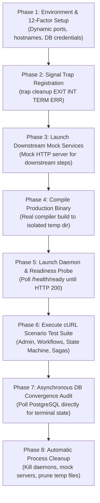

# Universal Polyglot Testing & Real-Infrastructure Verification Contract (`rules/folder-structure/09-test-writing.md`)

> **Architectural Separation & Real-World Invariant:**  
> Synthetic in-memory mocks create an illusion of correctness while disguising catastrophic production failure modes: network partitions, SQL check constraint violations, connection pool exhaustion, transaction deadlocks, SSRF security guards, and Compare-And-Swap (CAS) race conditions.
> 
> Testing MUST be performed like a seasoned human distributed-systems engineer operating against real infrastructure, NOT an AI generating superficial mock unit tests. This contract is strictly **language-agnostic** and applies universally across all runtimes (Go, Python, TypeScript/Node, Rust, Java).

---

# PART I: STRICT GUARDRAILS (WHAT NOT TO DO AT ALL)

0. **STRICT REAL-WORLD INFRASTRUCTURE & ZERO-SYNTHETIC-ILLUSION INVARIANT**:
   - Strictly never assume code that passes in-memory unit tests will survive in production.
   - Every system feature interacting with persistence, networking, or concurrency MUST be verified against real backing services (PostgreSQL, Kafka, Redis, HTTP wire protocols) enforcing physical database constraints, regex validations, network isolation, and thread safety.
   - Strictly never write synthetic mock adapters that bypass real production validation rules or foreign key relationships.

These are non-negotiable negative constraints and architectural invariants. Systems, AI agents, and engineers MUST review these first before writing or running tests:

1. **NEVER Substitute In-Memory Stubs for Database Integration Tests:** Mocking database drivers hides SQL syntax errors, data type mismatches (e.g. UUID vs string), foreign key cascades, unique index collisions, and transaction deadlocks. All data persistence layers MUST be tested against real, running relational/NoSQL databases.
2. **NEVER Use Arbitrary `sleep` Calls for Asynchronous State Verification:** Distributed transactions, sagas, message queues, and background pollers execute asynchronously. Hardcoded sleep intervals (`sleep(2)`, `time.Sleep(...)`, `setTimeout`) create flaky test suites under CI resource throttling and waste pipeline runtime. Every asynchronous assertion MUST poll using deterministic retry predicates with bounded timeouts and exponential backoff against the real state store or status endpoint.
3. **NEVER Leave Orphaned Background Processes or Dangling Sockets:** Any test script, harness, or test runner that launches background processes (daemons, mock HTTP servers, proxies, port forwarders) MUST register explicit signal traps (`trap cleanup EXIT INT TERM ERR`) to guarantee 100% of child processes are reaped and temporary directories are unlinked upon exit or abort.
4. **NEVER Hardcode Hostnames, Ports, File Paths, or Secrets:** Tests must read configuration exclusively from 12-factor environment variables (`PORT`, `ADMIN_PORT`, `MOCK_PORT`, `DB_HOST`, `DB_PORT`, `DB_USER`, `DB_PASSWORD`, `DB_NAME`, `DB_SSLMODE`) with non-conflicting fallback defaults. Never assume port `8080`, `5432`, or `6379` is unoccupied.
5. **NEVER Bypass Production Security Boundaries in Test Mode:** Never disable Server-Side Request Forgery (SSRF) filters, IP loopback validators, authentication headers, or version fencing to force a test to pass. Tests must fulfill the exact production security rules (e.g. resolving a valid non-loopback DNS hostname instead of injecting blocked `127.0.0.1` when loopback addresses are prohibited).
6. **NEVER Write Only Happy-Path Tests:** A test suite that only verifies successful execution is incomplete and non-compliant. Tests must systematically simulate and assert:
   - Pre-pivot business failures and reverse compensation execution.
   - Network timeouts, TCP connection resets, and DNS resolution failures.
   - Stale Compare-And-Swap (CAS) version concurrency conflicts (HTTP 409 Conflict).
   - Poisoned inputs, boundary violations, and malformed payloads (HTTP 400 Bad Request).
   - Mid-flight cancellation and graceful draining of unstarted stages.
7. **NEVER Bleed State Across Tests (Mandatory State Isolation):** Tests running concurrently or sequentially must never mutate shared entities without cryptographic or tenant-level isolation. Every test run must generate globally unique identifiers (UUIDs, tenant suffixes, prefixed names) so that tests remain completely idempotent and safe to run in parallel.
8. **NEVER Ship Unbenchmarked Hot Paths or Critical Loops:** State transition evaluation, DAG topological sorting, serialization/deserialization, and idempotency key derivations must have automated benchmark tests measuring latency percentiles and memory allocation quotas to catch memory leaks and GC thrashing.
9. **NEVER Conflate Unit Tests with Integration Tests:** Pure unit tests must execute completely offline with zero file I/O, zero network calls, and sub-millisecond execution times. Tests requiring external daemons, containers, or network sockets must be isolated into integration or real test suites.
10. **NEVER Deploy Without a Self-Contained CLI Test Runner:** Developers and CI systems must not be expected to manually invoke multi-step ad-hoc cURL commands or run setup scripts by hand. The system MUST provide automated, self-contained shell scripts (`scripts/test/test.real.sh`, `test.load.sh`) that orchestrate the entire lifecycle: build, launch, probe readiness, execute assertions, verify state, and tear down cleanly.

---

# PART II: UNIVERSAL TEST TAXONOMY & POLYGLOT NAMING MATRIX

All tests live within the feature's dedicated `tests/` directory and under the project root `scripts/test/`. The structure is strictly uniform across all programming languages:

```
<project-root>/
├── scripts/
│   └── test/
│       ├── test.unit.sh          # Executes Tier 0 unit tests across all features
│       ├── test.integration.sh   # Boots dependencies and executes Tier 1 integration tests
│       ├── test.e2e.sh           # Executes Tier 2 in-process E2E regression suite
│       ├── test.real.sh          # Full automated live host verification against real daemons
│       └── test.load.sh          # High-concurrency load and saturation test harness
└── src/
    └── features/
        └── <feature-name>/
            └── tests/
                ├── <feature>.rules.test.[ext]        # Tier 0: Pure domain rules & invariants
                ├── <feature>.schema.test.[ext]       # Tier 0: Schema validation & boundary checks
                ├── <feature>.integration.test.[ext]  # Tier 1: Real database adapter verification
                ├── <feature>.e2e.test.[ext]          # Tier 2: In-process full lifecycle flows
                ├── <feature>.scenario.test.[ext]     # Tier 3: Complex multi-step journeys
                ├── <feature>.edgecases.test.[ext]    # Tier 3: Adversarial inputs & edge conditions
                └── <feature>.performance.test.[ext]  # Tier 4: Latency & memory allocation budgets
```

### Polyglot Extension & Runner Mapping Matrix

| Language | Test Extension `.[ext]` | Unit Test Runner | Integration Runner | Benchmark Runner |
| :--- | :--- | :--- | :--- | :--- |
| **Go** | `_test.go` | `go test -v -race` | `go test -tags=integration` | `go test -bench=. -benchmem` |
| **Python** | `_test.py` or `test_*.py` | `pytest -m "unit"` | `pytest -m "integration"` | `pytest-benchmark` |
| **TypeScript / Node** | `.test.ts` or `.spec.ts` | `vitest run --unit` / `jest` | `vitest run --integration` | `mitata` / `tinybench` |
| **Rust** | `_test.rs` / `tests/*.rs` | `cargo test --lib` | `cargo test --test integration` | `cargo bench` / `criterion` |
| **Java** | `Test.java` | `mvn test -Dtest=*UnitTest` | `mvn verify -Pintegration` | `jmh` (Java Microbenchmark) |

---

# PART III: TIER-BY-TIER TEST SPECIFICATIONS

## Tier 0: Pure Unit Tests (`*.rules.test.[ext]`, `*.schema.test.[ext]`)

### Mandatory Characteristics
- **Execution Speed:** Must execute in under **1 millisecond** per test case.
- **Environment:** 100% offline. Zero socket connections, zero disk I/O, zero database drivers.
- **Pattern:** Strictly table-driven. Every test must define an array/slice of structured test cases declaring:
  1. Test scenario name.
  2. Input data structure.
  3. Expected boolean outcome (`valid` vs `invalid`).
  4. Expected error code / canonical error string on failure.

### Strict Coverage Mandate
- Boundary value testing: zero values, empty strings, maximum length strings, Unicode special characters, boundary integers (0, 1, max int, negative numbers).
- Regular expression verification: public IDs (e.g. `^sga_[0-9a-zA-Z]{26}$`), entity names, version formats.
- Deterministic state machine transition tables: every state $S$ receiving event $E$ must deterministically transition to expected state $S'$ or emit a strict `ConflictError`.

---

## Tier 1: Real Database Integration Tests (`*.integration.test.[ext]`)

### Mandatory Characteristics
- **Target:** Concrete database repository adapters (`infrastructure/adapters/*`).
- **Storage:** A real, running database instance (e.g., PostgreSQL, MySQL, Redis, DynamoDB local).
- **Execution Model:** Either executed inside isolated transactions that are rolled back after each test, or executed against unique, freshly-created tenant schemas/partitions.

### Strict Verification Mandate
Every integration test suite MUST verify the following database invariants:
1. **Physical Check Constraints:** Tests must prove that inserting an invalid value (e.g. a string not matching regex, negative version number, or invalid status enum) triggers a physical SQL constraint violation (e.g. Postgres `23514 check_violation`).
2. **Foreign Key Integrity:** Tests must prove that inserting an entity referencing a non-existent parent returns a physical foreign key violation (e.g. Postgres `23503 foreign_key_violation`).
3. **Unique Index & Deduplication:** Tests must prove that inserting duplicate natural keys (e.g. `tenant_id`, `name`, `version`) returns a physical unique violation (e.g. Postgres `23505 unique_violation`).
4. **Optimistic Locking & Version Fencing:** Tests must execute a Compare-And-Swap update with an outdated version/fencing token and verify that the database update affects **0 rows** and emits a conflict error.

---

## Tier 2: In-Process End-to-End Tests (`*.e2e.test.[ext]`)

### Mandatory Characteristics
- **Target:** Complete service execution graphs connecting API controllers, domain services, outbound ports, and event dispatchers.
- **Execution Model:** In-memory or locally-wired dependency injection container running within the test process.

### Strict Verification Mandate
1. **Pipeline Execution:** Full verification of end-to-end execution from request receipt to final output.
2. **Context & Metadata Propagation:** Must assert that `correlationId`, `traceparent`, and `tenantId` are preserved and propagated through every layer of the feature stack.

---

## Tier 3: Adversarial Scenario & Edge Case Tests (`*.scenario.test.[ext]`, `*.edgecases.test.[ext]`)

### Mandatory Characteristics
- **Target:** System resilience, failure recovery, and distributed invariants under abnormal conditions.

### Strict Verification Scenarios (Mandatory for Every Feature)
1. **Pre-Pivot Failure & Reverse Compensation:**
   - Execute a multi-step saga where an early step fails.
   - Assert that completed preceding steps are compensated in reverse topological order.
   - Assert that unstarted forward steps are cancelled/drained.
   - Assert that terminal state reaches `FAILED_COMPENSATED`.
2. **Post-Pivot Failure Invariant (Point of No Return):**
   - Execute a saga where the pivot step succeeds, but a post-pivot step fails.
   - Assert that reverse compensation is **STRICTLY BLOCKED** (money was charged / inventory committed).
   - Assert that the engine enters forward retry or enters a stuck state awaiting human operator intervention.
3. **Mid-Flight Cancellation:**
   - Trigger a cancellation event while forward steps are running.
   - Assert that running steps complete or cancel, unstarted steps are drained, executed steps are compensated, and final state is `CANCELLED`.
4. **Stale CAS Conflict:**
   - Concurrently trigger two transitions against the same version.
   - Assert that exactly one succeeds with HTTP 200/202 and the second is rejected with HTTP 409 Conflict.

---

## Tier 4: Micro-Performance & Allocation Benchmarks (`*.performance.test.[ext]`)

### Mandatory Characteristics
- **Target:** Hot loops, topological sorters, regex compilers, state machines, hash digests.
- **Budgets:**
  - Latency: Hot execution paths must complete within strict nanosecond/microsecond budgets.
  - Allocations: In garbage-collected languages (Go, Java), hot loops must maintain strict memory allocation quotas (`0 allocs/op` for pure logic).

---

## Tier 5: Real Infrastructure Verification Harness (`scripts/test/test.real.sh`)

### Mandatory Characteristics
- **Execution Standard:** A standalone, fully-automated bash test harness running directly in CI or on developer workstations.
- **Scope:** Compiles the real production binary, boots mock downstream microservices, starts background daemons with real network binding, and executes end-to-end user journeys using real HTTP clients (`curl`).

### Mandatory Lifecycle Architecture (`test.real.sh`)

Every `test.real.sh` harness MUST follow this exact 8-phase lifecycle:



### Strict Implementation Rules for `test.real.sh`
1. **Signal Trapping:**
   ```bash
   cleanup() {
       local exit_code=$?
       if [[ -n "${ENGINE_PID:-}" ]] && kill -0 "${ENGINE_PID}" 2>/dev/null; then
           kill -TERM "${ENGINE_PID}" 2>/dev/null || true
           wait "${ENGINE_PID}" 2>/dev/null || true
       fi
       if [[ -n "${MOCK_PID:-}" ]] && kill -0 "${MOCK_PID}" 2>/dev/null; then
           kill -TERM "${MOCK_PID}" 2>/dev/null || true
           wait "${MOCK_PID}" 2>/dev/null || true
       fi
       rm -rf "${TMP_DIR:-}"
       exit ${exit_code}
   }
   trap cleanup EXIT INT TERM ERR
   ```
2. **Deep Readiness Probing (No Blind Sleep):**
   ```bash
   READY=0
   for i in $(seq 1 30); do
       STATUS=$(curl -s -o /dev/null -w "%{http_code}" "http://127.0.0.1:${ADMIN_PORT}/health/ready" || true)
       if [[ "${STATUS}" == "200" ]]; then
           READY=1
           break
       fi
       sleep 1
   done
   if [[ ${READY} -ne 1 ]]; then
       echo "FATAL: Service failed to achieve deep readiness!"
       exit 1
   fi
   ```
3. **Asynchronous Database Convergence Polling:**
   ```bash
   COMPLETED=0
   for i in $(seq 1 30); do
       STATE=$(curl -s "http://127.0.0.1:${PORT}/api/v1/sagas/${SAGA_ID}?tenantId=default" | python3 -c "import sys, json; print(json.load(sys.stdin)['data']['currentState'])" 2>/dev/null || echo "PENDING")
       if [[ "${STATE}" == "COMPLETED" ]]; then
           COMPLETED=1
           break
       fi
       sleep 1
   done
   if [[ ${COMPLETED} -ne 1 ]]; then
       echo "FATAL: Saga failed to converge to COMPLETED within 30 seconds!"
       exit 1
   fi
   ```

---

## Tier 6: High-Concurrency Load & Saturation Tests (`scripts/test/test.load.sh`)

### Mandatory Characteristics
- **Target:** Concurrency limits, database connection pool exhaustion, file descriptor limits, fencing token monotonicity under contention.
- **Execution:** Spawns concurrent client workers sending continuous traffic against running services.
- **Reporting:** Must report total requests, success count, failure count, and latency percentiles (`p50`, `p95`, `p99`).

### Strict Failure Criteria
- Error rate must be **0.00%** under normal rated capacity.
- Maximum p95 latency must remain below the documented SLA budget (e.g. `< 250ms`).
- Database connection pool must not leak (active connections return to baseline after load terminates).
- Fencing tokens in database rows must remain strictly monotonic.

---

# PART IV: HUMAN TESTING AUDIT VS SYNTHETIC AI ILLUSIONS

Every pull request and test suite review MUST be audited against this comparative standard. Any reliance on the "Synthetic AI Approach" is grounds for immediate PR rejection:

| Testing Vector | Synthetic AI Approach (STRICTLY BANNED) | Real Human Engineer Approach (MANDATORY) |
| :--- | :--- | :--- |
| **Database Verification** | In-memory mock returning hardcoded fake structs | Real PostgreSQL container verifying physical SQL constraints, types, and indexes |
| **Async Operations** | Arbitrary `sleep(5)` hoping operations finish | Bounded exponential retry loop polling terminal state from database or API |
| **Downstream Dependencies** | Mock functions that always return `200 OK` | Real HTTP mock server verifying network wire format, headers, retries, and errors |
| **Adversarial Scenarios** | Tests only the success path; ignores failures | Injects HTTP 500 downstream, socket disconnects, stale CAS versions, poison pills |
| **Process Lifecycles** | Leaves background daemons dangling on host ports | Explicit `trap cleanup EXIT INT TERM ERR` terminating all child PIDs |
| **Configuration** | Hardcoded `localhost:8080` and `postgres` passwords | 12-factor environment variables (`PORT`, `DB_HOST`, `DB_PORT`) with dynamic overrides |
| **Security Validation** | Disables SSRF / loopback filters to pass tests | Resolves local machine DNS hostname to satisfy production security policies |
| **Performance** | Assumes code is fast without measurement | Micro-benchmarking verifying allocation quotas and latency percentiles |
| **Concurrency** | Single-threaded sequential unit calls | Concurrent worker pools stressing lease locks, connection pools, and CAS fencing |

---

# PART V: CI/CD PIPELINE ENFORCEMENT & HARD FAILURE GATES

Automated CI/CD pipelines MUST execute all test tiers in strict sequential order of increasing computational cost. A failure at any stage MUST immediately halt the pipeline and dump diagnostic logs:

```
[Stage 1: Unit Tests] ─────────► [Stage 2: Benchmarks] ─────────► [Stage 3: Integration Tests]
        │                                │                                    │
    (Failure)                        (Failure)                            (Failure)
        ▼                                ▼                                    ▼
Reject Build Immediately         Reject Build Immediately             Reject Build Immediately
(Domain logic broken)            (Memory/latency regression)          (SQL schema / DB broken)
                                                                              │
                                                                              ▼
                                                                [Stage 4: Real E2E Harness]
                                                                              │
                                                                          (Failure)
                                                                              ▼
                                                                  Reject Build Immediately
                                                                (Wire / async poller broken)
                                                                              │
                                                                              ▼
                                                                [Stage 5: Load / Saturation]
                                                                              │
                                                                          (Failure)
                                                                              ▼
                                                                  Reject Build Immediately
                                                                (Deadlock / pool exhaustion)
```

### Zero-Tolerance Pipeline Invariants
1. **Never Skip Real Infrastructure Tests in CI:** CI workflows must spin up a real PostgreSQL service container. Disabling integration or real tests in CI is an immediate compliance violation.
2. **Never Ignore Test Exit Codes:** Any test runner script must run with `set -euo pipefail`. Any non-zero exit code anywhere in a pipeline MUST fail the build.
3. **Mandatory Log Dumps on Crash:** When `test.real.sh` fails, it must automatically tail and print the last 50 lines of daemon stdout/stderr before exiting.
