# Composable Parts Architecture

How small, independent parts connect, share data, survive disconnects, integrate with any host, and grow to more than a thousand features, while keeping every change confined to one place instead of a hundred.

- **Scope:** structure and rules. Nothing here depends on a programming language, framework, or vendor.
- **Audience:** every engineer who builds a part, and the platform team that builds what parts run on.
- **Status:** living document. Decisions that are still open are collected in [Section 17](#17-open-decisions).

---

## Contents

0. [The six rules](#0-the-six-rules)
1. [Vocabulary](#1-vocabulary)
2. [The system at a glance](#2-the-system-at-a-glance)
3. [Anatomy of a part](#3-anatomy-of-a-part)
4. [Contracts](#4-contracts)
5. [Connecting parts](#5-connecting-parts)
6. [Execution model inside a part](#6-execution-model-inside-a-part)
7. [Data ownership and sharing](#7-data-ownership-and-sharing)
8. [Integrating with any system](#8-integrating-with-any-system)
9. [Durability: connections that break safely](#9-durability-connections-that-break-safely)
10. [Changing the system](#10-changing-the-system)
11. [Scaling to 1000+ parts](#11-scaling-to-1000-parts)
12. [Platform components](#12-platform-components)
13. [Enforcement](#13-enforcement)
14. [Testing](#14-testing)
15. [Adding a new part: checklist](#15-adding-a-new-part-checklist)
16. [Anti-patterns](#16-anti-patterns)
17. [Open decisions](#17-open-decisions)
- [Appendix: notation](#appendix-notation)

---

## Introduction

Most large systems do not fail because a single component is badly written. They fail because components know too much about each other. One service reads another service's tables "just this once"; a handler calls three other services in sequence because it was quicker than designing an event; a central routing file collects one line from every team until nobody can change it without a merge conflict. Each shortcut is harmless on its own. Together they produce a system in which adding a field means editing a hundred files, an outage in one corner takes down everything, and a dropped network connection corrupts data.

This document describes a structure that prevents those outcomes by design rather than by discipline. It rests on two ideas:

- **No part knows another part. Parts know contracts.** A part is aware of its own logic and of the published, versioned contracts it uses. It never sees another part's code, storage, or deployment details. Because nothing depends on internals, internals can change freely.
- **Every connection is assumed to break, and breaking must cost nothing.** Networks drop, processes crash, and messages arrive twice or out of order. Instead of trying to prevent these failures, the structure makes each one harmless: nothing is lost, nothing happens twice, and nothing waits forever.

Everything that follows is an elaboration of those two ideas, together with the tooling that keeps them true as the number of parts grows.

---

## 0. The six rules

The whole architecture can be reduced to six rules. Each one exists because breaking it creates a specific, well-known failure, and each one is enforced automatically. At a scale of hundreds of teams and a thousand parts, any rule that depends on people remembering it will be broken within months, so enforcement is part of the rule, not an afterthought.

1. **Parts know contracts, never each other.**
   - Why: knowing another part's internals (its tables, classes, endpoints, or deployment) is what turns one change into a hundred. When a part depends only on a contract, the other side can rewrite everything behind that contract without anyone noticing.
   - Enforced by: CI checks that reject imports of other parts or of adapters from logic, and runtime credentials that physically prevent a part from reaching another part's storage.

2. **One owner per piece of data.**
   - Why: when two parts write the same data, there is no single place that decides what is correct. The data drifts, the bugs are intermittent, and the two parts can never be separated later without rewriting both.
   - Enforced by: the contract registry, which refuses to register a second owner for any data contract.

3. **TELL by default, ASK rarely, SHARE by copying.**
   - Why: every synchronous call (ASK) makes the caller's availability depend on the callee's. With a thousand parts, long chains of synchronous calls guarantee that something on the chain is always failing. Events (TELL) and local copies (SHARE) decouple availability.
   - Enforced by: graph validation of manifests, which rejects synchronous cycles and deep call chains, and trace analysis, which flags call depth observed in production.

4. **Every write is idempotent, and every connection is assumed to break.**
   - Why: at scale, retries and redelivery are not edge cases; they happen every second. Any write that is not idempotent will, eventually, execute twice.
   - Enforced by: the chassis runtime, which provides the outbox, deduplication, and deadlines, and rejects writes that arrive without an idempotency key.

5. **Nothing central is edited by hand.**
   - Why: a central file that every team edits (a router table, an event registry, a dependency-injection list) becomes everyone's merge conflict and the single point every change has to pass through.
   - Enforced by: CI, which rejects hand edits to registries, and self-registration, which builds those registries from each part's manifest.

6. **Every contract is versioned from day one.**
   - Why: an unversioned contract can only change by breaking someone. A versioned one can evolve while old and new consumers coexist.
   - Enforced by: CI compatibility checks against the contract registry, which classify every change as minor or major and block breaking changes that do not declare a new major version.

---

## 1. Vocabulary

The same words are used precisely throughout this document. Ambiguity in vocabulary becomes ambiguity in design, so each term below has exactly one meaning.

- **Part:** the smallest independently buildable unit of behavior, typically one feature or capability. A part owns its logic and its data, and nothing else.
- **Contract:** the published, versioned shape of what a part offers: its operations, the events it emits, and the data it shares. Contracts are the only thing parts share with each other.
- **Port:** an interface a part declares for something outside itself, such as storage, event publishing, the clock, or another part's operation. A port says what is needed, never how it is provided.
- **Adapter:** a concrete implementation of a port, such as a specific database driver, a message broker client, an HTTP client, or an in-memory fake for tests. Adapters are selected by configuration, never by logic.
- **Connector:** the path data travels between two contracts. It may be an in-process call, a network call, a durable log, or a file. Connectors are replaceable without changing either side.
- **Manifest:** a machine-readable self-description of a part: its identity, what it provides, what it requires, its configuration schema, and its data. The platform builds every registry from manifests.
- **Domain:** a group of parts owned by one team that share a data-ownership boundary. Domains are the unit of team ownership.
- **Deployment:** a runtime unit, such as a process or container, that holds one or more parts from the same domain. Deployments are a packing decision, not a design decision.
- **Host:** anything that runs a part. That includes our own chassis, a third-party system, a workflow engine, a command-line invocation, or a serverless runtime.
- **Chassis:** the shared runtime every part runs on inside our own systems. It provides lifecycle management, port binding, the execution runner, connection management, and telemetry.
- **Platform:** the shared services parts depend on: the durable log, contract registry, catalog, configuration, secrets, identity, and telemetry backend.
- **Owner and copy:** the owner is the single part allowed to write a piece of data. A copy is another part's local, read-only version of that data, kept current through events.
- **Outbox:** a record of "events to be published," written in the same transaction as the state change that caused them and relayed to the durable log afterwards. It guarantees that a saved change is always announced.
- **Idempotency key:** a caller-supplied key that makes repeating a write produce exactly one effect, no matter how many times it arrives.
- **Checkpoint:** the last position a consumer fully processed. After any interruption, the consumer resumes from there.
- **Fencing token:** a monotonically increasing number attached to a leader's writes, so that writes from a stale former leader are rejected.

---

## 2. The system at a glance

The system has three layers. At the bottom is the **platform**, built once and shared by everyone. Above it are **domains**, each owned by one team. Inside each domain are **parts**, the units that hold logic and data. Parts in the same domain usually communicate through events; parts in different domains communicate only through published contracts, almost always via the durable log, and occasionally through a synchronous request when an immediate answer is unavoidable.

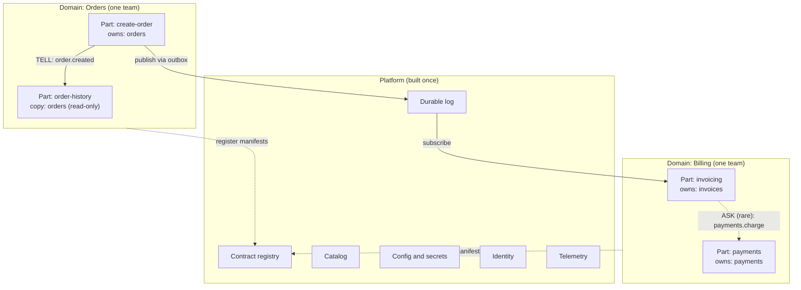

Every part runs on the same chassis, which means retries, deadlines, error mapping, health checks, and telemetry behave identically everywhere. A developer moving from one domain to another finds the same structure and the same guarantees.

The overall start-up and run sequence of the system is described by the following function structure:

```
system
├── platform.start() → log, registry, catalog, config, secrets, identity, telemetry
├── for each part → platform.register(part.manifest)                         [enforced]
├── platform.validateGraph(allManifests)                                     [enforced]
├── for each deployment → chassis.run(parts[], environment)
│   ├── bind(ports → adapters, from configuration)
│   ├── connect(parts via contracts, through the connection manager)
│   └── run(lifecycle)
└── invariants that hold at all times
    ├── every write → idempotent, and published through the outbox
    ├── every wait → bounded by a deadline
    ├── every link → managed through its connection lifecycle (Section 9)
    └── every copy → reconciled against its owner on a schedule (Section 7)
```

---

## 3. Anatomy of a part

Every part, in every domain, is built from the same six layers. Uniformity is deliberate: when every part looks the same, tooling can check them all, any engineer can work on any part, and the platform can host them without special cases.

### 3.1 Layers

- **Manifest:** who the part is, what it provides, and what it needs.
- **Contracts:** the operations, events, and data the part publishes, each versioned.
- **Logic:** pure decisions. Given a command, the current state, and a context, the logic returns a decision. It performs no input or output of any kind.
- **Ports:** interfaces for everything the logic needs from outside.
- **Adapters:** replaceable implementations of those ports, selected by configuration.
- **Data:** the data the part owns, plus read-only copies of data owned by others.

The single most important structural rule is the direction of dependencies. Adapters depend on ports, ports are used by logic, and logic depends on contracts. Nothing points the other way.

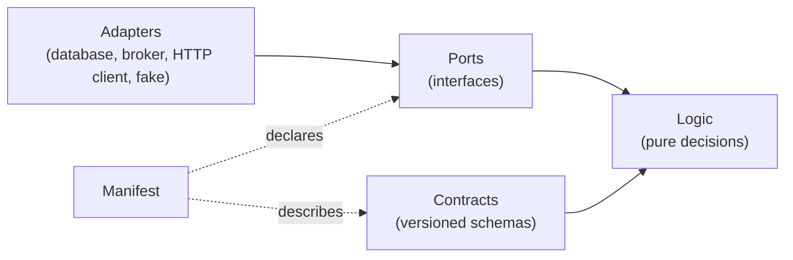

Because logic never imports an adapter, a framework, a driver, or another part, the same logic can run inside any host and survive any change of infrastructure. Replacing a database means writing a new adapter; the logic is untouched.

### 3.2 Function structure

```
part
├── manifest() → descriptor
│   ├── identity() → {name, domain, owner, version}
│   ├── provides()
│   │   ├── operations() → [operationContract]
│   │   ├── events() → [eventContract]
│   │   ├── dataContracts() → [dataContract]
│   │   ├── jobs() → [jobSpec]
│   │   ├── commands() → [commandSpec]
│   │   └── workflowSteps() → [stepSpec]
│   ├── requires()
│   │   ├── ports() → [{name, required | optional, contract}]
│   │   ├── peerOperations() → [operation@version]
│   │   └── subscribedEvents() → [event@version]
│   ├── config() → schema {field, type, default, secret, reloadable}
│   ├── data() → {owned: [...], copies: [...]}
│   └── surfaces() → [library, http, events, cli, workflowStep, function, plugin]
│
├── contracts() → versioned schemas                          (see Section 4)
│
├── logic                                                    (pure, no I/O)
│   ├── validate(command) → errors
│   ├── decide(command, state, context) → decision
│   │   └── decision = {newState, events[], effects[], result} | rejection
│   └── apply(state, event) → state
│
├── ports
│   ├── storage           → load, commit (atomic), outbox, effects, idempotency
│   ├── eventPublisher    → publish
│   ├── eventSubscriber   → subscribe(event, from: checkpoint)
│   ├── peer(operation)   → call(input, context)
│   ├── clock             → now()
│   ├── idGenerator       → newId()
│   ├── flags             → isEnabled(key, subject)             (optional)
│   └── telemetry         → span, metric, log                   (optional)
│
├── adapters
│   └── bind(port, adapterName, config) → implementation
│
└── lifecycle                                                (driven by the host, Section 8.3)
    ├── describe() → manifest
    ├── configure(config) → ok                               (fails → refuse to start)
    ├── init(boundPorts) → ok                                (no I/O)
    ├── start() → ok                                         (starts background loops)
    ├── ready() → {ready, reasons[]}
    ├── drain(deadline) → ok
    └── stop() → ok
```

### 3.3 What each layer is allowed to do

- **The manifest** is data only. It is read by the platform at build time and at start-up, and it must be complete before a part can be registered.
- **The logic** may compute, validate, and decide. It may not read the clock (the clock is passed in through the context), generate random identifiers (identifiers come from the id generator port), log, call another part, or touch storage. This restriction is what makes the logic deterministic and therefore testable in isolation: the same inputs always produce the same decision.
- **Ports** are declarations, not code paths. A port that is marked optional must come with a safe built-in default, such as no-op telemetry or static feature flags, so that the part can run in a minimal host.
- **Adapters** contain all the messy, infrastructure-specific code. They are the only place where a driver, a client library, or a framework appears.
- **Data** owned by the part is written only by its own logic. Copies of other parts' data are written only by the part's event handlers that maintain them, and they are never used to make decisions that belong to the owner.

### 3.4 Part rules and their enforcement

```
enforcement                                                                   [enforced]
├── logic imports an adapter, framework, or another part      → CI fails
├── part reads another part's storage                         → CI fails; credentials do not exist
├── manifest missing owner, domain, or contract versions      → CI fails
├── required port unbound at start-up                         → part refuses to start, names the port
└── I/O performed during init()                               → chassis test fails
```

---

## 4. Contracts

Contracts are the only thing parts share. Anything a consumer may rely on must be written in the contract; anything not in the contract may change without notice. This is what allows the owner of a part to refactor, re-platform, or completely rewrite it without coordinating with anyone, as long as the contract still holds.

There are three kinds of contract (operations, events, and data), plus two cross-cutting definitions that every contract uses: the context that travels with every call and message, and the error taxonomy that every part returns.

### 4.1 Operation contract

An operation is something a caller can ask a part to do or to answer. Its contract states not only the shape of the input and output, but also the behavioral promises a caller needs in order to use it safely: whether it is idempotent, how consistent its answers are, how long it may take, and what can go wrong.

```
operation(name) → operationContract
├── name + majorVersion             (orders.create@v1)
├── input → schema
├── output → schema
├── errors → [canonical error codes this operation may return]
├── idempotency → required | natural | none (reads only)
├── consistency → strong | eventual         (stated explicitly to callers)
├── timeoutBudget → default deadline
├── auth → required scopes, and whether a resource-level check applies
├── rateClass → quota tier
└── lifecycle → active | deprecated(sunsetDate)
```

Declaring errors in the contract matters as much as declaring the output. A caller that does not know which errors are possible cannot decide which ones to retry, which ones to show to a user, and which ones indicate a bug.

### 4.2 Event contract and envelope

Events are facts, written in the past tense: `order.created`, `payment.failed`, `shipment.delivered`. An event never instructs another part to do something; it announces that something has already happened. This distinction keeps the producer independent of its consumers. The producer does not know who listens, and adding a new listener requires no change to the producer.

```
event(name) → eventContract
├── name + version                  (order.created@v2)
├── payload → schema
├── partitionKey → field            (determines ordering scope and parallelism)
├── ordering → per key | none
├── piiFields → [fields to encrypt or omit]
└── retention → how long the event can be replayed
```

Every event travels inside one standard envelope. The envelope is identical for all events in the system, so the infrastructure (deduplication, tracing, ordering, routing) can operate on any event without understanding its payload.

```
envelope
├── eventId          → unique, set by the producer; the deduplication key for consumers
├── type + version   → order.created@v2
├── source           → the producing part
├── subject          → the entity the event is about
├── entityVersion    → monotonic per entity; ordering is by version, never by arrival
├── occurredAt       → when it happened (event time)
├── correlationId    → identifies the whole business flow
├── causationId      → identifies the command or event that caused this one
├── tenant           → if the system is multi-tenant
├── traceparent      → distributed tracing context
└── payload
```

The `entityVersion` field deserves particular attention. Networks and brokers can deliver events out of order, and machine clocks disagree. The only reliable way for a consumer to know whether an event is newer than what it already has is a version number assigned by the owner at the moment of the change.

### 4.3 Data contract

A data contract describes data that one part owns and others may copy. It names the single owner, describes every field and its meaning, and specifies how changes are published and how a full snapshot can be obtained.

```
dataContract(name) → contract
├── owner → exactly one part
├── fields → {name, type, meaning, pii}
├── version
├── publishedVia → the event(s) that carry changes
└── snapshotVia → the operation used for bootstrap and reconciliation
```

The `meaning` of each field is not decoration. When a consumer copies a field called `total`, it needs to know whether that total includes tax, discounts, and shipping. Undocumented meaning is the most common source of silent data errors across teams.

### 4.4 Context

A single context object crosses every connector and every surface with its meaning unchanged. It carries identity, tracing, deadlines, and idempotency, so that every part along a flow can make correct decisions without asking anyone.

```
context
├── requestId        → unique per inbound call
├── correlationId    → shared across a whole business flow
├── causationId      → the command or event that caused this one
├── traceparent      → tracing
├── principal        → {subject, type: user | service, scopes}
├── tenant           → tenantId | none
├── deadline         → an ABSOLUTE timestamp, which shrinks naturally across hops
├── idempotencyKey   → required for every write
└── now              → injected by the host's clock, keeping logic deterministic
```

Two choices in this structure are deliberate:

- **The deadline is an absolute timestamp, not a duration.** If each hop receives "five seconds" and passes "five seconds" onwards, a chain of four hops can run for twenty seconds while the original caller gave up after five. An absolute deadline means every hop knows exactly how much time is really left.
- **`now` is part of the context.** Logic that reads the system clock directly is non-deterministic and cannot be tested reliably. Logic that receives the time as input can be tested for any moment, including leap days, time zone transitions, and expiry boundaries.

The context is carried differently by each kind of connector, but with the same field names everywhere:

```
carry(context, connector) → carrier
├── in-process     → explicit parameter on every call
├── HTTP / RPC     → headers: traceparent, x-request-id, idempotency-key,
│                    x-correlation-id, x-deadline (plus a verified identity token)
├── durable log    → envelope fields, using the same names
├── CLI / batch    → command-line flags or environment variables
├── workflow step  → a "context" field in the step input
└── missing required field → rejected at the edge with InvalidContext
                             (never silently defaulted)
```

A missing idempotency key or principal must never be silently replaced with a default. A generated idempotency key defeats its purpose, because a retry would generate a new one, and a default principal is a security hole.

### 4.5 Error taxonomy

Errors are defined once for the whole system. Every part returns only these codes, and every connector translates them in the same way. This means a caller never has to understand the internal failures of the part it is calling; it only needs to understand thirteen codes and what each implies.

Each error carries a code, a human-readable message, whether it is retryable, an optional retry-after hint, optional structured details, and the request identifier for correlation.

The codes, with their meaning and how each surface represents them:

- **InvalidInput:** the caller sent something malformed. Never retry. HTTP 400; CLI exit 2; an event consumer sends it to the dead-letter queue; a workflow step fails without retry.
- **InvalidContext:** a required context field is missing or invalid. Never retry. HTTP 400; CLI exit 2; dead-letter; non-retryable workflow failure.
- **Unauthenticated:** no valid principal. Never retry without new credentials. HTTP 401; CLI exit 3; dead-letter; non-retryable failure.
- **Forbidden:** the principal is not allowed to do this. Never retry. HTTP 403; CLI exit 3; dead-letter; non-retryable failure.
- **NotFound:** the entity does not exist or is not visible to the principal. Never retry. HTTP 404; CLI exit 4; dead-letter; non-retryable failure.
- **BusinessRule:** the request was valid but a domain rule rejected it (for example, an order total below the minimum). Never retry. HTTP 422; CLI exit 5. On event and workflow surfaces this is **not a failure**: the consumer completes normally and records or emits a rejection outcome.
- **Conflict:** a concurrent change happened. A retry, after re-reading, may succeed. HTTP 409; CLI exit 75; retry; retryable.
- **IdempotencyConflict:** the same idempotency key was reused with different input. Never retry; this is a caller bug. HTTP 422; CLI exit 2; dead-letter; non-retryable.
- **InProgress:** the same idempotency key is still executing. Retry later. HTTP 409; CLI exit 75; retry; retryable.
- **RateLimited:** the caller is over quota. Retry after the indicated delay. HTTP 429; CLI exit 75; retry after delay; retryable with delay.
- **DependencyUnavailable:** something this part depends on is down. Retry. HTTP 503; CLI exit 75; retry; retryable.
- **DeadlineExceeded:** the time budget ran out. Retry only if the caller still has budget. HTTP 504; CLI exit 75; retry if budget remains; retryable.
- **Internal:** an unexpected bug. Retry a limited number of times. HTTP 500; CLI exit 1; retry, then dead-letter; retryable with a low limit. Details are never exposed to the caller, only the request identifier.

Exit code 75 is the conventional "temporary failure, try again" code, which lets schedulers and scripts distinguish transient from permanent failures without parsing output.

Treating `BusinessRule` as an outcome rather than a failure is one of the most important details in this taxonomy. A rejected order is a correct, final result. If an event consumer or workflow engine treats it as a failure, it will retry it indefinitely or fill the dead-letter queue with valid business decisions, hiding the real bugs among them.

### 4.6 Versioning and evolution

Every contract carries a version from the first day it exists. Versioning applies to operations, events, data contracts, stored state schemas, port contracts, and the host protocol itself.

The rules are:

- An **additive change**, such as a new optional field, is a minor version and can be deployed at any time.
- A **breaking change**, such as removing or renaming a field, changing a type, or adding a required input, is a new major version, published alongside the old one.
- Every reader is a **tolerant reader**: it ignores fields it does not recognize. Without this rule, even additive changes break consumers.
- Old versions are **upcast** to the current version whenever state is loaded or an event is consumed, so logic only ever deals with the current shape.
- The **support window** is the current major version plus the previous one, with a published sunset date for the older version.

The evolution process is designed so that the producer never has to coordinate a simultaneous release with its consumers:

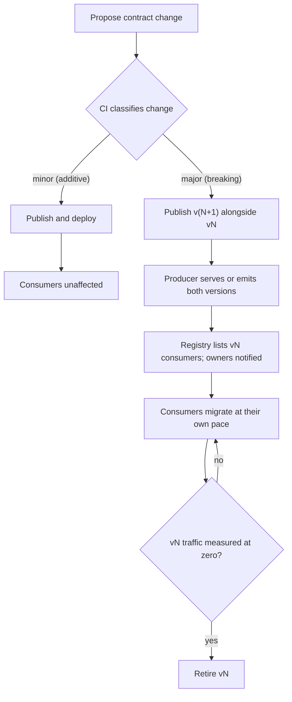

```
evolveContract(change) → released
├── classify(change) → minor | major                     [enforced: CI decides, not the author]
├── minor → publish → consumers unaffected
└── major
    ├── publish v(N+1) alongside vN
    ├── produce both (events) / serve both (operations)
    ├── registry lists vN consumers → their owners are notified
    ├── consumers migrate at their own pace
    ├── vN traffic reaches zero, as measured                 [enforced]
    └── retire vN
```

Classification is done by CI, not by the author of the change, because authors reliably underestimate the impact of their own changes. Retirement is gated on measured traffic, not on announcements, because some consumer always misses the announcement.

---

## 5. Connecting parts

Parts connect in exactly three ways, plus one composite pattern for multi-step processes. Restricting the system to a small number of connection styles is what makes it possible to reason about a thousand parts: every connection is one of four things, each with known failure behavior.

### 5.1 Choosing a connection style

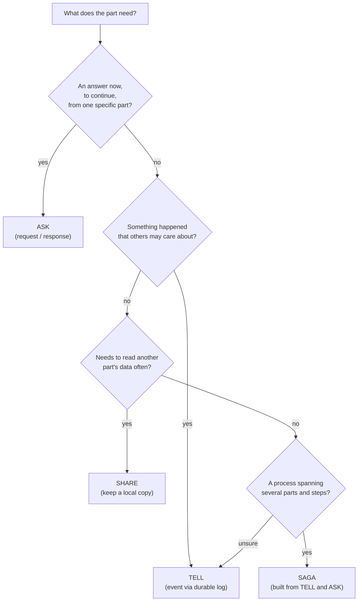

The target mix across the system is mostly TELL, a fair amount of SHARE, and few ASK connections. When unsure, choose TELL. Any path of synchronous calls deeper than two hops is flagged automatically, because latency and failure probability both accumulate along such paths.

### 5.2 ASK: request and response

ASK is used when a part genuinely cannot continue without an immediate answer from a specific other part, for example checking whether a payment authorization succeeded before confirming an order. It is the most convenient connection style and the most dangerous one, because it couples the availability of the caller to the availability of the callee.

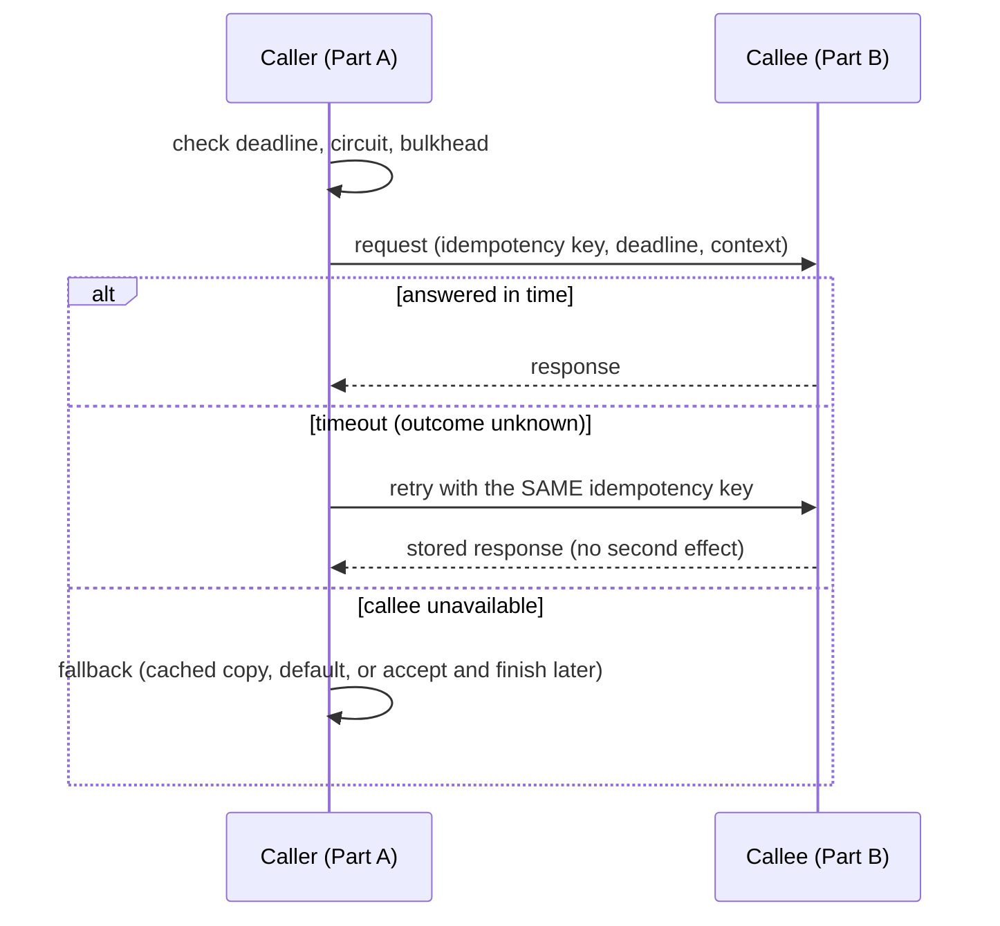

The central difficulty with ASK is the timeout. When a call times out, the caller does not know whether the callee performed the action. The only safe responses are to retry with the same idempotency key, so that the callee returns its stored result instead of acting twice, or to query the status by that key. Any other choice either loses the action or performs it twice.

```
ask(operation, input, context) → result
├── checkDeadline(context) → time left            (none left → DeadlineExceeded; do not call)
├── checkCircuit(target) → closed | open          (open → use fallback)
├── acquireBulkhead(target) → permit              (full → use fallback)
├── send(target, input, context)
├── await(deadline) → response | timeout
│   └── timeout → outcome is UNKNOWN; the call may have happened
├── onUnknown
│   ├── retry with the SAME idempotencyKey (the target deduplicates)
│   └── or queryStatus(idempotencyKey)
├── onRetryable → retry only if (operation idempotent AND retry budget available
│                  AND deadline remaining), with jittered backoff
├── onFailure → fallback: cached copy | safe default | "accepted, finishing later"
└── release(permit); record(outcome)
```

Retries are limited by a **retry budget** (a cap on retries as a fraction of total traffic) rather than a fixed count per call. With fixed counts, a failure deep in a chain multiplies: three retries at each of four hops can turn one request into dozens on the deepest service, which is how retry storms start.

### 5.3 TELL: events through a durable log

TELL is the default connection style. The producing part records an event in its outbox, in the same transaction as the state change, and returns immediately. A relay publishes the outbox to the durable log, and any number of consumers read from the log at their own pace. The producer does not know who the consumers are, whether they are running, or how long they take.

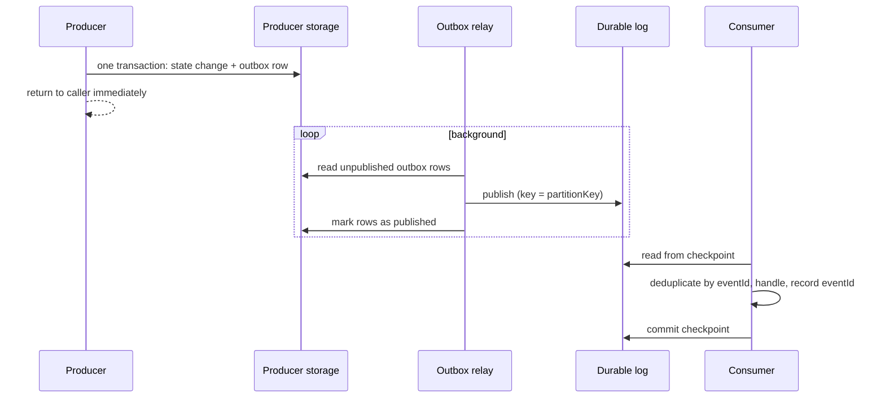

The outbox exists because the obvious alternative (save the change, then publish the event) has a gap between the two steps. If the process crashes in that gap, the change is saved and nobody is ever told. Writing the event into the same transaction as the change closes the gap: either both are saved or neither is.

```
tell(event, context) → recorded
├── writeOutbox(event) in the SAME transaction as the state change
├── return immediately (never waits for consumers)
└── relay (background)
    ├── readOutbox(batch)
    ├── publish(log, key = partitionKey)           (fails → retry indefinitely with backoff)
    └── markPublished(eventIds)

consume(event) → processed
├── deserialize + upcast                            (malformed → dead-letter)
├── alreadyProcessed(eventId)? → acknowledge and skip
├── handle(event) → state change + markProcessed(eventId) + outbox
│                   (all in one transaction)
├── classify failure → transient: retry | permanent: dead-letter
└── commitCheckpoint()   (only after success or after writing to dead-letter)
```

The relay guarantees **at-least-once** delivery: an event may be published more than once if the relay crashes after publishing but before marking the row. Consumers therefore deduplicate by `eventId`, recording processed identifiers in the same transaction as their own state change. Together, at-least-once delivery and idempotent consumption produce an effectively-once outcome.

### 5.4 SHARE: owned data, copied out

SHARE is used when a part needs to read another part's data frequently. Instead of calling the owner every time, the reading part maintains its own local, read-only copy of only the fields it needs, kept current by the owner's change events. Reads become local and fast, and they keep working when the owner is unavailable. The full mechanism, including bootstrap and reconciliation, is described in [Section 7](#7-data-ownership-and-sharing).

### 5.5 SAGA: multi-step processes across parts

Some business processes span several parts and cannot be completed in a single transaction, for example placing an order, reserving inventory, charging a payment, and scheduling a shipment. A saga coordinates such a process as a sequence of steps, each one idempotent, with saved progress after every step and a compensating action for each step that may need to be reversed.

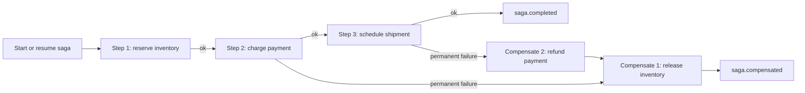

```
runSaga(sagaSpec, input) → completed | compensated
├── startOrResume(sagaId) → saved progress            (durable; survives restarts)
├── for each step
│   ├── execute(step, idempotencyKey = sagaId + step name)
│   │   ├── transient failure → retry according to the step's policy
│   │   └── permanent failure → begin compensation
│   └── saveProgress(step)
├── compensate() → completed steps, in reverse order
│   └── compensation fails → retry; when exhausted → manual intervention queue
└── emit(saga.completed | saga.compensated | saga.stuck)
```

Compensation is not an undo. By the time a later step fails, earlier steps have already produced events that other parts may have acted on. A payment cannot be "un-charged"; it can only be refunded, which is a new business action with its own events. Compensations must therefore be designed as business operations in their own right.

---

## 6. Execution model inside a part

Every write operation, in every host and through every surface, runs through the same six steps. These steps are performed by a shared **runner**, not re-implemented by each part, so the semantics of a write never differ between hosts. Whether the part is called as a library, over HTTP, from an event, or as a workflow step, the same admission checks, the same atomic commit, and the same dispatch rules apply.

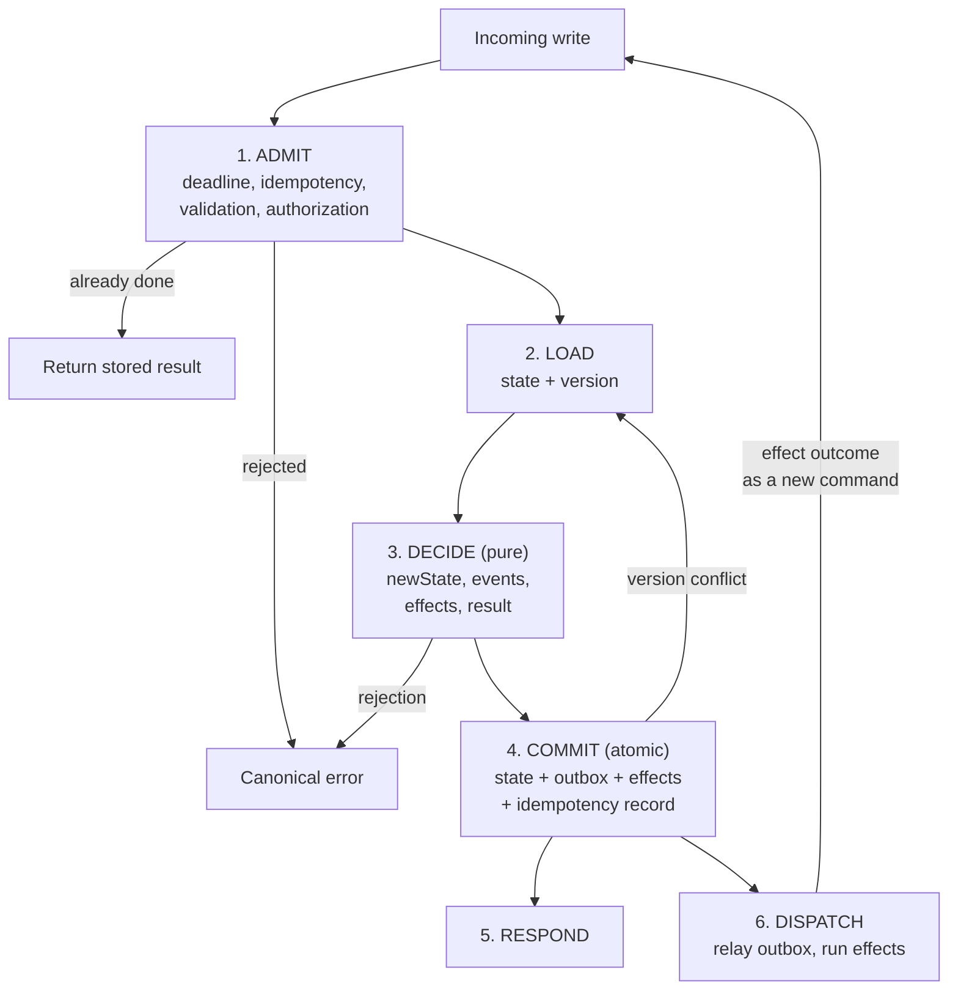

### 6.1 The six steps

```
execute(operation, input, context, ports) → result
├── 1. ADMIT
│   ├── checkDeadline(context)                             (fails → DeadlineExceeded)
│   ├── checkIdempotency(key, hash(input))
│   │   ├── done, same hash        → return the stored result
│   │   ├── done, different hash   → IdempotencyConflict
│   │   └── in progress            → InProgress (retryable)
│   ├── validateInput(schema)                              (fails → InvalidInput)
│   └── authorize(principal, operation, target)            (fails → Forbidden | NotFound)
│
├── 2. LOAD
│   └── storage.load(entityId) → state + version           (fails → DependencyUnavailable)
│
├── 3. DECIDE   (pure; no ports are touched)
│   └── logic.decide(command, state, context) → decision | rejection
│
├── 4. COMMIT   (one atomic unit)
│   └── storage.commit(newState, expectedVersion,
│                      events → outbox,
│                      effects → effect queue,
│                      idempotency record)
│       └── version mismatch → Conflict → retry from LOAD (bounded number of times)
│
├── 5. RESPOND
│   └── return decision.result
│
└── 6. DISPATCH   (after commit; may run in the background)
    ├── relay outbox → durable log
    └── run effects
        ├── sync-after-commit → run now
        ├── async → queue, job, or workflow (the host decides)
        └── outcome → fed back into logic as a NEW command
                      (an effect never mutates state directly)
```

Each step exists for a specific reason:

- **Admit** rejects work that cannot succeed before any resources are spent. Checking the idempotency record first means that a retry of a completed write is answered instantly from storage, without running logic again.
- **Load** reads the current state together with its version number. The version is what makes the later commit safe under concurrency.
- **Decide** is the only step where business logic runs, and it is pure. Because it touches nothing outside itself, it can be retried freely if the commit conflicts.
- **Commit** writes the new state, the events, the pending effects, and the idempotency record in one atomic operation. If another writer changed the entity in the meantime, the expected version no longer matches and the commit is rejected, so no update is ever silently overwritten.
- **Respond** returns the result to the caller as soon as the commit succeeds. The caller never waits for events to be published or effects to run.
- **Dispatch** publishes events and runs effects after the commit. Because both were stored durably during commit, a crash at this point loses nothing; dispatch simply resumes when the process restarts.

Step 4 is what makes a part safe to embed in any host. If the host's storage cannot provide atomicity for these four writes, the part cannot guarantee correctness on that host, and the storage port test kit (Section 14) will fail and say so.

### 6.2 Effects

Logic never performs side effects. It returns its intentions as data, and the runner executes them. This is the mechanism that allows the same part to run synchronously in a library, asynchronously behind a queue, or as a step in a workflow engine.

```
effect
├── callPeer(operation, input)
├── scheduleCommand(command, at | after)          (timers, expiries, reminders)
├── notify(channel, template, data)
├── emitIntegrationEvent(name, payload)
└── every effect carries
    ├── effectId → stable; becomes the downstream idempotency key
    ├── retryPolicy
    ├── compensation (optional)
    └── onResult → the command name through which the outcome re-enters logic
```

When an effect completes, its outcome does not modify state directly. Instead it is turned into a new command (for example, `inventoryReserved` or `inventoryReservationFailed`) and passed back through the same six steps. This keeps every state change flowing through logic and the atomic commit, so no change can bypass validation, versioning, or event publication. The host only decides **when** an effect runs, never **what** its outcome means.

---

## 7. Data ownership and sharing

Data ownership is the decision that most determines whether a large system can keep evolving. When each piece of data has exactly one owner, the owner can change how it stores and computes that data freely, and every other part is insulated by the data contract. When ownership is shared, every change requires every co-owner to agree, and eventually nothing changes at all.

### 7.1 The ownership model

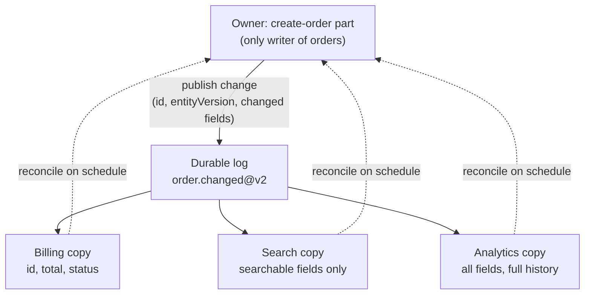

Each consumer keeps only the fields it actually needs, shaped the way it needs them. Billing does not need the order's shipping notes; search does not need its internal status codes. Copies are therefore smaller and simpler than the owner's data, and changes to fields a consumer does not copy never affect it.

How to handle common needs:

- **Changing the data:** only the owner, and only through its own logic, so validation, versioning, and event publication always happen.
- **Reading occasionally, where the value must be exact at this moment:** ASK the owner.
- **Reading often:** keep a local copy maintained from the owner's events.
- **Joining with your own data:** join your copy with your own data inside your part. Never join across parts at query time.
- **Making a decision that belongs to the owner:** never use a copy. If the decision is "can this order still be cancelled?", only the order owner can answer it correctly; ASK the owner, or let the owner make the decision.
- **Referring to the data:** store the identifier only. Never embed the owner's structure inside your own records, because that structure will change.

### 7.2 Function structure

```
owner
├── write(entity) → only through its own logic (Section 6)
├── publishChange(entity) → event {id, entityVersion, changedFields}   (via outbox)
└── provideSnapshot(ids | range | asOfVersion) → records              (bootstrap and reconcile)

copier
├── bootstrap()
│   ├── snapshot = owner.provideSnapshot(all)
│   ├── load(snapshot)
│   └── subscribe(from: the log position at snapshot time)
├── onChange(event)
│   ├── upcast(event) → current version
│   ├── upsertIfNewer(copy, event.entityVersion)   (version wins; arrival order is ignored)
│   └── keepOnly(fieldsINeed)
└── onDelete(event) → remove or tombstone

reconcile(owner, copier) → report                                     (scheduled)
├── compare(counts, checksums per range, sampled records)
├── repair(differences) from the owner's snapshot
└── drift above threshold → alert the copier's owner
```

### 7.3 Bootstrapping a new copy

A new consumer cannot simply start reading events from "now", because it would miss everything that existed before it started. It also cannot replay the entire event history if retention has expired. Bootstrap solves this by combining a snapshot with a precise starting position in the log.

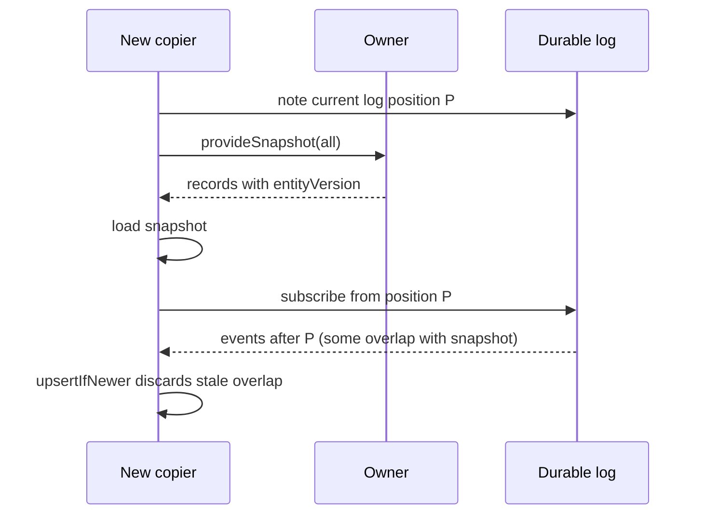

Some events between position P and the moment the snapshot was taken will be delivered even though their effect is already in the snapshot. That overlap is harmless because `upsertIfNewer` discards any event whose `entityVersion` is not newer than what the copy holds.

### 7.4 Reconciliation

Events can, in rare cases, be lost through bugs, misconfiguration, or a consumer that was deployed with a defect for a few hours. Reconciliation is the safety net that catches what every other mechanism missed. On a schedule, each copier compares its copy with the owner's snapshot, using cheap aggregate checks (counts and checksums per range) first and detailed comparison only for ranges that differ. Differences are repaired from the owner, and drift above a threshold raises an alert, because sustained drift indicates a bug that must be fixed rather than repeatedly repaired.

### 7.5 State modes

A part's own state can be stored in one of three ways. The choice depends on what the host can offer, and the part's logic is identical in all three.

```
stateMode
├── owned          the part has its own storage through the storage port
│                  fits: our services, containers, and most hosts
├── hostManaged    the part is stateless; the host stores an opaque, versioned state blob
│                  execute(op, input, context, state, version)
│                      → {newState, events, effects, result}
│                  fits: serverless runtimes, workflow engines, third-party systems
└── eventSourced   state = fold(events); the host stores events (and optional snapshots)
                   fits: hosts that already run an event store
```

- **Owned** is the default for our own services. The part ships its own migrations and the host runs them.
- **Host-managed** is what makes integration with systems we do not control realistic. The third-party system does not need to run our database; it only needs to store a blob next to its own records and pass it in on every call. The trade-off is that atomically storing the new state together with the outgoing events becomes the host's responsibility, which the storage test kit verifies.
- **Event-sourced** suits hosts that already keep an event store. Its cost is that every event schema must remain readable forever, because current state is rebuilt from the full history.

---

## 8. Integrating with any system

"Integrates with any system" cannot be achieved by making a part flexible enough to anticipate every host. That approach fills the part with host-specific branches, and every new host means editing and retesting the core. Instead, the part speaks a small set of standard boundaries that almost every system understands. A host that speaks none of them gets one thin adapter, written once on the host side, and the part never changes.

### 8.1 Three rings

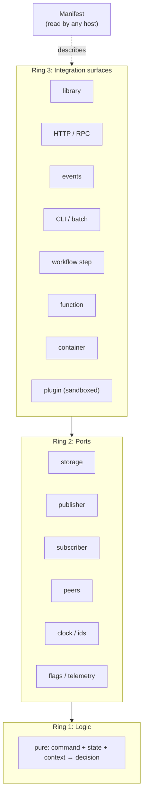

- **Logic** is pure and knows nothing about hosts.
- **Ports** declare everything the logic needs from outside, with optional ports carrying safe defaults.
- **Surfaces** expose the part to a particular kind of host. Each surface is a thin adapter that translates the host's way of calling into an operation, a context, and a canonical error mapping.
- **The manifest** tells any host exactly what to wire, without a conversation with the part's team.

### 8.2 Integration surfaces

```
surface
├── library          same language and runtime; the host passes port implementations
├── HTTP / RPC       any language; generated from operation contracts
├── events           decoupled; consumes command messages, produces result events
├── CLI / batch      arguments, stdin, or files in; stdout or files out; documented exit codes
├── workflow step    one step per operation; serializable input and output;
│                    idempotency and compensation declared
├── function         one handler per operation; external state only; fast cold start
├── container        image exposing the HTTP or event surface; configured by
│                    environment variables and mounted files
└── plugin           sandboxed module; the host grants ports as imports; resource limits
```

Build the HTTP, event, and command-line surfaces first. Nearly every system in existence can make an HTTP call, move a message, or run a process, so these three cover most real hosts. Add the others only when a real host needs them, because each surface is code to maintain and test.

### 8.3 Host protocol

Every host, whether it is our chassis or a system built by someone else, drives a part through the same protocol. The protocol begins with a handshake, in which host and part agree on what is available before anything runs.

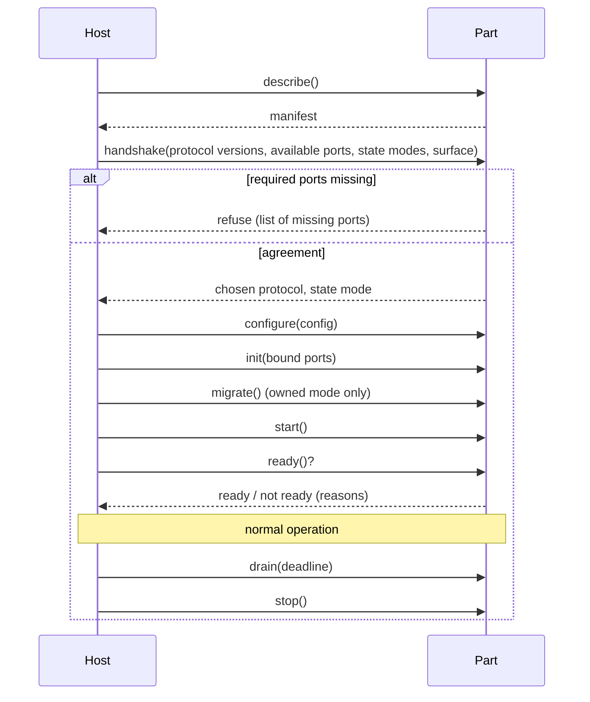

```
hostProtocol
├── handshake(hostInfo) → agreement                         (fails → refuse)
│   ├── host offers  → {protocolVersions, availablePorts, stateModes, surface}
│   ├── part answers → {chosenProtocol, chosenStateMode, missingRequired[]}
│   └── missingRequired not empty → refuse, listing the ports to provide
├── configure(config)                                        (fails → InvalidConfig)
├── init(boundPorts)              (no I/O)
├── migrate()                     (owned mode only; the host decides when)
├── start()                       (outbox relay, effect runner, timers, consumers)
├── ready() → {ready, reasons[]}
├── live() → ok                   (process-level only; never checks dependencies)
├── drain(deadline)               (stop accepting work, finish in-flight work, flush outbox)
├── stop()
└── describe() → manifest         (available before init)
```

`live()` and `ready()` are deliberately different. Liveness only answers "is this process functioning?", while readiness answers "should this process receive work right now?". If liveness checked dependencies, a brief database outage would cause every instance of every part to be restarted at once, turning a short incident into a long one.

### 8.4 Port binding per host

```
bindPorts(requires, host) → bound
├── host has an equivalent         → adapter to the host's implementation
├── optional port, host lacks it   → the part's built-in default
│                                     (no-op telemetry, static flags)
├── required port, host lacks it   → refuse to start, naming the port
└── peer operation
    ├── provider in the same process → in-process adapter
    │     still applies deadlines, error mapping, and serialization,
    │     so it behaves like the network and splitting later is safe
    └── provider elsewhere           → generated network client
```

The in-process adapter for a peer is intentionally made to behave like a network call. If two parts run in the same process and call each other with no timeouts and no serialization, the code silently starts relying on calls that are instant and never fail. The day the parts are split into separate deployments, that code breaks. Applying the same rules in-process removes the surprise.

### 8.5 Trust levels

The degree to which a part trusts its host determines how much the part verifies on its own.

```
trust(host)
├── trusted       (our own systems)     principal from context accepted;
│                                       logic still authorizes every action
├── semiTrusted   (partner systems)     signed identity verified at the surface;
│                                       tenant derived from the token only;
│                                       per-integrator quotas
└── untrusted     (foreign code running sandboxed plugin; no direct I/O;
                   the part in-process) ports granted explicitly;
                                        CPU, memory, and call limits;
                                        secrets never enter the sandbox
```

At every trust level, authorization lives in the logic, never in a surface adapter. If authorization were implemented in the HTTP adapter, the event, command-line, and workflow surfaces would silently skip it, and the part would be secure through one door and open through the others.

### 8.6 Integration procedure

Integrating a part with a new host follows the same procedure every time, which turns integration from a negotiation into a checklist.

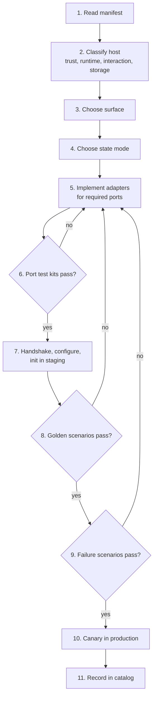

```
integrate(part, host) → certified
├── 1. describe(part) → manifest
├── 2. classify(host) → trust level, runtime, interaction style, storage available
├── 3. chooseSurface(classification)
├── 4. chooseStateMode(storage available)
├── 5. implement adapters for the required ports
├── 6. run port test kits                              [enforced: blocks on failure]
├── 7. handshake → configure → init (staging)
├── 8. run golden scenarios through the chosen surface [enforced: blocks on failure]
├── 9. run failure scenarios (Section 14.4)            [enforced: blocks on failure]
├── 10. canary in production
└── 11. record in catalog → host, versions, surface, state mode, test results
```

The test kits and golden scenarios are what make integration with systems we do not control possible. When a host's adapter has a bug, the failing test identifies which side the problem is on, without anyone having to debug the other team's code.

---

## 9. Durability: connections that break safely

Disconnects are normal, not exceptional. A system of a thousand parts running across many machines has some connection failing at almost every moment. The design therefore does not ask "how do we keep connections up?" but "how do we make every connection state correct?", including the states where the connection is degraded, gone, or recovering.

### 9.1 Connection lifecycle

Every connection, whether to a database, a broker, or another part, moves through the same five states. The chassis manages these transitions, so individual parts do not implement them.

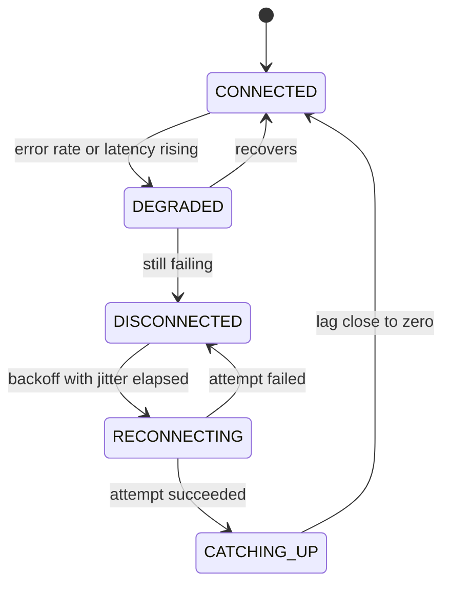

- **Connected:** normal operation.
- **Degraded:** the connection still works but errors or latency are rising. Low-priority work is shed, and the circuit breaker sends only probe traffic until health returns.
- **Disconnected:** the connection is unusable. Outgoing events stay safely in the outbox or an on-disk buffer, synchronous calls use their fallbacks, and reads are served from local copies.
- **Reconnecting:** attempts are spaced with exponential backoff and random jitter, so that thousands of instances recovering from the same outage do not reconnect at the same instant and knock the dependency over again.
- **Catching up:** the connection is back, but the part is behind. It resumes from its last checkpoint, replays what it missed (idempotently), and upcasts any old contract versions it encounters. Only when its lag is close to zero does it return to the connected state and report itself fully ready.

### 9.2 Connection manager

```
connection(target) → managed link                               (provided by the chassis)
├── connect() → link                                            (fails → RECONNECTING)
├── monitor()
│   ├── heartbeat / health check → is the link alive?
│   ├── errorRate, latency → CONNECTED | DEGRADED
│   └── sustained failure → DISCONNECTED
├── whileDegraded()
│   ├── shed low-priority work
│   └── circuit half-open → probe with a small amount of traffic
├── whileDisconnected()
│   ├── outgoing TELL → stays in the outbox or an on-disk buffer (never memory only)
│   ├── outgoing ASK  → fallback, or "accepted, finishing later"
│   └── reads         → served from local copies
├── reconnect()
│   ├── delay = min(cap, base × 2^attempt) + random jitter
│   └── never give up; raise an alert after a threshold
├── catchUp()
│   ├── resume(from: lastCheckpoint)
│   ├── replay(missed) → each item processed idempotently
│   ├── upcast(old versions)
│   └── return to CONNECTED only when lag is close to zero
└── onLeadershipLost()
    └── stop writing immediately; the fencing token rejects any late write
```

Buffering outgoing work in memory during a disconnect is a common and serious mistake. If the process crashes while disconnected, everything in memory is lost. Buffers must be durable: the outbox for events, an on-disk queue for anything else.

### 9.3 Guarantees and the mechanisms behind them

The durability design gives six guarantees. Each guarantee is delivered by specific mechanisms, and each mechanism is provided by the chassis rather than re-implemented by parts.

- **Nothing is lost.** Delivered by the outbox in the same transaction as the change, the durable log with replication, consumer checkpoints, and log retention that exceeds the worst plausible outage, backed by an archive for longer periods.
- **Nothing happens twice.** Delivered by idempotency keys on every write and processed-event identifiers recorded by every consumer in the same transaction as its state change.
- **Nothing is wrongly reordered.** Delivered by entity version checks (`upsertIfNewer`), so that ordering never depends on arrival order or on wall clocks.
- **Nothing hangs.** Delivered by an absolute deadline on every wait, at every hop.
- **Nothing cascades.** Delivered by circuit breakers, bulkheads that cap the resources any one dependency can consume, fallbacks, and load shedding.
- **Nothing silently drifts.** Delivered by scheduled reconciliation between owners and copies, with alerts.

### 9.4 Edge case catalog

Each edge case below has happened in real systems at scale, and each one is handled by a specific mechanism described elsewhere in this document.

- **Disconnect in the middle of a call.** The caller does not know whether the action happened. Handled by retrying with the same idempotency key, or querying status by that key.
- **Crash after saving, before publishing.** The change is saved but nobody is told. Handled by writing the event into the outbox in the same transaction as the change.
- **Duplicate delivery.** The same event or request arrives twice, risking a double charge or a second email. Handled by processed-event identifiers and idempotency records.
- **Out-of-order delivery.** An older update arrives after a newer one and overwrites it. Handled by `upsertIfNewer` on the entity version.
- **Receiver down for days.** The backlog exceeds what was expected. Handled by log retention longer than the worst outage, plus replay from the archive.
- **Sender down.** The receiver stops getting updates. Handled by the receiver serving reads from its own copies and continuing to work.
- **Two leaders at once.** A network partition makes two instances believe they hold a lease, producing conflicting writes. Handled by leases combined with fencing tokens, so the stale leader's writes are rejected by storage.
- **Mass reconnect.** Every instance reconnects at the same moment after an outage, overloading the dependency again. Handled by exponential backoff with random jitter.
- **Contract changed while a consumer was offline.** The consumer returns to find messages in a newer or older format. Handled by versioned contracts, tolerant readers, and upcasting.
- **Multi-step process half done.** Some steps succeeded and a later one failed. Handled by sagas that resume from saved progress or compensate in reverse.
- **Slow but not dead.** A dependency responds, but very slowly, and work piles up everywhere. Handled by deadlines, load shedding, and bulkheads.
- **Clocks disagree between machines.** Ordering or expiry decisions are wrong. Handled by using sequence and version numbers for ordering, never another machine's timestamp.
- **A copy silently drifts from its owner.** Data is wrong but no error is raised. Handled by reconciliation and drift alerts.
- **Poison message.** A message that can never be processed blocks everything behind it. Handled by a retry limit followed by the dead-letter queue and an alert.
- **Partial batch failure.** One item in a batch fails and the whole batch is retried, repeating the successful items. Handled by per-item outcomes and checkpointing only processed items.
- **Dead-letter queue never handled.** Failed messages accumulate unnoticed, which is silent data loss. Handled by alerts on dead-letter rates and a replay command.
- **Configuration changed mid-flight.** Some work runs with old settings and some with new. Handled by atomic configuration swaps, with non-reloadable fields requiring a restart.

The first case is the most important to internalize. A timed-out call has an unknown outcome, and without an idempotency key there is no correct way to recover: any retry either loses the action or performs it twice.

---

## 10. Changing the system

The real test of this structure is not whether it works on the day it is built, but where each future change lands. If a change spreads beyond the place listed below, the structure is broken at that point, and the right response is to fix the structure, not just to push the change through.

### 10.1 Where each change lands

- **Changing logic inside a part:** edit that part only. Nothing else changes.
- **Changing storage technology:** write one new storage adapter. Nothing else changes.
- **Changing connection style** (for example, replacing a synchronous call with a queue): change the connector or its configuration. Neither part changes.
- **Changing an infrastructure vendor** (broker, database, cloud service): write one new adapter. Nothing else changes.
- **Adding a field to a contract:** a minor version in the owner's contract. No consumer changes, because all readers are tolerant.
- **Removing or renaming a field:** a new major version. Consumers migrate at their own pace within the support window.
- **Adding a feature:** add a new part and its manifest. Nothing else changes.
- **Adding a consumer of existing data:** the new part subscribes. The producer does not change.
- **Splitting or merging deployments:** change the deployment configuration. No part changes.
- **Moving a part to a different host:** write host adapters and configuration. The part does not change.

### 10.2 Procedures

**Swapping an adapter.** The new adapter is proven against the port's test kit before it carries any traffic, deployed behind a configuration switch so it can be enabled per environment, and, if it handles data, run in parallel with the old adapter long enough to compare results.

```
swapAdapter(port, from, to) → done
├── implement the new adapter
├── run the port test kit against it                     [enforced]
├── deploy behind a configuration switch (per environment)
├── dual-run or shadow if it handles data (storage, publisher)
├── switch the configuration
└── remove the old adapter after a stability window
```

**Splitting a deployment.** Because parts in the same process already talk through adapters that behave like the network, splitting them apart is a configuration change: the in-process adapter is replaced by a network client.

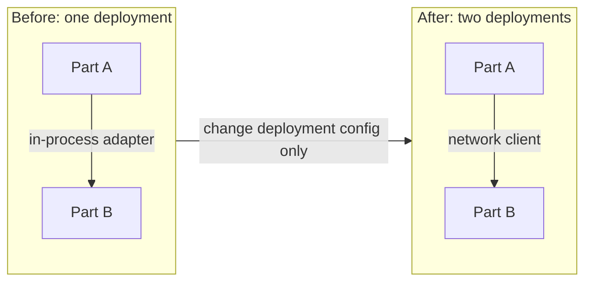

```
splitDeployment(deployment, partsA, partsB) → two deployments
├── parts unchanged (in-process peer adapters become network clients through config)
├── deploy B alongside A
├── route B's operations and subscriptions to the new deployment
└── remove B's parts from A
```

**Retiring a part.** A part is retired only when the registry shows that nothing still consumes its contracts. Its data is either transferred to a new owner or deleted according to policy, and its final state is archived.

```
retirePart(part) → removed
├── registry shows zero consumers of its contracts       [enforced]
├── stop producing events; archive a final snapshot
├── hand data to a new owner, or delete it according to policy
└── deregister the manifest
```

---

## 11. Scaling to 1000+ parts

A thousand features does not mean a thousand microservices. Operating a thousand separate deployments would be enormously expensive and would not improve independence. Instead, parts are the unit of design, domains are the unit of ownership, and deployments are the unit of operation, and the three are deliberately different.

### 11.1 Grouping

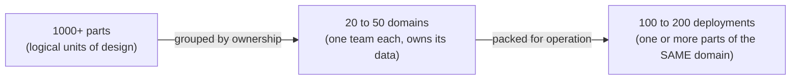

The one rule for packing is that a deployment never mixes parts from different domains. If it did, one team's release would depend on another team's code, and a defect in one domain could take down another.

### 11.2 Adding a part

Adding part number 1001 must be as routine as adding part number 2. It never involves editing a central file; the platform reads the new manifest, validates it against everything already registered, and wires the part in automatically.

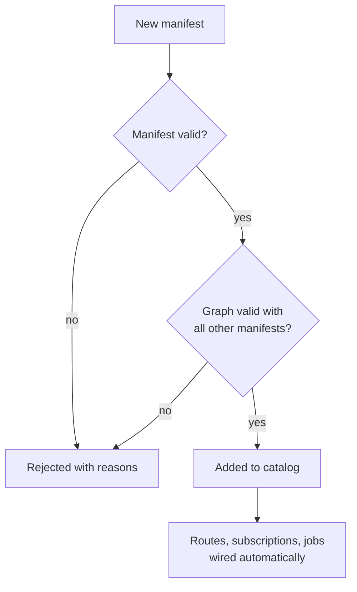

```
addPart(domain, manifest) → registered
├── validateManifest(manifest)                                 [enforced: rejects]
├── validateGraph(allManifests + manifest)                     [enforced: rejects]
│   ├── every required operation and event has a provider at a compatible version
│   ├── no synchronous (ASK) cycles
│   ├── ASK depth at most 2 on any path
│   ├── no duplicate names, routes, event types, or data owners
│   └── domain boundaries respected (no cross-domain storage access)
├── catalog.add(part)
└── the platform wires routes, subscriptions, and jobs automatically (no central edit)
```

### 11.3 What breaks first as systems grow, and how it is prevented

- **Central hand-edited lists** become merge-conflict hotspots. Prevented by self-registration through manifests.
- **A shared database** couples every schema to every team. Prevented by one owner per piece of data and copies maintained through events.
- **Long synchronous chains** cascade outages and accumulate latency. Prevented by TELL as the default and a maximum ASK depth of two.
- **"Who uses this field?"** becomes unanswerable. Prevented by a catalog and lineage generated from manifests and observed traffic.
- **Inconsistent behavior across teams** makes incidents unpredictable. Prevented by one chassis for every part.
- **Contract drift** breaks consumers silently. Prevented by compatibility checks that block CI.
- **Orphaned parts** have nobody to fix them. Prevented by mandatory owners in manifests and visible scorecards.
- **Retry storms** multiply load during incidents. Prevented by retry budgets in place of fixed retry counts.
- **Connection exhaustion** occurs when pool sizes multiply across instances. Prevented by pool sizes allocated from a fleet-wide budget, behind connection poolers.
- **Thundering herd on fleet-wide restart** overwhelms shared infrastructure. Prevented by start-up jitter and by treating other parts as soft dependencies at boot.

### 11.4 Catalog

The catalog is the system's memory. It is generated, never hand-maintained, and it answers the questions that become impossible to answer by asking people once there are hundreds of teams.

```
catalog
├── part(name) → owner, domain, deployment, versions, surfaces
├── whoUses(contract@version) → consumers (from manifests and observed traffic)
├── impact(change) → affected parts, owners, environments
├── lineage(dataContract) → owner → copies → derived data
└── scorecard(part)
    ├── contracts versioned, SLOs defined, runbook linked
    ├── test kits and golden scenarios passing
    ├── chassis version current
    └── reconciliation enabled for every copy
```

---

## 12. Platform components

The platform is built once, by a dedicated team, and every part depends on it through ports. Its purpose is to make the right behavior the default: a part built on the platform gets idempotency, outbox publishing, deadlines, connection management, and telemetry without writing any of it.

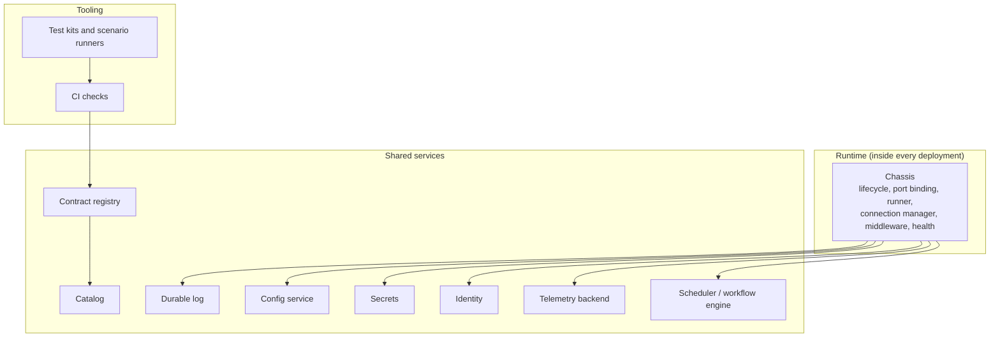

- **Chassis:** manages part lifecycle, binds ports to adapters, runs the six-step execution model (Section 6), manages connections (Section 9), applies standard middleware, and exposes health endpoints.
- **Durable log:** an ordered, replicated, replayable event transport, with retention long enough to outlast outages and an archive behind it for longer replays.
- **Contract registry:** stores every contract, enforces single ownership, checks compatibility of every change, and tracks which parts consume which versions.
- **Catalog:** records parts, owners, dependencies, lineage, and scorecards, all generated from manifests and observed traffic.
- **Config service:** provides layered configuration (defaults, environment, service, instance), validates it, and supports live reload for fields marked reloadable.
- **Secrets:** retrieves secrets scoped to each workload's identity, and handles rotation with an overlap window so that no restart is needed.
- **Identity:** provides workload identity for service-to-service trust and verifies user identity at the edge.
- **Telemetry:** collects traces, metrics, and logs under shared naming conventions, so dashboards and alerts work the same for every part.
- **Scheduler and workflow engine:** run durable timers, sagas, and long-running processes that must survive restarts.
- **Test kits:** port test kits, the golden scenario runner, and the failure scenario runner, shared by every part and every host.

---

## 13. Enforcement

Rules that are not checked automatically decay. This section lists every automated check, where it runs, and which of the six rules it protects.

### 13.1 In CI (before code is merged)

- Logic imports an adapter, framework, or another part: rejected. Protects rule 1.
- A hand edit to any central registry file: rejected. Protects rule 5.
- A contract change classified as major without a new version: rejected. Protects rule 6.
- A manifest missing an owner, domain, or contract versions: rejected. Protects rules 1 and 6.
- Port test kits and golden scenarios failing: rejected. Protects rule 4.

### 13.2 In the contract registry (when manifests are registered)

- A second owner declared for a data contract: rejected. Protects rule 2.
- A required operation or event with no compatible provider: rejected. Protects rule 1.
- A synchronous cycle, or an ASK path deeper than two: rejected. Protects rule 3.

### 13.3 At runtime (while the system runs)

- No credentials exist for another part's storage, so access is physically impossible. Protects rules 1 and 2.
- An unbound required port causes the part to refuse to start. Protects rule 1.
- A write without an idempotency key is rejected. Protects rule 4.
- Publishing outside the outbox is not possible through the chassis. Protects rule 4.
- Every wait carries a deadline. Protects rule 4.

### 13.4 From observation (continuously, in production)

- Call depth measured from traces, retry rates, dead-letter rates, and copy drift are tracked per part and shown on scorecards. Protects rules 3 and 4.

---

## 14. Testing

Testing in this architecture has two goals beyond ordinary correctness. First, it must prove that a part behaves **identically** on every host and every surface. Second, it must prove that the part stays correct when connections break, messages repeat, and processes crash.

### 14.1 Layers

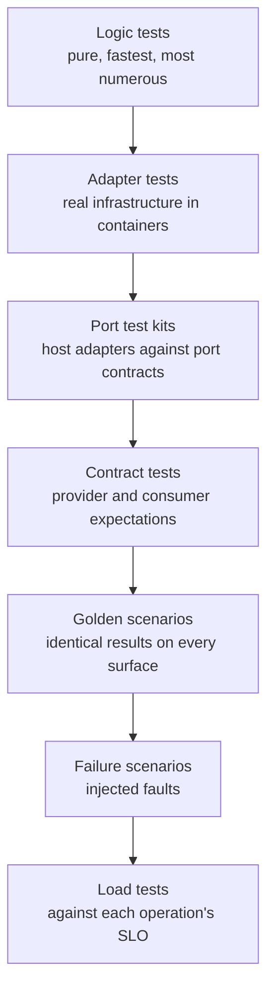

- **Logic tests** exercise `decide` and `apply` with no input or output at all. Because logic is pure, these tests are fast, deterministic, and can cover every business rule exhaustively.
- **Adapter tests** run against real infrastructure in containers, never against mocks of a database. A mock only proves that the code matches the author's assumptions about the database, not the database's actual behavior.
- **Port test kits** prove that any host's adapter satisfies the port contract.
- **Contract tests** prove that a provider matches its published contract and that consumers' expectations of it still hold.
- **Golden scenarios** prove identical behavior across surfaces and hosts.
- **Failure scenarios** prove correctness under faults.
- **Load tests** prove each operation meets its service-level objective under production-shaped traffic.

### 14.2 Port test kits

Each port ships with an executable test kit. A host cannot be certified until its adapters pass the kits. This turns integration from "read the documentation and hope" into "run this and see it pass."

```
storageTestKit
├── commit, then load → same state, version incremented by one
├── two commits with the same expectedVersion → exactly one succeeds
├── fault injected mid-commit → nothing becomes visible
├── outbox rows appear only for committed transactions
├── concurrent idempotency inserts → exactly one wins
├── slow backend → DeadlineExceeded, never a hang
└── restart between commit and publish → events are still published

publisherTestKit
├── acknowledgement only after the event is durable
└── per-entity order preserved

peerTestKit
├── same idempotency key twice → exactly one side effect
├── deadline already expired → DeadlineExceeded without calling
└── errors arrive as canonical codes, never raw driver or HTTP errors
```

### 14.3 Golden scenarios

Golden scenarios are a fixed, versioned set of inputs with exact expected outputs, events, effects, and errors. Every surface and every host runs the same set. Passing them is the operational definition of "behaves identically everywhere": if the library surface and the HTTP surface produce different events for the same scenario, one of them has drifted, and the test identifies which.

### 14.4 Failure scenarios

```
failureScenarios
├── kill the process between commit and publish     → event still delivered, once
├── deliver every message twice                     → exactly one effect
├── deliver messages out of order                   → final state matches in-order delivery
├── disconnect a peer mid-call                      → retry with same key → one effect
├── peer down for an extended period                → fallback used; catch-up after reconnect
├── deadline expired at every hop                   → DeadlineExceeded, no partial work
├── version conflict                                → Conflict, then success on retry
├── poison message                                  → dead-letter after the limit; queue continues
├── old contract version arriving after an upgrade  → upcast and processed correctly
└── two leaders briefly                             → the fenced writer is rejected
```

---

## 15. Adding a new part: checklist

This checklist is used in the review of every new part. Each item maps to a rule or section above, and none can be skipped.

1. The domain and owning team are chosen.
2. The data the part **owns** is listed, and it is confirmed that no other part owns it.
3. The data the part **copies** is listed, each with its source event and reconciliation enabled.
4. Contracts are written before code: operations, events, and data contracts, all versioned.
5. A connection style is chosen for every dependency (TELL, SHARE, or ASK), and every ASK is justified in writing.
6. Logic is pure: `decide` and `apply` only, with no input or output.
7. Ports are declared, and every optional port has a safe default.
8. Every write operation requires an idempotency key.
9. Errors come only from the canonical taxonomy.
10. The manifest is complete: identity, provides, requires, configuration, data, and surfaces.
11. Port test kits, golden scenarios, and failure scenarios pass.
12. Service-level objectives and alerts are defined, alerting on symptoms rather than causes.
13. A runbook is linked.
14. The part is registered through its manifest, with no central file edited.

---

## 16. Anti-patterns

Each anti-pattern below is a shortcut that looks reasonable in the moment and becomes expensive at scale.

- **Reading another part's tables.** It couples schemas permanently, so neither part can change its storage. Instead, keep a copy from events, or ASK the owner.
- **Publishing to the log directly after saving.** A crash between the two steps loses the event. Instead, write to the outbox in the same transaction.
- **Retrying without an idempotency key.** Every retry risks a duplicate or a lost action. Instead, require a key on every write.
- **Ordering by timestamp.** Clocks on different machines disagree. Instead, order by entity version or sequence number.
- **Chains of synchronous calls.** Outages cascade and latency accumulates. Instead, use TELL and local copies.
- **A central router or registry edited by hand.** It becomes a merge-conflict hotspot and the single place every change must pass through. Instead, use self-registration.
- **Business logic in HTTP handlers or event consumers.** It cannot be reused from other surfaces, so it gets duplicated. Instead, keep logic in the logic layer and keep surfaces thin.
- **Authorization in a surface adapter.** Other surfaces silently skip it. Instead, authorize in logic.
- **Treating business rejections as failures.** Engines retry them indefinitely and dead-letter queues fill with valid decisions. Instead, complete with a rejection outcome.
- **Unbounded in-memory buffers during a disconnect.** A crash loses everything buffered. Instead, use the outbox or an on-disk buffer.
- **Fixed retry counts at every hop.** Retries multiply into storms. Instead, use retry budgets and deadlines.
- **One feature equals one microservice.** It produces thousands of deployments to operate with no gain in independence. Instead, pack parts into domain deployments.

---

## 17. Open decisions

The following decisions change parts of this design and must be made explicitly, recorded, and revisited as the system grows. Until they are made, the sections they affect describe defaults, not commitments.

- **Tenancy model.** Options: a shared schema with a tenant column, a schema per tenant, a database per tenant, or a cell-based design combining shared and dedicated cells. Affects storage, security, caching, rate limiting, routing, and backup and restore.
- **Freshness requirement per data flow.** Options: seconds (true streaming), minutes (micro-batch), or hours (batch). Affects how the durable log is used, how copies are maintained, and cost.
- **First host types.** Options: our own services, third-party systems we do not control, or both. Affects which surfaces are built first, which trust levels apply, and which state modes are needed.
- **Consistency per domain.** The default is strong consistency within an owner and eventual consistency across copies. Each domain must state where it needs stronger guarantees, because those are exactly the places where ASK is unavoidable.
- **Multi-region posture.** Options: active-passive, active-active with each tenant homed in one region, or active-active globally with conflict resolution. Affects routing, failover procedures, and conflict handling.

---

## Appendix: notation

Function structures in this document use a consistent notation:

- `name(inputs) → output` describes a function and what it returns.
- Indented branches (`├──` and `└──`) list the calls or sub-steps a function performs, in order.
- `(fails → X)` states what happens when a step fails, using a canonical error code or an outcome.
- `[enforced]` marks a rule or check that is applied automatically by CI, the contract registry, or the runtime, rather than relying on people.
- **ASK**, **TELL**, **SHARE**, and **SAGA** refer to the connection styles defined in [Section 5](#5-connecting-parts).

Diagrams are written in Mermaid and render directly in most repository hosts and documentation tools.